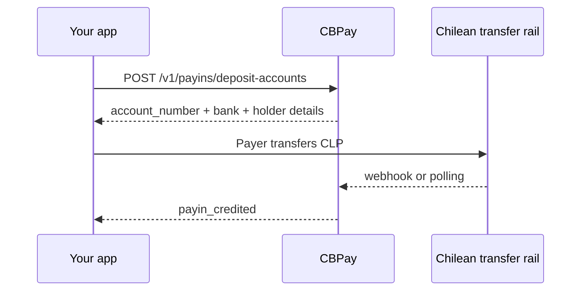

> **Environments:** Test `https://cryptobank.qbank.cl/platform` (`pk_test_...`) - Live `https://api.qbank.cl/platform` (`pk_...`).

This guide covers the `fintoc` method for Chilean pesos (CLP). It is
provider-agnostic: your integration receives a virtual deposit account and a
normal payout contract. It does not change the existing `CL/CLP/bank_transfer`
corridor.

> **Important**
CLP has no minor unit. Send whole positive pesos such as `"150000"`; values
such as `"150000.50"` are rejected with `400 invalid_amount`.
## Funding and Banking slots

The same CL/CLP/fintoc corridor supports both purposes without changing the
response shape (`purpose`, `label`, derived `balance` and movements):

- `purpose: "fondeo"` (default) converts the inbound CLP credit to the
  account's principal balance.
- `purpose: "banking"` receives, retains and exposes a derived CLP balance for
  that instrument. It does not originate payouts; CL payouts always send from
  the root account, and no physical sweep-exempt flag applies.

Companies can create additional funding or Banking accounts with a distinct
idempotency key per account; Banking is capped at 50 instruments per
company/corridor. Person accounts can create the second virtual Banking slot
in this corridor. Reusing a key replays the original account.

## Receive CLP into a virtual account



### 1. Confirm the corridor

```bash
curl "https://api.qbank.cl/platform/v1/payins/methods?country=CL" \
  -H "Authorization: Bearer <token>"
```

Use `method: "fintoc"` for the virtual-account flow. The existing
`method: "fintoc"` checkout on `POST /v1/payins` remains available; it returns
a hosted `payment_url` and is a different flow.

### 2. Provision the account

Provisioning is automatic after approved KYC/KYB, and a company admin can
backfill a missing account by calling the same endpoint. The operation is
idempotent:

```bash
curl -X POST "https://api.qbank.cl/platform/v1/payins/deposit-accounts" \
  -H "Authorization: Bearer <token>" \
  -H "Idempotency-Key: cl-fintoc-account-001" \
  -H "Content-Type: application/json" \
  -d '{
    "country": "CL",
    "currency": "CLP",
    "method": "fintoc",
    "idempotency_key": "cl-fintoc-account-001"
  }'
```

Response `201`:

```json
{
  "country": "CL",
  "currency": "CLP",
  "account_number": "123456789",
  "account_id": "acc_7f3a",
  "instrument_id": "4f81c2d0-1111-2222-3333-444455556666",
  "status": "active",
  "bank_code": "0012",
  "bank_name": "BancoEstado",
  "account_currency": "CLP",
  "holder_name": "CBPay Operations SpA",
  "holder_tax_id": "76543210-8",
  "holder_account_type": "checking"
}
```

Show the payer the account number, bank, holder name, RUT and account type
exactly as returned. Do not infer a bank from its name or replace the RUT.
The holder is the company that owns the CPF used for the dedicated account,
not the payer or end user.

### 3. Reconcile the credit

The platform matches an inbound transfer by the virtual account number. It
accepts the provider webhook and also polls as an idempotent backstop. Your
application receives `payin_credited` when the CLP deposit is credited:

```bash
curl "https://api.qbank.cl/platform/v1/payins?country=CL&currency=CLP&method=fintoc&status=credited&from=2026-10-01&to=2026-10-31&page=1&page_size=50" \
  -H "Authorization: Bearer <token>"
```

Always read the payin after a webhook; the webhook is a notification, not the
financial record.

## Send a CLP payout

First read the method and bank catalogs:

```bash
curl "https://api.qbank.cl/platform/v1/payouts/methods?country=CL" \
  -H "Authorization: Bearer <token>"
curl "https://api.qbank.cl/platform/v1/payouts/banks?country=CL&method=fintoc" \
  -H "Authorization: Bearer <token>"
```

`bank_code` accepts the numeric SBIF code returned by the catalog (for
example `"0012"`) or a routed wallet code such as `"cl_mach"`. The beneficiary
account number must contain digits only, and `account_type` is `checking`
(cuenta corriente) or `sight` (cuenta vista).

```bash
curl -X POST "https://api.qbank.cl/platform/v1/payouts" \
  -H "Authorization: Bearer <token>" \
  -H "Idempotency-Key: cl-payout-8841" \
  -H "Content-Type: application/json" \
  -d '{
    "country": "CL",
    "currency": "CLP",
    "method": "fintoc",
    "amount": "150000",
    "beneficiary": {
      "name": "María López",
      "tax_id": "11111111-1",
      "bank_code": "0012",
      "account_number": "12345678",
      "account_type": "checking"
    },
    "description": "Invoice 8841",
    "idempotency_key": "cl-payout-8841"
  }'
```

The response is `202` with `status: "processing"`. Read
`GET /v1/payouts/{payoutID}` or subscribe to `payout_status_changed`.
`partially_succeeded` remains processing and reports the settled amount plus
the remainder; create a new payout for the remainder only after review.
`reversed`, `returned`, `failed` and `rejected` are failed outcomes. CBPay
does not retry an ambiguous request or create a second payout automatically:
reuse the same idempotency key and reconcile the original.

## States and errors

| State/code | Meaning and action |
|---|---|
| `pending` / `processing` | Await reconciliation; query the same resource. |
| `completed` | Final credit or payout. |
| `partially_succeeded` | Some CLP settled; inspect `status_message` and create a new payout only for the remainder. |
| `failed`, `rejected`, `reversed` | Final unsuccessful outcome; inspect `status_code`. |
| `400 invalid_amount` | Send a positive whole CLP amount. |
| `422 invalid_beneficiary` | Use a valid Chilean RUT, numeric account number, catalog bank code and checking/sight type. |
| `422 payout_corridor_unsupported` | Re-read the methods catalog; do not switch the existing bank-transfer corridor implicitly. |
| `502 provider_ambiguous` | Do not retry with a new key; query the original payout and contact operations if it remains unresolved. |

## Webhooks

Subscribe to the normal CBPay webhook endpoint. Relevant events are
`payin_credited` and `payout_status_changed`; verify the signature, dedupe by
delivery ID, return quickly, and fetch the resource for the authoritative
state.

#### Is this the same as the existing fintoc checkout?
    No. Checkout uses `POST /v1/payins` and returns a hosted `payment_url`.
    Business Accounts provisions a reusable CLP account number and matches
    inbound transfers by that number.
#### Can I use decimals in CLP?
    No. CLP amounts are integer pesos. Decimal values are accepted only when
    their fractional part is all zero, such as `"100.00"`, and are normalized
    as whole pesos.
#### Should I retry a timeout?
    No. Reuse the same idempotency key and query the original operation. An
    ambiguous payout must never be sent again automatically.
#### Why am I not the holder of the dedicated account?
    Dedicated CLP account numbers are issued to the company that owns the CPF.
    The payer or end user is not the account holder. Display the holder fields
    returned by CBPay without replacing them.
See [webhooks](https://docs.cbpayapp.com/en/webhooks), [errors](https://docs.cbpayapp.com/en/errors), and
[idempotency](https://docs.cbpayapp.com/en/concepts/idempotency) for shared contracts.
