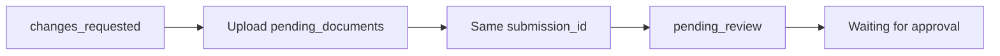

> **Environments:** Test `https://cryptobank.qbank.cl/platform` (`pk_test_...`) - Live `https://api.qbank.cl/platform` (`pk_...`).

## Continue the current case

Your account has one **current verification case**. A later `rejected` record
does not invalidate an earlier case that is still actionable for remediation.
When a request is already in progress, `POST /v1/me/verification/link`
returns `409 self_verification_in_progress` without a new URL:

```json
{
  "error": {
    "code": "self_verification_in_progress",
    "message": "a verification is already in progress"
  }
}
```

Call `GET /v1/me/verification` and reopen the existing `link.url`. Do not
create a second case or change the idempotency key.

## Resubmit in place

While remediation is possible, the current submission exposes:

```json
{
  "submission_id": "sub_123",
  "status": "changes_requested",
  "pending_documents": ["proofOfResidence"],
  "documents_received": ["identity"],
  "changes_requested_comments": "Upload a legible proof of residence.",
  "documents_gate": { "ok": false, "total": 2, "matched": 1 }
}
```

Upload every item in `pending_documents` in the existing wizard. The wizard
resubmits **in place**: the `submission_id` is unchanged and no new
submission is created. When the last required document is accepted, the case
automatically returns to `pending_review` and the portal shows **Waiting for
approval**.



#### Why did I receive a 409?
    A current self-verification case already exists. Read the current
    verification and reuse its open link.
#### Does resubmission create a new review?
    No. The existing submission is updated and returns to review after the
    requested evidence is complete.
See the [error catalog](https://docs.cbpayapp.com/en/errors) for actionable error codes.
