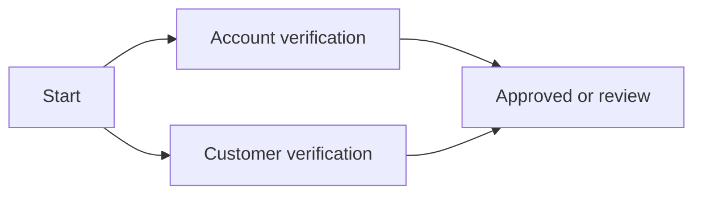

Choose the overview for account and customer verification.

## Verification flow

- [KYC overview](https://docs.cbpayapp.com/en/guides/kyc-overview)
- [OCR and liveness evidence](https://docs.cbpayapp.com/en/guides/kyc-ocr)
- [Errors](https://docs.cbpayapp.com/en/errors)

#### Which page should I start with?Start with the overview, then use the OCR page for evidence details.
