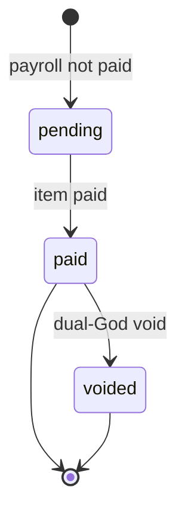

## What you can do

The portal exposes only pay slips owned by the authenticated account. Use the list to filter a payroll period, open a detail view, or download the branded PDF. A slip is available after its payroll item is `paid` or `voided`; another account's slip returns `404 not_found`.

For sandbox testing, replace `api.qbank.cl` with `cryptobank.qbank.cl`; use sandbox credentials and simulated funds.

## List and filter

```bash
curl "https://api.qbank.cl/platform/v1/me/pay-slips?period=2026-10&page=1&page_size=50" \
  -H "Authorization: Bearer $ACCOUNT_TOKEN"
```

The response is `{pay_slips, page, page_size, total}`. Omit `period` to list all available periods. `period` must use `YYYY-MM`; `page_size` is capped at 200.

## Open a detail

Use the `id` from the list:

```bash
curl "https://api.qbank.cl/platform/v1/me/pay-slips/slip_01" \
  -H "Authorization: Bearer $ACCOUNT_TOKEN"
```

The JSON contains `period`, employer and employee display fields, earnings, deductions, gross/net amounts, currency, USD value, payment method, masked destination, payment time and `core_ref`. The destination is masked by design.

## Download the PDF

```bash
curl "https://api.qbank.cl/platform/v1/me/pay-slips/slip_01/pdf" \
  -H "Authorization: Bearer $ACCOUNT_TOKEN" -o pay-slip.pdf
```

The response is `application/pdf`. The PDF is branded and localized for the account. A rendering failure returns `500 receipt_render_failed`; retry the read and provide the request id if it persists.



## States

| State | Meaning | What to do |
|---|---|---|
| `pending` | Payroll is not yet paid; no slip is available. | Read again after payment. |
| `paid` | The sealed slip is readable and its PDF can be downloaded. | Open detail or download PDF. |
| `voided` | The slip remains readable for audit history. | Keep it for audit history. |

## Errors

| HTTP | Code | Solution |
|---:|---|---|
| 400 | `invalid_period` | Send a calendar period in `YYYY-MM` format. |
| 404 | `not_found` | Confirm the slip id belongs to the authenticated account and that the item is paid or voided. |
| 500 | `receipt_render_failed` | Retry the PDF read; do not create another payroll operation. |

See the [public error catalog](https://docs.cbpayapp.com/en/errors).

## FAQ

#### Can I see another employee's pay slip?No. Ownership is enforced by the linked account; another account's slip is not disclosed.#### Why is the slip missing after payroll approval?Approval seals the item, but the slip is created after payment. Read again after the item becomes `paid` or `voided`.#### Does downloading the PDF move money?No. The portal endpoints are reads only.
