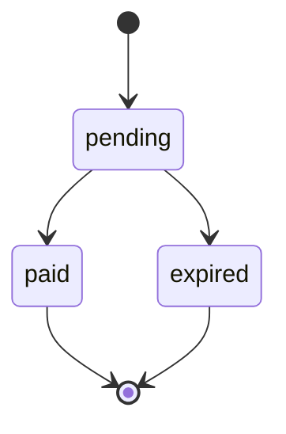
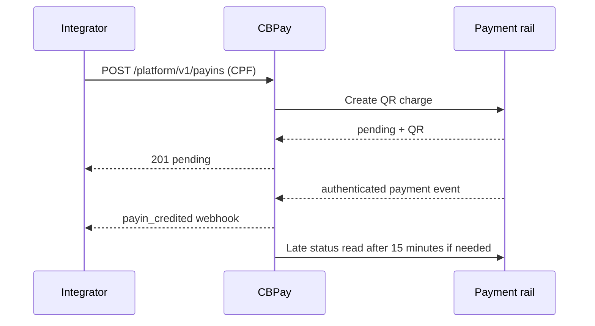

> **Environments:** Test `https://cryptobank.qbank.cl/platform` (`pk_test_...`) - Live `https://api.qbank.cl/platform` (`pk_...`).

QR payins let you create a charge that a customer completes with their banking
app. Use an idempotency key whenever a client may retry after a timeout or
ambiguous network response.



## Create a QR payin

Send `method: "qr"` to `POST /v1/payins`. The key is optional and can be sent
in the JSON body or in the `Idempotency-Key` header.

```bash
curl -X POST https://api.qbank.cl/platform/v1/payins \
  -H "Authorization: Bearer <token>" \
  -H "Content-Type: application/json" \
  -d '{
    "country": "BO",
    "currency": "BOB",
    "method": "qr",
    "amount": "700.00",
    "description": "App top-up",
    "idempotency_key": "qr-bo-700-20261002-001",
    "expires_in": 3600
  }'
```

### QR expiration limits

`expires_in` is an integer number of seconds for platform QR payins. The
server selects the configured rail; the integrator cannot select it. The
legacy QR contract has an effective maximum of `86399` seconds (23:59:59).
The 7-day QR rail has an effective maximum of `604800` seconds, with
`86400` seconds (24 hours) as its default when the value is missing or
non-positive. Values above the selected rail maximum are capped, not
rejected. For the 7-day rail, use at least `120` seconds as an operational minimum.

Response `201`:

```json
{
  "payin_id": "9c2a1b2c-3d4e-5f60-7a8b-9c0d1e2f3a4b",
  "status": "pending",
  "charge": {
    "charge_id": "c9d8e7f6-a5b4-c3d2-e1f0-a9b8c7d6e5f4",
    "our_reference": "77849505",
    "qr_payload": "<QR content>",
    "status": "pending"
  }
}
```

Display the QR payload or the `qr_image_url` returned by the API. When the
customer pays, the account is credited automatically. Read the current status
with `GET /v1/payins/{payinID}`.

## Brazil: PIX QR in BRL or BOB

For Brazil, `method: "qr"` accepts either `currency: "BRL"` (recommended)
or `currency: "BOB"` (direct advanced mode). With BRL, the platform quotes
the BOB charge using the current mid rates, without spread in the quote, and
passes the converted BOB amount to the core. The credit and fees are based on
the BOB amount actually received. The quote is snapshotted and preserved on
idempotent replay.

### Recommended: enter the payer amount in BRL

```bash
curl -X POST https://api.qbank.cl/platform/v1/payins \
  -H "Authorization: Bearer <token>" \
  -H "Content-Type: application/json" \
  -d '{
    "country": "BR",
    "currency": "BRL",
    "method": "qr",
    "amount": "120.00",
    "description": "Order 7719",
    "payer_document": "52998224725",
    "payer_phone": "+5511999990000",
    "payer_email": "payer@example.test",
    "expires_in": 1800,
    "idempotency_key": "qr-brl-20261022-001"
  }'
```

The response includes the QR image, the amount the payer sees in BRL, the BOB
amount charged, and the auditable platform quote:

```json
{
  "payin_id": "2f7b2a6e-6d1c-4c71-9d5e-4e0c2e7a1101",
  "status": "pending",
  "charge": {
    "charge_id": "8d4f1a90-0d7a-4fb1-8b51-8f3cc2b1e401",
    "our_reference": "77849505",
    "qr_image": "<base64 PNG>",
    "qr_image_url": "https://cdn.example.test/qr/77849505.png",
    "conversion": {"amount": "120.00", "currency": "BRL", "rate": "0.50"},
    "expires_at": "2026-10-22T12:57:14.937Z",
    "bob_charged": "240.00",
    "platform_quote": {
      "quoted_currency": "BRL",
      "quoted_amount": "120.00",
      "charged_currency": "BOB",
      "charged_amount": "240.00",
      "rate_brl_per_usd": "5.0000000000",
      "rate_bob_per_usd": "10.0000000000",
      "rates_updated_at": "2026-10-22T20:00:00Z"
    },
    "status": "pending"
  }
}
```

`conversion.amount` is the BRL amount returned by the rail. It can differ by
centavos from the BRL request when the BRL→BOB conversion is rounded
half-up to cents.

### Advanced: enter the charge directly in BOB

For `country: "BR"`, `currency: "BOB"` and `method: "qr"`, the charge is
denominated in BOB. The payer pays in BRL through the rail's conversion.
The payer's CPF is required; `payer_phone` and `payer_email` are optional and
are forwarded when provided:

```bash
curl -X POST https://api.qbank.cl/platform/v1/payins \
  -H "Authorization: Bearer <token>" \
  -H "Content-Type: application/json" \
  -d '{
    "country": "BR",
    "currency": "BOB",
    "method": "qr",
    "amount": "1.00",
    "description": "Order 7719",
    "payer_document": "52998224725",
    "payer_phone": "+5511999990000",
    "payer_email": "payer@example.test",
    "idempotency_key": "qr-br-bob-20261022-001"
  }'
```

The response is `201` with `status: "pending"`, the QR image fields, the
conversion shown to the payer, and the rail expiration. Brazil's QR contract
provides a PNG image, not an EMV copy-and-paste payload:

```json
{
  "payin_id": "2f7b2a6e-6d1c-4c71-9d5e-4e0c2e7a1101",
  "status": "pending",
  "charge": {
    "charge_id": "8d4f1a90-0d7a-4fb1-8b51-8f3cc2b1e401",
    "our_reference": "77849505",
    "qr_image": "<base64 PNG>",
    "qr_image_url": "https://cdn.example.test/qr/77849505.png",
    "conversion": {
      "amount": "0.48",
      "currency": "BRL",
      "rate": "0.48"
    },
    "expires_at": "2026-10-22T12:57:14.937Z",
    "status": "pending"
  }
}
```

The checkout-link quote marks this `BR`/`BOB` corridor with
`payer_required: true`.
When a payer opens a hosted link, the server-driven page asks for the CPF
before materializing the charge. Do not bypass that form by creating a second
charge. Checkout links remain BOB-denominated; BRL parity for checkout is a
future phase.

### Confirmation and reconciliation

The lifecycle is webhook-first. An authenticated inbound event (the rail
webhook uses its configured `x-api-key` header) can close the pending charge; a
late reconciliation read is allowed only after the configured
minimum age (15 minutes by default). Until the platform status is verified as
`credited`, the charge remains `pending` and must not be credited:



Subscribe to `payin_credited` and `payin_charge_status_changed`; use
`GET /v1/payins/{payinID}` as the source of truth before fulfilling an order.
Never retry a possibly submitted payment with a new idempotency key.

## Brazil-specific errors

| HTTP | Code | What to do |
| --- | --- | --- |
| 400 | `invalid_request` | Include `payer_document` for a BR QR payin and use `BRL` or `BOB` as the currency. |
| 422 | `amount_too_small` | Increase the BRL amount: after conversion and half-up rounding, it must produce at least `0.01 BOB`. |
| 422 | `provider_rejected` | The payment rail rejected the charge, including a missing CPF at the adapter boundary; correct the payer data using the returned detail and do not blind-retry. |
| 503 | `rates_unavailable` | Retry the same request with the same idempotency key after rate service recovery. No charge is created while rates are unavailable. |

## Idempotent retries

`idempotency_key` is optional for QR payins. Send it in the JSON body or as the
`Idempotency-Key` header. If both are present, the body value is used. The
platform namespaces the key by account internally; the integrator sends the
key exactly as provided.

The request identity includes country, currency, method and the numeric amount.
For example, `"100"` and `"100.00"` are equivalent. `description` is display
text and is not part of replay identity. The QR channel is not part of the
replay identity: the same key replays the same charge regardless of channel.

The first request creates one charge. A retry with the same key and equivalent
payload returns the original object with `idempotency_hit: true`; it does not
create another charge:

```json
{
  "payin_id": "9c2a1b2c-3d4e-5f60-7a8b-9c0d1e2f3a4b",
  "status": "pending",
  "charge": {
    "charge_id": "c9d8e7f6-a5b4-c3d2-e1f0-a9b8c7d6e5f4",
    "status": "pending"
  },
  "idempotency_hit": true
}
```

The header form is equivalent:

```bash
curl -X POST https://api.qbank.cl/platform/v1/payins \
  -H "Authorization: Bearer <token>" \
  -H "Idempotency-Key: qr-bo-700-20261002-001" \
  -H "Content-Type: application/json" \
  -d '{"country":"BO","currency":"BOB","method":"qr","amount":"700.00","description":"App top-up"}'
```

If the same key is reused with a different country, currency, method or amount,
the API returns `409 idempotency_conflict`:

```json
{
  "error": "idempotency_conflict",
  "message": "this idempotency key was used with a different payload"
}
```

An expired or paid charge is replayed as-is. The replay response preserves the
original object; use `GET /v1/payins/{payinID}` to read its live status.

Both the core and the platform return `400 invalid_idempotency_key` when the
integrator key is longer than 256 characters or contains carriage-return/
line-feed characters. The platform also rejects the request with the same code
if its server-side account namespace would make the resulting core key exceed
256 characters. That namespace is invisible to the integrator: send the key
unchanged.

## Errors

| HTTP | Code | What to do |
| --- | --- | --- |
| 400 | `invalid_idempotency_key` | Trim the key to 256 characters or fewer and remove control characters. |
| 409 | `idempotency_conflict` | Reuse the original payload, or generate a new key for a new charge. |

## FAQ

#### Can I change the description when retrying?
Yes. The description is display text and is not part of the replay identity.
#### What if the customer paid while my request timed out?
Retry with the same idempotency key, then read the returned `payin_id` with
`GET /v1/payins/{payinID}`. Do not create a new key for the same operation.
#### Is a CPF required for every QR payin?
Only for Brazil (`BR`/`BRL` or `BOB`/`qr`). The rail validates that the CPF
exists; a synthetic or unknown CPF can be rejected with `CPF no encontrado`.
Other QR corridors keep their own payer requirements.
#### How does the Brazil QR amount work?
Use BRL when the amount your payer should pay is the product price. The
platform converts it to BOB at the mid rate and snapshots the quote. Use BOB
only when you need to specify the core charge directly.
#### Why can the payer amount differ by a few centavos?
The platform converts BRL to BOB and rounds the BOB charge half-up to two
decimals. The rail then returns the BRL amount corresponding to that rounded
charge, so `conversion.amount` can differ slightly from the requested BRL
amount.
#### What if FX rates are unavailable?
The API returns `503 rates_unavailable` before creating a charge. Retry later
with the same idempotency key; do not create a new payment attempt.
#### When can I treat a Brazil QR payin as paid?
Only after the API status is `credited` or the corresponding verified webhook
is received. A QR being generated, scanned or locally expired is not proof of
settlement.
#### What is the maximum expires_in for a BO/BOB QR payin in production?
For the platform API, the maximum effective value is `604800` seconds (7
days) when the server selects the 7-day QR rail. The legacy QR rail
has an effective maximum of `86399` seconds (23:59:59). Values above the
selected maximum are capped, not rejected; the integrator does not choose the
rail. Use at least `120` seconds for the 7-day rail.
