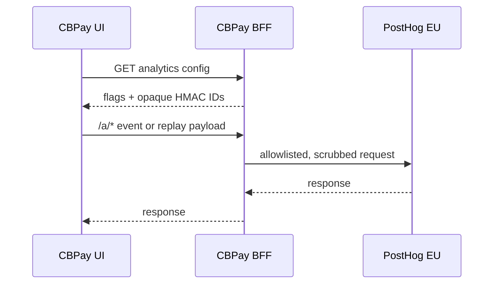

> **Environments:** Test `https://cryptobank.qbank.cl/platform` (`pk_test_...`) - Live `https://api.qbank.cl/platform` (`pk_...`).

Product analytics helps you understand activation, feature adoption and
integration health without collecting customer identity or raw financial data.
The browser asks the platform for a scoped configuration; it never reads
secrets or derives account identities.

## What is measured

Events describe product behavior, not a customer dossier. The tracking plan
covers sign-up and login, onboarding, KYC/KYB, payins, payouts, transfers,
swaps, cards, banking, public verification surfaces, support and admin
operations. Server-side events are authoritative for money; the front end
records UI behavior only.

Allowed properties are bounded values such as `country`, `currency`, `method`,
`service`, `status`, `source`, `account_type`, locale, and amount or score
bands. Emails, names, phone numbers, RUT/tax IDs, account or card numbers,
exact amounts, raw request bodies, provider identity, tokens and AML/CFT reasons
are excluded. Values are filtered and scrubbed before leaving the platform.

## Consent and the opt-in banner

Analytics is opt-in. The banner explains the purpose and offers accept or
decline. Until consent is granted, the SDK does not initialize and the
platform config remains disabled for collection. A declined choice is
respected; it is not overridden by a later page load.

Authenticated portal pages use `GET /v1/me/analytics-config`. Anonymous
surfaces use `GET /v1/public/analytics-config`; no identity is issued there.
The config includes `consent_required`, `cb_env`, `proxy_path`, the EU host
hint, and an empty token when analytics is disabled.

## Replay is portal-only

Session replay is enabled only for the authenticated customer portal after
opt-in. It is disabled for admin pages and every public surface. The shipped
client masks all inputs and text by default, blocks sensitive selectors and
covers QR material; replay must never be treated as a support recording or an
identity source.

## First-party proxy

The browser sends PostHog traffic to the same-origin `/a/*` path. The proxy
accepts only the documented segments (`e`, `i`, `batch`, `decide`, `array`,
`static` and `capture`), forwards only required content and `PostHog-*`
headers, strips cookies and forwarding headers, and pins the bearer token to
this project. Requests are limited to 64 MiB, have a 10-second upstream
timeout and a 1,200-request-per-IP-per-hour throttle. Unknown paths, invalid
tokens and disabled analytics fail closed.

## Configuration endpoints

The OpenAPI reference contains the full response shapes:

- `GET /v1/me/analytics-config` (`getMyAnalyticsConfig`) — authenticated
  account portal; returns HMAC-bound `distinct_id` and `group_id` only when
enabled, plus `replay: true` when enabled.
- `GET /v1/public/analytics-config` (`getPublicAnalyticsConfig`) — anonymous
  tracker, consent, verification and embed surfaces; replay is always false.

See the [error catalog](https://docs.cbpayapp.com/en/errors) for `service_unavailable`,
`invalid_token`, `rate_limited`, `not_found` and `upstream_unavailable`.

## FAQ

#### Does CBPay send personal data to analytics? No. The allowlist excludes direct identifiers and exact financial values. IDs are opaque HMACs and amounts are represented by bands.#### Can I use replay on an admin or public page? No. Replay is portal-only and masked. Admin and public configurations return `replay: false`.#### Why does the browser call /a instead of PostHog directly? The first-party proxy keeps the browser same-origin, removes forwarding metadata and pins requests to the configured EU project.#### What happens when PostHog is not configured? Config endpoints return disabled flags and proxy requests return `503 service_unavailable`; the business request continues without analytics.#### Where are retention and deletion rules defined? The tracking plan defines one-year event retention, 90-day replay retention and deletion of the HMAC identity when an account is deleted.
