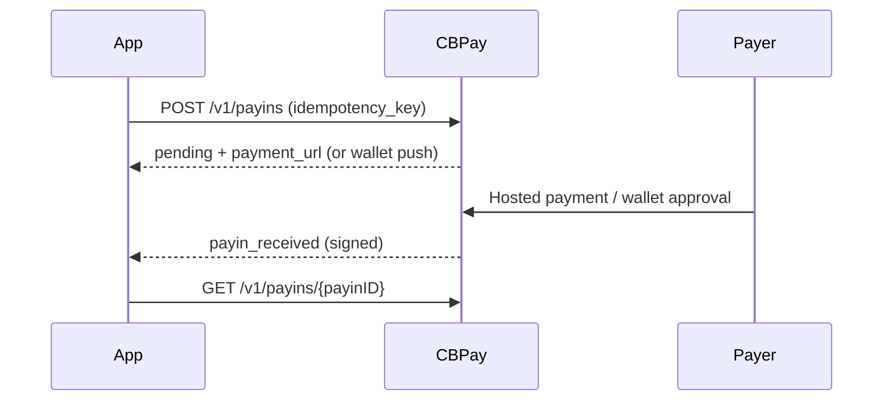

> **Environments:** Test `https://cryptobank.qbank.cl/platform` (`pk_test_...`) - Live `https://api.qbank.cl/platform` (`pk_...`).

This guide covers the currently enabled regional corridors. The public API is
provider-agnostic: select a country, currency and neutral method, then follow
the status and webhook contract. Availability is deployment-controlled; the
catalog is authoritative.

## Corridor matrix

| Country | Currency | Payout | Payin | Amount format |
|---|---|---|---|---|
| PY | PYG | `bank_transfer` | `bank_transfer`, `wallet` | Up to 2 decimals |
| CO | COP | `bank_transfer` | `bank_transfer`, `wallet` | Whole pesos only |
| EC | USD | `bank_transfer` | `wallet` | Up to 2 decimals |

Payouts use `flow_type` `B2C`, `B2B` or `P2P` through the server-controlled
rail configuration. Payin checkout accepts `payer_name`, `payer_document` and
`payer_phone` when the selected method requires them.

## Payouts

Use `GET /v1/payouts/methods` and `GET /v1/payouts/banks` before presenting a
form. Always send an idempotency key. Do not retry an ambiguous network or
5xx result by creating a new payout; query the original resource with the same
key and wait for reconciliation.

```bash
curl -X POST https://api.qbank.cl/platform/v1/payouts \
  -H "Authorization: Bearer <token>" \
  -H "Content-Type: application/json" \
  -H "Idempotency-Key: py-payout-20261012-001" \
  -d '{
    "country": "PY",
    "currency": "PYG",
    "method": "bank_transfer",
    "amount": "500000.00",
    "beneficiary": {
      "name": "Sofia Benitez",
      "document_type": "CI",
      "tax_id": "4123456",
      "bank_code": "8",
      "account_number": "6001234567890123"
    },
    "options": {"flow_type": "B2C", "purpose": "OTHER_SERVICES"}
  }'
```

COP amounts must be integers, for example `"150000"`; `"150000.50"` is
rejected before dispatch. The beneficiary data is country-specific and the
bank code must come from the catalog.

## Payins

### Hosted checkout

PY `bank_transfer` and `wallet`, CO `bank_transfer`, and EC `wallet` return a
`payment_url`. Open it in the payer's browser and wait for the signed
`payin_received` or terminal charge-status webhook.

```bash
curl -X POST https://api.qbank.cl/platform/v1/payins \
  -H "Authorization: Bearer <token>" \
  -H "Content-Type: application/json" \
  -d '{
    "country": "PY",
    "currency": "PYG",
    "method": "wallet",
    "amount": "7500.00",
    "payer_name": "Ana Torres",
    "payer_document": "1234567",
    "idempotency_key": "py-wallet-20261012-001"
  }'
```

The response contains `charge_id`, `our_reference`, `payment_url` and
`status: pending`. Read it with `GET /v1/payins/{payinID}`. A retry with the
same idempotency key returns the same hosted session.

### Colombia wallet collect

CO/COP/`wallet` is a push collection: it does not return a URL. Provide
`payer_name`, `payer_document` and `payer_phone`; the payer approves in their
wallet app. The first response is normally pending and the result arrives by
webhook, commonly around 15 minutes. Do not poll it as if it were a hosted
checkout.

### Colombia bank transfer

CO/COP/`bank_transfer` uses hosted PSE checkout. COP remains integer-only and
the payer identity fields are required.

## Lifecycle and webhooks



Incoming provider callbacks are authenticated by CBPay; your outbound
webhooks are signed with `X-Webhook-Signature`. Accept duplicate deliveries
idempotently. Final payin states are `completed` and `failed`; `pending` and
`processing` are transient.

## Common errors

| HTTP | Code | Action |
|---:|---|---|
| 400 | `invalid_amount` | Use PYG/USD with at most two decimals; use integer COP. |
| 400 | `payin_corridor_unsupported` | Re-read the live methods catalog. |
| 409 | `idempotency_conflict` | Reuse the original payload or choose a new key. |
| 422 | `invalid_payload` | Correct the country-specific beneficiary or payer fields. |
| 502/503 | `payin_provider_failed` / `payins_unavailable` | Keep the same key and reconcile; do not create a second money operation. |

## FAQ

#### Can I select a provider or the PY fallback rail?
No. Public clients select only the neutral corridor. Rail variants are
server-controlled and signed; the public API does not accept a provider name.
#### What happens after a timeout?
Keep the same idempotency key and query the resource. CBPay does not
automatically resend an ambiguous money operation.
#### Why did a payout stay processing after a conflict?
Upstream reconciliation signals are surfaced as neutral status and status
code. The original payout is reconciled by its external reference; keep the
same idempotency key and query the resource instead of creating a new payout.
#### How do I retrieve an old payin?
The upstream payment lookup is available only for payments created within
12 months. Keep the CBPay charge and webhook records as the system of record.
