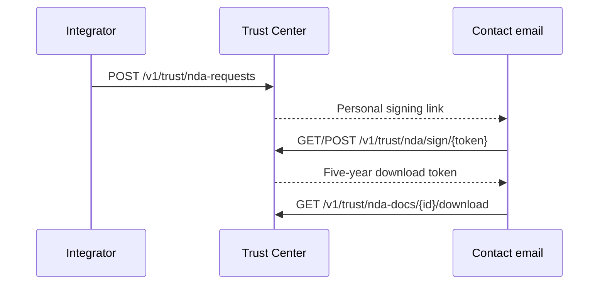

> **Environments:** Test `https://cryptobank.qbank.cl/platform` (`pk_test_...`) - Live `https://api.qbank.cl/platform` (`pk_...`).

The public Trust Center at [cbpayapp.com/trust](https://www.cbpayapp.com/trust) lists public compliance records and explains how to request the gated N2 room. The gated documents are provider-agnostic compliance evidence; bytes are released only after the external contact signs the NDA. No CBPay account is required.

The room holds 24 documents: 7 first-party programs (US AML program, Peru SPLAFT manual, Chile AML audit + training plan, Bolivia UIF + SEPREC, Colombia existence), 7 vendor audit reports received by GRUPO CB LLC (Sophos C5, SOC 2, PCI AOC, healthcare risk analysis; Cloudflare C5, SOC 2, PCI AOC), and 10 PCI DSS/SAQ-A and ASV scan reports (Aperia, September 2026). The Canada FINTRAC/PSP registrations are fully public and download directly from the site.

Request only what you need: pass `document_ids` with the chosen catalog IDs (see `GET /v1/trust/nda-docs`). Omitted means all documents; an explicitly empty list is rejected. Downloads, the status panel, and the completion email all honor the selection — documents outside it return 404 as if unknown.

Signing captures a drawn (or typed) signature on the signing page: it is printed on the signed NDA block and attached to the completion email. The pre-signature branded PDF can be viewed and downloaded from the signing page before signing.



## Flow

### Request access

Send the company, contact and purpose. The same company plus email while pending is idempotent.

```bash
curl -X POST https://api.qbank.cl/platform/v1/trust/nda-requests \
  -H 'Content-Type: application/json' \
  -d '{"company_name":"Acme Payments Ltd","contact_name":"Jordan Lee","contact_email":"compliance@acme.example","country":"US","purpose":"Evaluate compliance controls","locale":"en"}'
```

Response (`202`, or `200` with `idempotency_hit: true` on replay):

```json
{"request_id":"4e7b1f3e-8b20-4ef8-9cc5-1bcb6d9b2a01","status":"pending_signature","expires_at":"2026-11-18T20:00:00Z","email_sent":true}
```
### List available document metadata

Metadata is public; document bytes are not.

```bash
curl https://api.qbank.cl/platform/v1/trust/nda-docs
```

Response (`200`):

```json
{"documents":[{"id":"us-aml-program","title_en":"US AML Program (Grupo CB LLC, Jan 2026)","pages":39,"sha256":"7d1df3be9f4a8b4bf88dce93a3b939f8a737f123cb60b8074442ca035cd6e940"}]}
```
### Review and sign from the email

Open the personal link. The page is public and no CBPay session is needed. Submit the signer identity, company registration, address and `accept: true`. The response contains the raw download token once.

```bash
curl -X POST https://api.qbank.cl/platform/v1/trust/nda/sign/<SIGN_TOKEN> \
  -H 'Content-Type: application/json' \
  -d '{"signer_name":"Jordan Lee","signer_title":"Chief Compliance Officer","company_reg":"US-123456","company_address":"1 Main Street, Boston MA","accept":true}'
```

Response (`200`):

```json
{"request_id":"4e7b1f3e-8b20-4ef8-9cc5-1bcb6d9b2a01","status":"signed","download_token":"<32-hex-token>","download_url":"https://www.cbpayapp.com/en/trust/nda?request=...&token=...","expires_at":"2031-10-18T20:00:00Z"}
```
### Check status and download

Use the download Bearer token. Each PDF response includes `X-Checksum-Sha256` and `Cache-Control: no-store`; every delivery is audit-recorded.

```bash
curl https://api.qbank.cl/platform/v1/trust/nda-requests/<REQUEST_ID>/status \
  -H 'Authorization: Bearer <DOWNLOAD_TOKEN>'
curl -L -o trust-document.pdf https://api.qbank.cl/platform/v1/trust/nda-docs/us-aml-program/download \
  -H 'Authorization: Bearer <DOWNLOAD_TOKEN>'
```

Status response (`200`):

```json
{"request_id":"4e7b1f3e-8b20-4ef8-9cc5-1bcb6d9b2a01","status":"signed","signed_at":"2026-10-19T20:00:00Z","expires_at":"2031-10-18T20:00:00Z","documents":["us-aml-program"]}
```
## States and errors

| State | Meaning | Action |
|---|---|---|
| `pending_signature` | Signing link is valid for 30 days. | Review and sign, or request again after expiry. |
| `signed` | Downloads are enabled for five years. | Use the download Bearer token. |
| `expired` | Signing or download entitlement expired. | Submit a new request. |
| `revoked` | Compliance removed access immediately. | Contact compliance or submit a new request. |

See the [error catalog](https://docs.cbpayapp.com/en/errors) for `counsel_pending`, `invalid_token`, `unknown_document`, `already_decided`, `accept_required`, `email_unavailable`, `entitlement_revoked` and `entitlement_expired`.

## FAQ

#### Is a CBPay account required?No. The contact uses the personal signing and download tokens from email.#### Can I retry the request safely?Yes. Reusing the same company and contact email while pending returns the existing request and does not send a duplicate envelope.#### What does email_sent mean?`true` means delivery was handed to the configured email service; `false` means the request exists but delivery failed. Do not log or expose raw tokens.#### How long are downloads available?Five years after signing, unless compliance revokes the entitlement sooner.
