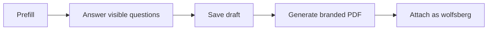

> **Environments:** Test `https://cryptobank.qbank.cl/platform` (`pk_test_...`) - Live `https://api.qbank.cl/platform` (`pk_...`).

## Complete the questionnaire

Company onboarding includes the Wolfsberg CBDDQ v1.4 questionnaire. It has
15 sections, conditional follow-up questions, and a final declaration. The
form shows only questions activated by previous answers; progress counts
visible questions.

Matching company-profile values are prefilled and a local draft is saved as
you move between sections. Review every prefilled value: it is a suggestion,
not a compliance decision.

Select **Generate PDF** to create the branded
`wolfsberg-cbddq-v1.4-*.pdf`. The completed PDF is attached to the native KYB
submission with document category `wolfsberg`. If upload fails, retry from
the saved draft without answering again.

#### Can I submit an incomplete questionnaire?
    No. Complete all visible required questions and the final declaration.
#### Can I edit it after generating the PDF?
    Yes. Generate and upload the latest version; the submission remains the
    same.
#### Does it replace other KYB evidence?
    No. It is one requested evidence category.
See the [error catalog](https://docs.cbpayapp.com/en/errors) if the PDF upload fails.
