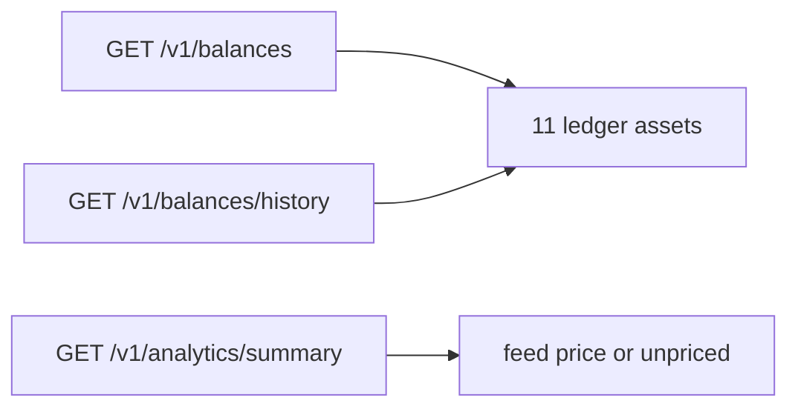

> **Ambientes:** Test `https://cryptobank.qbank.cl/platform` (`pk_test_...`) - Live `https://api.qbank.cl/platform` (`pk_...`).

Las cuentas CBPay ahora exponen cuatro activos fiat locales del ledger:
**BOB**, **MXN**, **ARS** y **CLP**. BOB/MXN/ARS usan dos decimales; CLP usa
cero decimales (pesos enteros). Son saldos independientes junto a USD, USDT,
USDC, BTC, GOLD, SILVER y PLATINUM.

CLP mantiene hold local en Banking y exhibe saldo derivado por instrumento.
Las transferencias internas same-asset están permitidas. `settlement_asset:
CLP` solo se puede usar para un payout CLP: el débito es same-currency,
identidad y con spreads cero. Todo decimal no nulo en CLP responde
`400 invalid_amount`.



## Dónde aparecen

- `GET /v1/balances`: siempre devuelve los once activos del ledger, incluso
  filas en cero. BOB/MXN/ARS usan dos decimales; CLP usa cero decimales,
  por ejemplo `"125.40"` o `"125"`.
- `GET /v1/balances/history`: incluye una serie diaria por cada activo fiat.
  La serie sigue `available`; los holds aparecen en el snapshot actual.
- `GET /v1/analytics/summary`: incluye saldos y volumen fiat cuando existen.
  La valorización USD usa el feed de tasas de la organización (`1 / tasa
  local-por-USD`). Sin una tasa válida, el activo queda como `unpriced` y se
  excluye de los totales USD.

```json
{
  "account_id": "9b1deb4d-3b7d-4bad-9bdd-2b0d7b3dcb6d",
  "balances": [
    { "asset": "BOB", "available": "15000.00", "held": "0.00" },
    { "asset": "MXN", "available": "0.00", "held": "0.00" },
    { "asset": "ARS", "available": "0.00", "held": "0.00" },
    { "asset": "CLP", "available": "0", "held": "0" }
  ]
}
```

## Transferencias

`POST /v1/transfers` permite transferencias internas del mismo activo cuando
origen y destino usan el mismo asset. La transferencia fiat conserva sus dos
decimales; CLP conserva pesos enteros y no convierte implícitamente a USDT ni
a otra moneda.

## Gates de producto en v1

Registrar el fiat en el ledger no significa que todos los productos puedan
gastarlo:

| Producto | BOB/MXN/ARS en v1 |
|---|---|
| Saldos, history y analytics | Soportado; CLP usa feed y queda `unpriced` si falta |
| Transferencias internas del mismo asset | Soportado |
| Settlement de payouts y defaults de organización | CLP same-currency permitido; cross-fiat responde `503 pricing_unavailable` |
| Swaps | Rechazado con `400 invalid_pair` |
| Checkout y POS | CLP rechazado como settlement asset con `400 invalid_asset` |
| Tarjetas | Rechazado con `400 spending_asset_unavailable` |
| `default_payin_asset` | CLP rechazado con `400 invalid_asset` |

La separación es intencional: un saldo puede existir en el ledger antes de
que exista el pricing o el camino de settlement externo.

## Errores y precisión

Los montos son strings decimales. `1.50` BOB equivale a 150 unidades menores;
`1.234` BOB, MXN o ARS se rechaza; `"100.50"` CLP también. Una solicitud
cross-fiat puede responder `503 pricing_unavailable` porque no existe pricing
FX.

#### ¿Agregar fiat cambia mi settlement asset por defecto?
No. Tu default no cambia. El fiat se usa solo
cuando el activo está habilitado y el gate del producto lo acepta.
#### ¿Puedo usar un saldo fiat para pagar una compra con tarjeta?
No. Las tarjetas rechazan assets fiat en v1; el saldo sigue visible y usable
por los productos soportados arriba.
