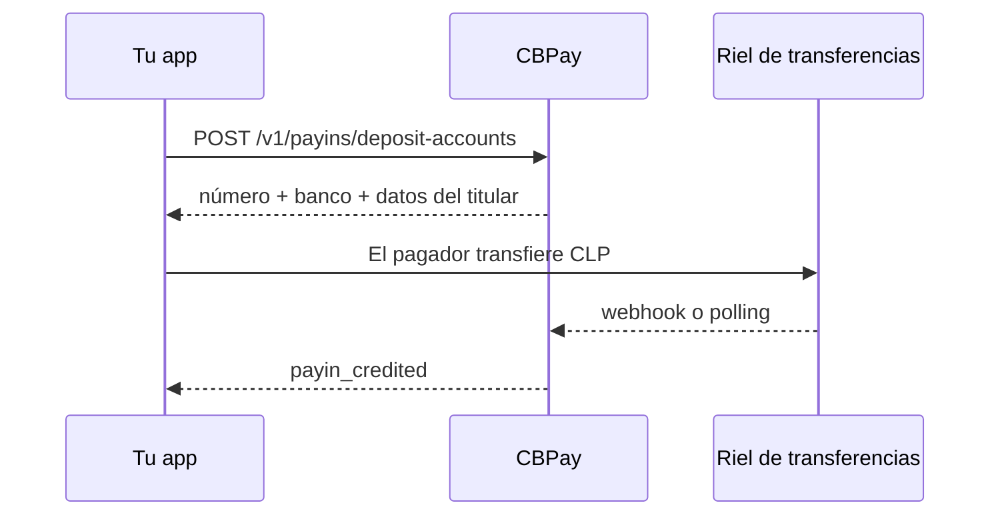

> **Ambientes:** Test `https://cryptobank.qbank.cl/platform` (`pk_test_...`) - Live `https://api.qbank.cl/platform` (`pk_...`).

Esta guía cubre el método `fintoc` para pesos chilenos (CLP). Es
provider-agnostic: tu integración recibe una cuenta virtual de depósito y
usa el contrato normal de payouts. No cambia el corredor existente
`CL/CLP/bank_transfer`.

> **Importante**
CLP no tiene unidad menor. Envía pesos enteros positivos, por ejemplo
`"150000"`; `"150000.50"` responde `400 invalid_amount`.
## Slots de fondeo y Banking

El mismo corredor `CL/CLP/fintoc` admite ambos propósitos sin cambiar la
forma de respuesta (`purpose`, `label`, `balance` derivado y movimientos):

- `purpose: "fondeo"` (por defecto) convierte el abono CLP al saldo principal.
- `purpose: "banking"` recibe, retiene y exhibe el saldo CLP derivado del
  instrumento. No origina payouts: los payouts CL siempre salen desde la cuenta root
  y no aplica un flag físico de sweep-exempt.

Las empresas pueden crear cuentas adicionales de fondeo o Banking con una
idempotency key distinta por cuenta; Banking tiene tope de 50 instrumentos por
empresa/corredor. Las personas pueden crear la segunda virtual Banking en este
corredor. Repetir una key reproduce la cuenta original.

## Recibir CLP en una cuenta virtual



### 1. Confirma el corredor

```bash
curl "https://api.qbank.cl/platform/v1/payins/methods?country=CL" \
  -H "Authorization: Bearer <token>"
```

Usa `method: "fintoc"` para la cuenta virtual. El checkout hospedado
existente también usa `method: "fintoc"` en `POST /v1/payins`, pero es otro
flujo y devuelve `payment_url`.

### 2. Emite la cuenta

La emisión automática ocurre después de KYC/KYB aprobado. Una empresa puede
hacer backfill para una cuenta faltante usando el mismo endpoint:

```bash
curl -X POST "https://api.qbank.cl/platform/v1/payins/deposit-accounts" \
  -H "Authorization: Bearer <token>" \
  -H "Idempotency-Key: cl-fintoc-account-001" \
  -H "Content-Type: application/json" \
  -d '{"country":"CL","currency":"CLP","method":"fintoc","idempotency_key":"cl-fintoc-account-001"}'
```

Respuesta `201`:

```json
{
  "country": "CL",
  "currency": "CLP",
  "account_number": "123456789",
  "account_id": "acc_7f3a",
  "instrument_id": "4f81c2d0-1111-2222-3333-444455556666",
  "status": "active",
  "bank_code": "0012",
  "bank_name": "BancoEstado",
  "account_currency": "CLP",
  "holder_name": "CBPay Operations SpA",
  "holder_tax_id": "76543210-8",
  "holder_account_type": "checking"
}
```

Muestra al pagador exactamente el número, banco, nombre, RUT y tipo
devueltos. No infieras un banco por su nombre ni reemplaces el RUT.
El titular es la empresa dueña del CPF usado para la cuenta dedicada, no el
pagador ni el usuario final.

### 3. Concilia el abono

CBPay relaciona el abono por el número de cuenta virtual. Acepta el webhook y
usa polling como respaldo idempotente. Recibirás `payin_credited` al acreditar:

```bash
curl "https://api.qbank.cl/platform/v1/payins?country=CL&currency=CLP&method=fintoc&status=credited&from=2026-10-01&to=2026-10-31&page=1&page_size=50" \
  -H "Authorization: Bearer <token>"
```

## Enviar un payout CLP

```bash
curl "https://api.qbank.cl/platform/v1/payouts/methods?country=CL" -H "Authorization: Bearer <token>"
curl "https://api.qbank.cl/platform/v1/payouts/banks?country=CL&method=fintoc" -H "Authorization: Bearer <token>"
```

`bank_code` acepta el código SBIF numérico del catálogo, por ejemplo
`"0012"`, o una billetera ruteada como `"cl_mach"`. El número de cuenta debe
tener solo dígitos y `account_type` debe ser `checking` (corriente) o `sight`
(vista).

```bash
curl -X POST "https://api.qbank.cl/platform/v1/payouts" \
  -H "Authorization: Bearer <token>" \
  -H "Idempotency-Key: cl-payout-8841" \
  -H "Content-Type: application/json" \
  -d '{"country":"CL","currency":"CLP","method":"fintoc","amount":"150000","beneficiary":{"name":"María López","tax_id":"11111111-1","bank_code":"0012","account_number":"12345678","account_type":"checking"},"description":"Invoice 8841","idempotency_key":"cl-payout-8841"}'
```

La respuesta `202` queda en `processing`. Consulta
`GET /v1/payouts/{payoutID}` o usa `payout_status_changed`.
`partially_succeeded` sigue en processing e informa lo liquidado y el
remanente; crea un payout nuevo solo por el remanente después de revisarlo.
`reversed`, `returned`, `failed` y `rejected` son resultados fallidos.
Ante timeout no se reenvía: usa la misma idempotency key y concilia.

## Estados y errores

| Estado/código | Significado y acción |
|---|---|
| `pending` / `processing` | Espera conciliación y consulta el mismo recurso. |
| `completed` | Resultado final exitoso. |
| `partially_succeeded` | Parte liquidada; revisa `status_message` y paga solo el remanente con una nueva operación. |
| `failed`, `rejected`, `reversed` | Resultado final fallido; revisa `status_code`. |
| `400 invalid_amount` | Envía un monto CLP entero positivo. |
| `422 invalid_beneficiary` | Usa RUT válido, cuenta numérica, banco del catálogo y tipo corriente/vista. |
| `502 provider_ambiguous` | No uses una key nueva; consulta el payout original. |

## Webhooks

Verifica la firma, deduplica por delivery ID, responde rápido y consulta el
recurso. Los eventos relevantes son `payin_credited` y
`payout_status_changed`.

#### ¿Es igual al checkout fintoc?
    No. El checkout devuelve `payment_url`; Business Accounts emite un número
    reutilizable y relaciona transferencias por ese número.
#### ¿Puedo usar decimales?
    No hay centavos en CLP. Solo se aceptan fracciones compuestas por ceros,
    como `"100.00"`.
#### ¿Debo reintentar un timeout?
    No. Reutiliza la misma idempotency key y consulta la operación original.
#### ¿Por qué yo no soy el titular de la cuenta dedicada?
    Los números de cuenta CLP dedicados se emiten para la empresa dueña del CPF.
    El pagador o usuario final no es el titular. Muestra los campos de titular
    devueltos por CBPay sin reemplazarlos.
Consulta [webhooks](https://docs.cbpayapp.com/es/webhooks), [errores](https://docs.cbpayapp.com/es/errors) e
[idempotencia](https://docs.cbpayapp.com/es/concepts/idempotency).
