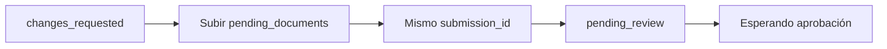

> **Ambientes:** Test `https://cryptobank.qbank.cl/platform` (`pk_test_...`) - Live `https://api.qbank.cl/platform` (`pk_...`).

## Continúa el expediente vigente

Tu cuenta tiene un único **expediente de verificación vigente**. Un registro
`rejected` posterior no anula un expediente que todavía permite subsanar. Si
ya existe una solicitud en curso, `POST /v1/me/verification/link` responde
`409 self_verification_in_progress` sin entregar un link nuevo:

```json
{
  "error": {
    "code": "self_verification_in_progress",
    "message": "a verification is already in progress"
  }
}
```

Consulta `GET /v1/me/verification` y vuelve a abrir el `link.url` existente.
No crees un segundo expediente ni cambies la clave de idempotencia.

Si un link subsanable vence mientras su submission sigue en
`changes_requested` o `more_info_required`, al abrirlo se reabre
automáticamente por 90 días más. Su estado queda en `opened` y la respuesta
reporta `changes_requested` con `next_step: resubmit`. Los links terminales o
revocados permanecen cerrados.

## Resubmisión en el mismo expediente

Mientras se pueda subsanar, la submission vigente expone:

```json
{
  "submission_id": "sub_123",
  "status": "changes_requested",
  "pending_documents": ["proofOfResidence"],
  "documents_received": ["identity"],
  "changes_requested_comments": "Sube un comprobante de domicilio legible.",
  "documents_gate": { "ok": false, "total": 2, "matched": 1 }
}
```

Sube cada elemento de `pending_documents` en el wizard existente. La
resubmisión ocurre **en el mismo expediente**: se conserva el
`submission_id` y no se crea otra submission. Al aceptar el último documento
exigido, el caso vuelve automáticamente a `pending_review` y el portal muestra
**Esperando aprobación**.

Para un UBO o director invitado en `/on/ubo/`, si falta la declaración jurada,
la tarjeta de revisión muestra **Falta tu firma en la declaración jurada**.
El UBO puede firmarla inline; basta con firmar y el caso mantiene su lugar en
revisión.

La pantalla de link vencido es distinguible, explica que tu avance quedó
guardado y solicita pedir un link nuevo.



#### ¿Por qué recibí un 409?
    Ya existe un expediente vigente. Consulta la verificación y reutiliza su
    link abierto.
#### ¿La resubmisión crea otra revisión?
    No. Se actualiza la submission existente y vuelve a revisión cuando la
    evidencia exigida está completa.
Consulta el [catálogo de errores](https://docs.cbpayapp.com/es/errors) para los códigos accionables.

## Casos terceros propios de la empresa

Una empresa puede leer sus propios casos KYC/KYB de terceros antes de estar
aprobada. Son rutas de solo lectura, acotadas a la cuenta empresa autenticada:
no adoptan, crean ni cambian una verificación.

### Listar casos

```bash
curl "https://api.qbank.cl/platform/v1/me/verifications/kyb/third-party?page=1&page_size=50&from=2026-11-01&to=2026-11-07&status=changes_requested" \
  -H "Authorization: Bearer <account-token>"
```

```json
{
  "page": 1,
  "page_size": 50,
  "submissions": [{
    "submission_id": "c3d4e5f6-a7b8-4c9d-0e1f-2a3b4c5d6e7f",
    "kind": "kyb",
    "status": "changes_requested",
    "external_customer_id": "link:7f8e9d0c-1b2a-4c3d-8e4f-0a1b2c3d4e5f",
    "created_at": "2026-11-03T16:18:20Z",
    "updated_at": "2026-11-06T16:37:23Z"
  }]
}
```

Acepta `page`, `page_size` (máximo 200), `status` y filtros opcionales
`from`/`to`. Si los omites, la API aplica su rango de fechas predeterminado;
se recomienda enviarlos explícitamente para que la paginación sea reproducible.
La lista sale del espejo de plataforma y no hace una consulta al core por cada
fila.

### Leer el detalle de subsanación

```bash
curl "https://api.qbank.cl/platform/v1/me/verifications/kyb/third-party/c3d4e5f6-a7b8-4c9d-0e1f-2a3b4c5d6e7f" \
  -H "Authorization: Bearer <account-token>"
```

```json
{
  "submission_id": "c3d4e5f6-a7b8-4c9d-0e1f-2a3b4c5d6e7f",
  "kind": "kyb",
  "status": "changes_requested",
  "external_customer_id": "link:7f8e9d0c-1b2a-4c3d-8e4f-0a1b2c3d4e5f",
  "pending_documents": ["proofOfAddress", "financialStatements"],
  "changes_requested_comments": "Please upload the listed documents.",
  "created_at": "2026-11-03T16:18:20Z",
  "updated_at": "2026-11-06T16:37:23Z"
}
```

El detalle lee el estado vigente del core cuando está disponible; si el
enriquecimiento falla temporalmente, devuelve el espejo seguro. Un caso
migrado se identifica con `status: "migrated"`, `migrated_from` y
`migrated_to`.

| HTTP | Código | Solución |
|---:|---|---|
| 400 | `invalid_range` | Corrige `from`/`to` malformados y usa el formato de fecha documentado. |
| 401 | `unauthorized` | Renueva el token y envíalo como Bearer. |
| 403 | `company_account_required` | Usa una cuenta empresa. |
| 404 | `not_found` | Verifica que el caso pertenezca a la cuenta autenticada. |

#### ¿La cuenta debe estar aprobada?
    No. Puede leer sus casos terceros en cualquier estado para completar la
    subsanación; las escrituras mantienen sus gates actuales.
#### ¿Leer crea o adopta un caso?
    No. Ambas rutas son lecturas puras y no cambian el estado.
#### ¿Cómo envío los documentos solicitados?
    Usa el flujo alojado existente y conserva el mismo `submission_id`.
