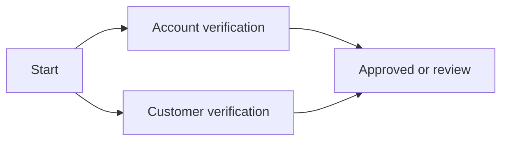

Elige la guía general para verificar cuentas y clientes.

## Flujo de verificación

- [Resumen KYC](https://docs.cbpayapp.com/es/guides/kyc-overview)
- [Evidencia OCR y prueba de vida](https://docs.cbpayapp.com/es/guides/kyc-ocr)
- [Errores](https://docs.cbpayapp.com/es/errors)

#### Which page should I start with?Start with the overview, then use the OCR page for evidence details.
