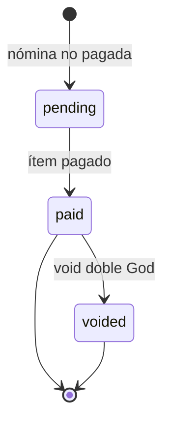

## Qué puedes hacer

El portal muestra solo las liquidaciones propias de la cuenta autenticada. Usa el listado para filtrar por período, abre el detalle o descarga el PDF brandeado. La liquidación existe cuando el ítem está `paid` o `voided`; la liquidación de otra cuenta responde `404 not_found`.

Para probar en sandbox, reemplaza `api.qbank.cl` por `cryptobank.qbank.cl`; usa credenciales sandbox y fondos simulados.

## Listar y filtrar

```bash
curl "https://api.qbank.cl/platform/v1/me/pay-slips?period=2026-10&page=1&page_size=50" \
  -H "Authorization: Bearer $ACCOUNT_TOKEN"
```

La respuesta es `{pay_slips, page, page_size, total}`. Omite `period` para listar todos los períodos. `period` debe usar `YYYY-MM`; `page_size` tiene tope 200.

## Abrir el detalle

Usa el `id` del listado:

```bash
curl "https://api.qbank.cl/platform/v1/me/pay-slips/slip_01" \
  -H "Authorization: Bearer $ACCOUNT_TOKEN"
```

El JSON contiene `period`, empleador y empleado, haberes, descuentos, montos bruto/neto, moneda, valor USD, método de pago, destino enmascarado, hora de pago y `core_ref`. El destino se enmascara por diseño.

## Descargar el PDF

```bash
curl "https://api.qbank.cl/platform/v1/me/pay-slips/slip_01/pdf" \
  -H "Authorization: Bearer $ACCOUNT_TOKEN" -o liquidacion.pdf
```

La respuesta es `application/pdf`. El PDF usa el branding y el idioma de la cuenta. Un fallo de render responde `500 receipt_render_failed`; reintenta la lectura y entrega el id de solicitud si persiste.



## Estados

| Estado | Significado | Qué hacer |
|---|---|---|
| `pending` | La nómina aún no está pagada; no hay liquidación disponible. | Vuelve a leer después del pago. |
| `paid` | La liquidación sellada se puede leer y descargar en PDF. | Abre el detalle o descarga el PDF. |
| `voided` | La liquidación sigue disponible para la historia de auditoría. | Consérvala para auditoría. |

## Errores

| HTTP | Código | Solución |
|---:|---|---|
| 400 | `invalid_period` | Envía un período calendario con formato `YYYY-MM`. |
| 404 | `not_found` | Confirma que el id pertenece a la cuenta autenticada y que el ítem está pagado o anulado. |
| 500 | `receipt_render_failed` | Reintenta la lectura del PDF; no crees otra operación de nómina. |

Consulta el [catálogo público de errores](https://docs.cbpayapp.com/es/errors).

## Preguntas frecuentes

#### ¿Puedo ver la liquidación de otro empleado?No. La propiedad se aplica mediante la cuenta vinculada; la liquidación de otra cuenta no se revela.#### ¿Por qué no aparece después de aprobar la nómina?Aprobar sella el ítem, pero la liquidación se crea después del pago. Vuelve a leer cuando el ítem pase a `paid` o `voided`.#### ¿Descargar el PDF mueve dinero?No. Los endpoints del portal son solo de lectura.
