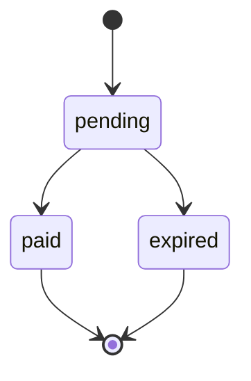

> **Ambientes:** Test `https://cryptobank.qbank.cl/platform` (`pk_test_...`) - Live `https://api.qbank.cl/platform` (`pk_...`).

Los payins QR permiten crear un cobro que el cliente completa con su app
bancaria. Usa una clave de idempotencia cuando el cliente pueda reintentar
después de un timeout o una respuesta de red ambigua.



## Crear un payin QR

Envía `method: "qr"` a `POST /v1/payins`. La clave es opcional y puede viajar
en el body JSON o en el header `Idempotency-Key`.

```bash
curl -X POST https://api.qbank.cl/platform/v1/payins \
  -H "Authorization: Bearer <token>" \
  -H "Content-Type: application/json" \
  -d '{
    "country": "BO",
    "currency": "BOB",
    "method": "qr",
    "amount": "700.00",
    "description": "Recarga app",
    "idempotency_key": "qr-bo-700-20261002-001",
    "expires_in": 3600
  }'
```

### Límites de expiración QR

`expires_in` es un número entero de segundos para los payins QR de la
plataforma. El servidor selecciona el riel configurado; el integrador no
puede elegirlo. El contrato QR legacy tiene un máximo efectivo de `86399`
segundos (23:59:59). El riel QR de 7 días tiene un máximo efectivo de
`604800` segundos, con `86400` segundos (24 horas) como default cuando el
valor falta o no es positivo. Los valores sobre el máximo del riel
seleccionado se recortan, no se rechazan. Para el riel de 7 días, usa al menos `120` segundos
como mínimo operativo.

Respuesta `201`:

```json
{
  "payin_id": "9c2a1b2c-3d4e-5f60-7a8b-9c0d1e2f3a4b",
  "status": "pending",
  "charge": {
    "charge_id": "c9d8e7f6-a5b4-c3d2-e1f0-a9b8c7d6e5f4",
    "our_reference": "77849505",
    "qr_payload": "<contenido del QR>",
    "status": "pending"
  }
}
```

Muestra el contenido QR o el `qr_image_url` que devuelve la API. Cuando el
cliente paga, la cuenta se acredita automáticamente. Consulta el estado actual
con `GET /v1/payins/{payinID}`.

## Brasil: QR PIX en BRL o BOB

Para `method: "qr"`, Brasil acepta `currency: "BRL"` (recomendado) o
`currency: "BOB"` (modo directo avanzado). Con BRL, la plataforma cotiza el
cobro en BOB usando la tasa mid vigente, sin spread en la cotización, y envía
el monto convertido al core. El crédito y las comisiones usan el BOB recibido.
La cotización queda guardada y se conserva en un replay idempotente.

### Recomendado: ingresar el monto del pagador en BRL

```bash
curl -X POST https://api.qbank.cl/platform/v1/payins -H "Authorization: Bearer <token>" -H "Content-Type: application/json" -d '{"country":"BR","currency":"BRL","method":"qr","amount":"120.00","description":"Order 7719","payer_document":"52998224725","payer_phone":"+5511999990000","payer_email":"payer@example.test","expires_in":1800,"idempotency_key":"qr-brl-20261022-001"}'
```

La respuesta expone la imagen QR, el monto en BRL que ve el pagador, el BOB
cobrado y la cotización auditable:

```json
{"charge":{"our_reference":"77849505","qr_image":"<PNG en base64>","qr_image_url":"https://cdn.example.test/qr/77849505.png","conversion":{"amount":"120.00","currency":"BRL","rate":"0.50"},"expires_at":"2026-10-22T12:57:14.937Z","bob_charged":"240.00","platform_quote":{"quoted_currency":"BRL","quoted_amount":"120.00","charged_currency":"BOB","charged_amount":"240.00","rate_brl_per_usd":"5.0000000000","rate_bob_per_usd":"10.0000000000","rates_updated_at":"2026-10-22T20:00:00Z"},"status":"pending"}}
```

El `conversion.amount` puede diferir por centavos del BRL solicitado: el BOB
se redondea half-up a dos decimales y el riel devuelve el BRL equivalente.

### Avanzado: ingresar directamente el cobro en BOB

Para `country: "BR"`, `currency: "BOB"` y `method: "qr"`, el cobro está
denominado en BOB. El pagador paga en BRL mediante la conversión del riel.
El CPF es obligatorio; `payer_phone` y `payer_email` son opcionales:

```bash
curl -X POST https://api.qbank.cl/platform/v1/payins \
  -H "Authorization: Bearer <token>" -H "Content-Type: application/json" \
  -d '{"country":"BR","currency":"BOB","method":"qr","amount":"1.00","description":"Order 7719","payer_document":"52998224725","payer_phone":"+5511999990000","payer_email":"payer@example.test","idempotency_key":"qr-br-bob-20261022-001"}'
```

La respuesta `201` queda en `pending` y contiene los campos de imagen QR, la
conversión que verá el pagador y la expiración del riel. El contrato brasileño
entrega una imagen PNG, no un payload EMV para copiar/pegar:

```json
{
  "payin_id": "2f7b2a6e-6d1c-4c71-9d5e-4e0c2e7a1101",
  "status": "pending",
  "charge": {
    "charge_id": "8d4f1a90-0d7a-4fb1-8b51-8f3cc2b1e401",
    "our_reference": "77849505",
    "qr_image": "<PNG en base64>",
    "qr_image_url": "https://cdn.example.test/qr/77849505.png",
    "conversion": {
      "amount": "0.48",
      "currency": "BRL",
      "rate": "0.48"
    },
    "expires_at": "2026-10-22T12:57:14.937Z",
    "status": "pending"
  }
}
```

El quote de un checkout link marca este corredor `BR`/`BOB` con
`payer_required: true`.
La página server-driven solicita el CPF antes de materializar el cobro.
Los checkout links siguen denominados en BOB; la paridad BRL para checkout
queda para una fase futura.

### Confirmación y conciliación

El ciclo es webhook-first. Un evento entrante autenticado (el webhook del riel
usa el header `x-api-key` configurado) puede cerrar el
cobro `pending`; una lectura tardía de conciliación solo se permite después
de la edad mínima configurada (15 minutos por defecto). Hasta verificar el
estado de plataforma `credited`, el cobro sigue `pending` y no se acredita.

Suscríbete a `payin_credited` y `payin_charge_status_changed`, y usa
`GET /v1/payins/{payinID}` como fuente de verdad. Nunca reintentes con una
clave nueva una solicitud cuyo resultado pueda ser ambiguo.

## Errores de Brasil

| HTTP | Código | Qué hacer |
| --- | --- | --- |
| 400 | `invalid_request` | Incluye `payer_document` y usa `BRL` o `BOB` en el payin QR BR. |
| 422 | `amount_too_small` | Aumenta el monto BRL: tras conversión y redondeo debe producir al menos `0.01 BOB`. |
| 422 | `provider_rejected` | El riel rechazó el cobro, incluido un CPF faltante en el adapter; corrige los datos según el `detail` y no reintentes a ciegas. |
| 503 | `rates_unavailable` | Reintenta la misma solicitud con la misma clave de idempotencia cuando vuelvan las tasas. |

## Reintentos idempotentes

`idempotency_key` es opcional para payins QR. Envíala en el body JSON o en el
header `Idempotency-Key`. Si envías ambas, se usa el valor del body. La
plataforma aplica internamente un namespace por cuenta; el integrador manda la
clave tal cual.

La identidad de la solicitud incluye país, moneda, método y monto numérico.
El canal QR no forma parte de la identidad del replay: la misma clave reproduce el mismo cobro independientemente del canal.
Por ejemplo, `"100"` y `"100.00"` son equivalentes. `description` es texto de
presentación y no forma parte de la identidad del replay.

La primera solicitud crea un solo cobro. Un reintento con la misma clave y un
payload equivalente devuelve el objeto original con `idempotency_hit: true`;
no crea otro cobro:

```json
{
  "payin_id": "9c2a1b2c-3d4e-5f60-7a8b-9c0d1e2f3a4b",
  "status": "pending",
  "charge": {
    "charge_id": "c9d8e7f6-a5b4-c3d2-e1f0-a9b8c7d6e5f4",
    "status": "pending"
  },
  "idempotency_hit": true
}
```

La forma con header es equivalente:

```bash
curl -X POST https://api.qbank.cl/platform/v1/payins \
  -H "Authorization: Bearer <token>" \
  -H "Idempotency-Key: qr-bo-700-20261002-001" \
  -H "Content-Type: application/json" \
  -d '{"country":"BO","currency":"BOB","method":"qr","amount":"700.00","description":"Recarga app"}'
```

Si reutilizas la misma clave con otro país, moneda, método o monto, la API
responde `409 idempotency_conflict`:

```json
{
  "error": "idempotency_conflict",
  "message": "this idempotency key was used with a different payload"
}
```

Un cobro expirado o pagado se reproduce tal cual. La respuesta conserva el
objeto original; usa `GET /v1/payins/{payinID}` para consultar su estado vivo.

El core y la plataforma responden `400 invalid_idempotency_key` cuando la clave
del integrador supera 256 caracteres o contiene retornos de carro/saltos de
línea. La plataforma también rechaza con el mismo código si su namespace de
cuenta del lado servidor hace que la clave resultante supere 256 caracteres.
Ese namespace es invisible para el integrador: envía la clave sin modificar.

## Errores

| HTTP | Código | Qué hacer |
| --- | --- | --- |
| 400 | `invalid_idempotency_key` | Reduce la clave a 256 caracteres o menos y elimina caracteres de control. |
| 409 | `idempotency_conflict` | Repite el payload original o genera una clave nueva para un cobro nuevo. |

## Preguntas frecuentes

#### ¿Puedo cambiar la descripción al reintentar?
Sí. La descripción es texto de presentación y no forma parte de la identidad
del replay.
#### ¿Qué hago si el cliente pagó mientras mi solicitud expiró?
Reintenta con la misma clave y consulta el `payin_id` devuelto con
`GET /v1/payins/{payinID}`. No crees una clave nueva para la misma operación.
#### ¿El CPF es obligatorio para todos los payins QR?
Solo para Brasil (`BR`/`BRL` o `BOB`/`qr`). El riel valida que el CPF exista;
un CPF sintético o desconocido puede responder `CPF no encontrado`. Los demás
corredores QR mantienen sus propios requisitos.
#### ¿Por qué el monto pagado puede diferir por centavos?
La plataforma convierte BRL a BOB y redondea el cobro BOB half-up a dos
decimales. Por eso `conversion.amount` puede diferir levemente del BRL pedido.
#### ¿Qué ocurre si no hay tasas FX?
La API responde `503 rates_unavailable` antes de crear el cobro. Reintenta más
tarde con la misma clave de idempotencia.
#### ¿Cómo funciona el monto del QR brasileño?
El cobro está denominado en BOB. El bloque `conversion` muestra el monto y la
tasa en BRL que verá el pagador; por ejemplo, `1.00` BOB puede convertirse en
`0.48` BRL con tasa `0.48`.
#### ¿Cuándo puedo tratar el QR brasileño como pagado?
Solo después de un estado `credited` verificado o de su webhook correspondiente.
Generar o escanear el QR no prueba la liquidación.
#### ¿Cuál es el máximo de expires_in para un payin QR BO/BOB en producción?
En la API de plataforma, el máximo efectivo es `604800` segundos (7 días)
cuando el servidor selecciona el riel QR de 7 días. El riel QR
legacy tiene un máximo efectivo de `86399` segundos (23:59:59). Los valores
sobre el máximo seleccionado se recortan, no se rechazan; el integrador no
elige el riel. Para el riel de 7 días, usa al menos `120` segundos.
