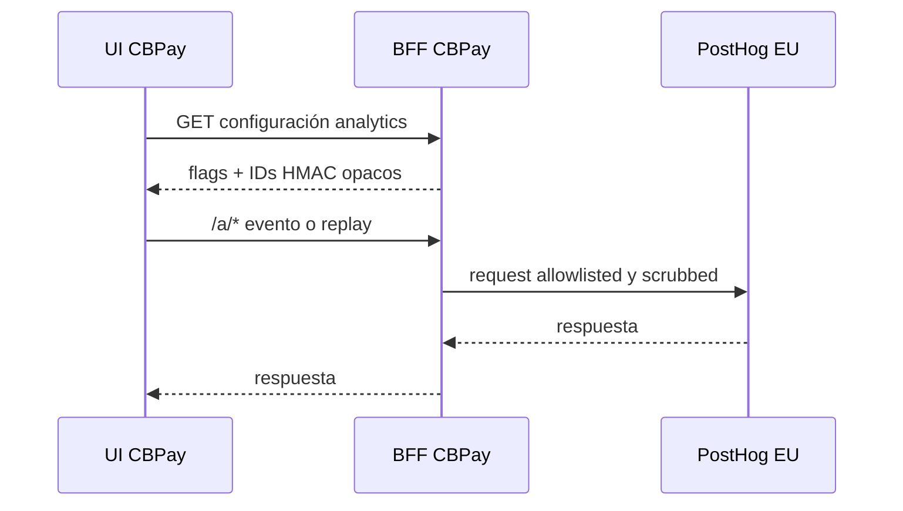

> **Ambientes:** Test `https://cryptobank.qbank.cl/platform` (`pk_test_...`) - Live `https://api.qbank.cl/platform` (`pk_...`).

La analítica de producto ayuda a entender activación, adopción de funciones y
salud de integraciones sin recolectar identidad de clientes ni datos financieros
crudos. El navegador pide una configuración acotada a la plataforma; nunca lee
secretos ni deriva identidades de cuenta.

## Qué se mide

Los eventos describen comportamiento de producto, no un expediente del cliente.
El tracking plan cubre registro y login, onboarding, KYC/KYB, payins, payouts,
transferencias, swaps, tarjetas, banking, verificaciones públicas, soporte y
operación admin. Los eventos server son autoritativos para dinero; el front
solo registra comportamiento de UI.

Las propiedades permitidas son valores acotados como `country`, `currency`,
`method`, `service`, `status`, `source`, `account_type`, locales y bandas de
monto o score. Se excluyen emails, nombres, teléfonos, RUT/tax IDs, números de
cuenta o tarjeta, montos exactos, cuerpos raw, identidad de proveedor, tokens y
motivos AML/CFT. Los valores se filtran y scrubbean antes de salir.

## Consentimiento y banner opt-in

La analítica es opt-in. El banner explica el propósito y permite aceptar o
rechazar. Hasta aceptar, el SDK no se inicializa y la configuración queda
desactivada para collection. Una decisión de rechazo se respeta y no se fuerza
en la siguiente carga.

Las páginas autenticadas usan `GET /v1/me/analytics-config`. Las superficies
anónimas usan `GET /v1/public/analytics-config`; allí no se entrega identidad.
La configuración incluye `consent_required`, `cb_env`, `proxy_path`, el hint de
host EU y un token vacío cuando analytics está desactivado.

## Replay solo en el portal

El session replay se activa solo en el portal autenticado y después del opt-in.
Está desactivado en páginas admin y en toda superficie pública. El cliente
shipped enmascara inputs y texto por defecto, bloquea selectores sensibles y
cubre material QR; replay nunca es una grabación de soporte ni una fuente de
identidad.

## Proxy first-party

El navegador envía tráfico PostHog al path same-origin `/a/*`. El proxy acepta
solo `e`, `i`, `batch`, `decide`, `array`, `static` y `capture`, reenvía el
contenido necesario y headers `PostHog-*`, elimina cookies y headers de forwarding
y fija el bearer token al proyecto. El límite es 64 MiB, timeout upstream 10 s y
throttle de 1.200 requests por IP/hora. Paths desconocidos, tokens inválidos y
analytics desactivado fallan cerrado.

## Endpoints de configuración

La referencia OpenAPI contiene las respuestas completas:

- `GET /v1/me/analytics-config` (`getMyAnalyticsConfig`) — portal de cuenta
  autenticado; entrega `distinct_id` y `group_id` HMAC solo si está habilitado,
  además de `replay: true` cuando corresponde.
- `GET /v1/public/analytics-config` (`getPublicAnalyticsConfig`) — tracker,
  consent, verificación y embeds anónimos; `replay` siempre es false.

Revisa el [catálogo de errores](https://docs.cbpayapp.com/es/errors) para `service_unavailable`,
`invalid_token`, `rate_limited`, `not_found` y `upstream_unavailable`.

## Preguntas frecuentes

#### ¿CBPay envía datos personales a analytics? No. La allowlist excluye identificadores directos y valores financieros exactos. Los IDs son HMAC opacos y los montos usan bandas.#### ¿Puedo usar replay en una página admin o pública? No. Replay solo existe en el portal y está enmascarado. Las configuraciones admin y públicas devuelven `replay: false`.#### ¿Por qué el navegador llama a /a y no directamente a PostHog? El proxy first-party mantiene el navegador same-origin, elimina metadatos de forwarding y fija las requests al proyecto EU configurado.#### ¿Qué pasa si PostHog no está configurado? Los endpoints entregan flags desactivados y el proxy responde `503 service_unavailable`; la operación de negocio continúa sin analytics.#### ¿Dónde están retención y borrado? El tracking plan define un año para eventos, 90 días para replay y borrado del ID HMAC cuando se elimina una cuenta.
