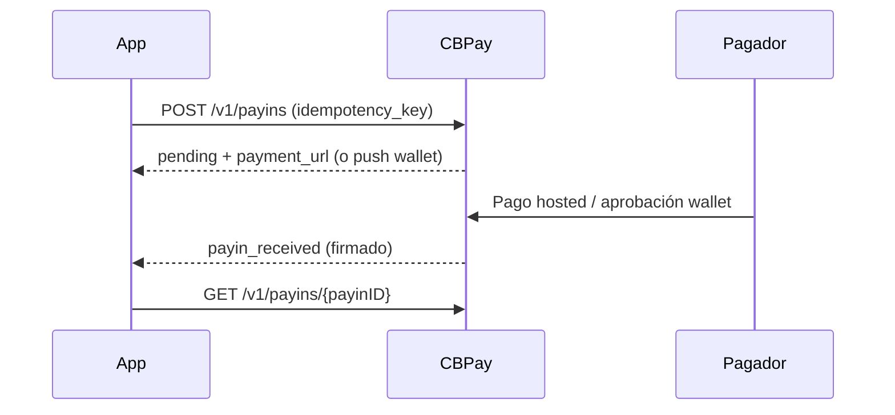

> **Ambientes:** Test `https://cryptobank.qbank.cl/platform` (`pk_test_...`) - Live `https://api.qbank.cl/platform` (`pk_...`).

Esta guía cubre los corredores regionales habilitados. La API pública es
agnóstica al proveedor: selecciona país, moneda y método neutro. El catálogo
en vivo es la fuente de verdad.

## Matriz de corredores

| País | Moneda | Payout | Payin | Formato |
|---|---|---|---|---|
| PY | PYG | `bank_transfer` | `bank_transfer`, `wallet` | Hasta 2 decimales |
| CO | COP | `bank_transfer` | `bank_transfer`, `wallet` | Solo pesos enteros |
| EC | USD | `bank_transfer` | `wallet` | Hasta 2 decimales |
| BR | BRL | `pix`, `bank_transfer` | `pix` (redirect hosted) | Hasta 2 decimales |

En payins hosted puedes enviar `payer_name`, `payer_document` y `payer_phone`
cuando el método los exige. Para payouts, `flow_type` puede ser `B2C`, `B2B` o
`P2P`, según la configuración server-controlled.

## Payins hosted y wallet

PY `bank_transfer` y `wallet`, CO `bank_transfer`, y EC `wallet` devuelven
`payment_url`. Crea el cobro con una `idempotency_key` y espera el webhook
firmado `payin_received`; luego consulta `GET /v1/payins/{payinID}`.

```bash
curl -X POST https://api.qbank.cl/platform/v1/payins \
  -H "Authorization: Bearer <token>" \
  -H "Content-Type: application/json" \
  -d '{"country":"PY","currency":"PYG","method":"wallet","amount":"7500.00",
       "payer_name":"Ana Torres","payer_document":"1234567",
       "idempotency_key":"py-wallet-20261012-001"}'
```

CO/COP/`wallet` es un collect push: no entrega URL. El pagador aprueba en su
app y la confirmación llega por webhook, normalmente alrededor de 15 minutos.
CO/COP/`bank_transfer` usa checkout hosted PSE. COP siempre debe ser entero.

## Brasil

Brasil expone dos métodos de payout y un payin PIX hosted. Usa
`GET /v1/payouts/methods` y `GET /v1/payins/methods` como fuente de verdad.

### Payout PIX y TED

Para PIX, envía `method: "pix"` con una llave PIX: CPF, CNPJ, email,
teléfono brasileño (`+55` más 10 dígitos fijo u 11 celular) o llave aleatoria EVP/UUID. CPF y
CNPJ se validan con sus dígitos verificadores; no envíes banco ni cuenta.

Para TED, usa `method: "bank_transfer"` con banco, agencia, tipo de cuenta,
número de cuenta, nombre y CPF/CNPJ. El banco debe venir de
`GET /v1/payouts/banks`; agencia y tipo de cuenta son obligatorios. El CPF/CNPJ
se valida antes del despacho. Algunos bancos aceptan solo documentos que no
sean CPF; sigue el catálogo y el error de validación del banco.

Ambos métodos BRL aceptan hasta dos decimales. Ante un timeout ambiguo,
consulta el payout con la misma clave y no crees un reemplazo.

### Payin PIX hosted

Crea `BR/BRL/pix` con mínimo `1` BRL, enviando `payer_name` y
`payer_document`. La respuesta trae `payment_url` y queda `pending`; redirige
al pagador a esa URL.

```bash
curl -X POST https://api.qbank.cl/platform/v1/payins \
  -H "Authorization: Bearer <token>" \
  -H "Content-Type: application/json" \
  -H "Idempotency-Key: br-pix-20261013-001" \
  -d '{"country":"BR","currency":"BRL","method":"pix","amount":"25.00",
       "payer_name":"Ana Torres","payer_document":"52998224725",
       "idempotency_key":"br-pix-20261013-001"}'
```

El monto usa BRL con hasta dos decimales y el mínimo es `"1"`. Repite con la
misma clave para recuperar el mismo cobro hosted.

## Payouts y seguridad operacional

Consulta `GET /v1/payouts/methods` y `GET /v1/payouts/banks` antes de mostrar
un formulario. Ante timeout o 5xx, conserva la misma clave y consulta el
recurso; CBPay no reenvía automáticamente una operación ambigua.

Los callbacks entrantes se autentican y tus webhooks salientes llevan
`X-Webhook-Signature`. Procesa duplicados de forma idempotente.

## Ciclo de vida y webhooks



Los estados finales del payin son `completed` y `failed`; `pending` y
`processing` son transitorios.

## Errores frecuentes

| HTTP | Código | Acción |
|---:|---|---|
| 400 | `invalid_amount` | Usa COP entero; PYG/USD admiten hasta 2 decimales. |
| 400 | `payin_corridor_unsupported` | Vuelve a leer el catálogo. |
| 409 | `idempotency_conflict` | Repite el payload original o usa otra clave. |
| 422 | `invalid_payload` | Corrige los datos del beneficiario o pagador. |
| 502/503 | `payin_provider_failed` / `payins_unavailable` | Reconcilia con la misma clave. |

## FAQ

#### ¿Puedo elegir el proveedor o el fallback de PY?
No. El integrador elige solo el corredor neutro. Las variantes son
server-controlled y firmadas.
#### ¿Qué hago después de un timeout?
Conserva la misma idempotency key y consulta el recurso. No abras una segunda
operación.
#### ¿Cuánto tiempo puedo consultar un payin?
La consulta upstream está disponible solo dentro de 12 meses; conserva el
charge y los webhooks de CBPay.
