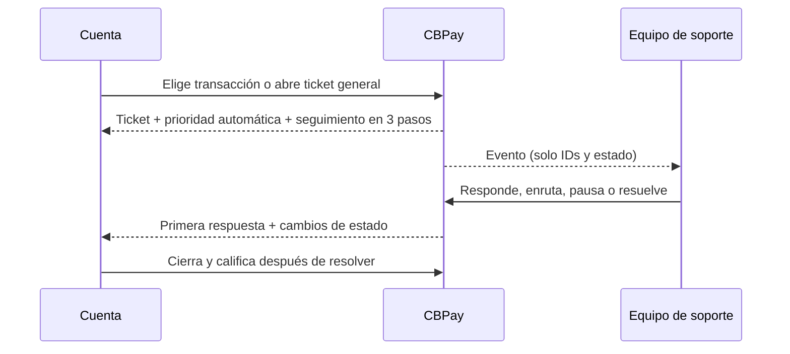

Para pruebas usa `https://cryptobank.qbank.cl/platform`.

Un ticket mantiene una conversación auditable con la organización. Puedes abrirlo desde una transacción o por un tema de cuenta; soporte puede vincular, cambiar o desvincular la transacción después. El snapshot es evidencia de solo lectura y nunca modifica el ledger.



## 1. Elegir el flujo

Hay dos formas de abrirlo: desde el detalle de una transacción o desde Soporte sin transacción (`kind: general`). En el segundo caso usa `category: other`; el alias antiguo `general` se normaliza temporalmente.

Las 11 categorías son cerradas: con transacción `error`, `question`, `delay`, `amount_mismatch`, `unrecognized_operation`, `refund_request`; de cuenta u otro tema `account_verification`, `access_security`, `fraud`, `fees_limits`, `other`. `money_stuck` es una señal separada y acepta `yes`, `no` o `unknown`.

## 2. Abrir un ticket

`kind` debe ser `payout`, `payin`, `payin_refund`, `transfer`, `crypto_withdrawal`, `crypto_deposit`, `swap`, `card_purchase`, `banking_operation`, `wallet_send` o `wallet_deposit`. Envía `resource_id`; los tickets `general` deben usar categoría `general` y omitirlo.

```bash
curl -X POST https://api.qbank.cl/platform/v1/support/tickets \
  -H "Authorization: Bearer $ACCOUNT_TOKEN" -H "Content-Type: application/json" \
  -H "Idempotency-Key: support-payout-2026-0001" \
  -d '{"kind":"payout","resource_id":"payout-123","subject":"El payout está demorado","category":"delay","money_stuck":"yes","message":"Revisen este payout.","idempotency_key":"support-payout-2026-0001"}'
```

La respuesta `201` incluye número `SUP-YYYY-NNNNNN`, snapshot, `money_stuck`, SLA y `priority_source: auto`. El cliente no elige prioridad: first-match aplica fraude/no reconocida → urgent; dinero retenido → urgent; error/demora/monto sobre el piso USD → high; seguridad → high; catch-all → normal. El piso por defecto es USD 1.000.

La clave se exige en body o header y es por organización+cuenta. Repetirla devuelve `idempotency_hit: true`; otro ticket abierto para la misma transacción devuelve `409 ticket_already_open`. Ante timeout, consulta usando la misma clave: no generes otra.

## 3. Seguimiento en 3 pasos

`open` significa investigación; la primera respuesta cambia a `pending_customer`; `resolved` permite CSAT y `closed` es terminal. Una respuesta de la cuenta reabre `pending_customer`, `on_hold` o `resolved`. La cuenta no ve notas internas ni Actividad.

## 4. Buscar y vincular transacciones

`GET /v1/support/transactions?q=125&from=2026-10-01&to=2026-10-31&page=1&page_size=50` devuelve los 11 tipos vinculables y `has_open_ticket`. Si es `true`, continúa el ticket existente. Soporte puede vincular, reemplazar o desvincular la transacción con ownership verificado.

## Leer y continuar el hilo

Usa `GET /v1/support/tickets?from=2026-10-01&to=2026-10-31&page=1&page_size=50` para listar. También puedes filtrar por `status`, `category`, `priority` y `kind`; `page_size` llega hasta 200. El detalle contiene `snapshot`, mensajes públicos y metadata de adjuntos. Las notas internas nunca llegan a la cuenta.

```bash
curl -X POST https://api.qbank.cl/platform/v1/support/tickets/TICKET_ID/messages \
  -H "Authorization: Bearer $ACCOUNT_TOKEN" -H "Content-Type: application/json" \
  -d '{"body":"Aquí hay contexto adicional."}'
```

Un mensaje de la cuenta reabre tickets `pending_customer`, `on_hold` o `resolved` como `open`. `closed` es terminal; abre uno nuevo.

## Adjuntos y deduplicación

Sube un `PDF`, `PNG` o `JPG` como `file`, hasta 10 MiB. Se verifica la firma real y se deduplica por SHA-256 dentro del ticket. Las descargas son binarias y autenticadas; no expongas `download_url`.

## Cerrar y calificar

`POST /v1/support/tickets/{id}/close` es convergente: un ticket ya cerrado devuelve su detalle actual. Tras la resolución, califica una sola vez con `rating` de 1 a 5 y comentario opcional de hasta 1.000 caracteres. La segunda calificación devuelve `409 already_rated`.

## Estados, SLA y errores

| Estado | Significado | Acción |
|---|---|---|
| `open` | Espera trabajo de soporte | Agrega contexto si hace falta |
| `pending_customer` | Soporte respondió y espera a la cuenta | Responde o cierra |
| `on_hold` | Soporte pausó el trabajo | Espera o agrega contexto |
| `resolved` | Soporte resolvió la solicitud | Califica o reabre con un mensaje |
| `closed` | Estado terminal | Abre otro ticket |

El SLA predeterminado de primera respuesta es 4 h, 2 h, 1 h y 30 min; resolución 48 h, 24 h, 8 h y 4 h. La organización puede configurar agenda hábil y pausa mientras espera al cliente; `sla_breached` lo calcula el servidor. El cliente ve el compromiso de primera respuesta, no la actividad interna.

| HTTP | Código | Solución |
|---:|---|---|
| 400 | `idempotency_key_required` | Envía la clave en el body o header `Idempotency-Key`. |
| 400 | `invalid_kind`, `invalid_category`, `invalid_subject`, `invalid_message`, `invalid_money_stuck`, `invalid_rating`, `invalid_comment` | Usa el vocabulario cerrado y sus límites; la prioridad es automática. |
| 403 | `forbidden` | Usa un token de cuenta con ownership del ticket. |
| 404 | `not_found` | Confirma ownership de la transacción o ticket. |
| 409 | `ticket_already_open`, `ticket_closed`, `already_rated`, `attachment_duplicate` | Continúa el existente, abre uno nuevo o conserva la calificación. |
| 422 | `invalid_attachment` | Usa tipo y tamaño permitidos. |
| 503 | `storage_unavailable` | Espera y vuelve a subirlo una vez; no dupliques el ticket. |

Revisa el [catálogo de errores](https://docs.cbpayapp.com/es/errors) y los [eventos webhook](https://docs.cbpayapp.com/es/webhooks#eventos-de-tickets-de-soporte).

## Preguntas frecuentes

#### ¿Puedo abrir un ticket sin transacción?Sí. Usa `kind: general`, omite `resource_id` y define `category: other`; el alias `general` se normaliza temporalmente.#### ¿Puedo elegir urgent?No. El motor de prioridad aplica reglas first-match; el campo `priority` antiguo se ignora.#### ¿Cómo evito duplicados?Busca la transacción y reutiliza la misma clave de idempotencia ante reintentos. El servidor también impide dos tickets abiertos para una transacción.#### ¿La cuenta ve notas internas o Actividad?No. Son superficies solo para administradores y los webhooks no incluyen cuerpos de notas.#### ¿Cuándo envío CSAT?Después de `resolved` o `closed`, una sola vez, con nota opcional de hasta 1.000 caracteres.
