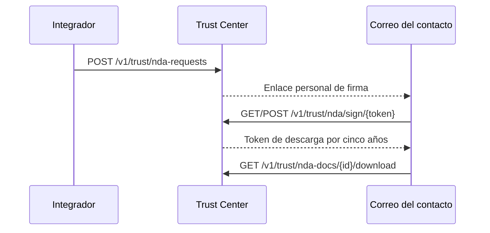

> **Ambientes:** Test `https://cryptobank.qbank.cl/platform` (`pk_test_...`) - Live `https://api.qbank.cl/platform` (`pk_...`).

El Trust Center público en [cbpayapp.com/trust](https://www.cbpayapp.com/trust) lista registros públicos y explica cómo pedir acceso a la sala N2 restringida. Los documentos son evidencia de cumplimiento agnóstica de proveedores; los bytes se entregan solo después de firmar el NDA. No se necesita una cuenta CBPay.

La sala tiene 31 documentos: 7 programas propios (programa AML US, manual SPLAFT Perú, auditoría AML + plan Chile, UIF + SEPREC Bolivia, existencia Colombia), 14 reportes y certificados de proveedores recibidos por GRUPO CB LLC (Sophos C5, SOC 2, PCI AOC, análisis healthcare, ISO 27001, TX-RAMP Cloud/MDR, tarjetas NIST/CIS/PCI; Cloudflare C5, SOC 2, PCI AOC, ISO 27001) y 10 reportes PCI DSS/SAQ-A y escaneos ASV (Aperia, septiembre 2026). Los registros FINTRAC/PSP de Canadá son totalmente públicos y se descargan directo del sitio.

Pide solo lo que necesites: envía `document_ids` con los IDs elegidos del catálogo (ver `GET /v1/trust/nda-docs`). Omitido significa todos; una lista explícitamente vacía se rechaza. Descargas, panel de estado y email de completitud respetan la selección — lo fuera de ella responde 404 como si no existiera.

La firma captura tu rúbrica dibujada (o escrita) en la página de firma: se imprime en el bloque del NDA firmado y se adjunta al email de completitud. El PDF brandeado pre-firma se puede ver y descargar desde la página antes de firmar.



## Flujo

### Solicita acceso

Envía empresa, contacto y propósito. La misma empresa y correo mientras está pendiente son idempotentes.

```bash
curl -X POST https://api.qbank.cl/platform/v1/trust/nda-requests \
  -H 'Content-Type: application/json' \
  -d '{"company_name":"Acme Payments Ltd","contact_name":"Jordan Lee","contact_email":"compliance@acme.example","country":"US","purpose":"Evaluar controles de cumplimiento","locale":"es"}'
```

Respuesta (`202`, o `200` con `idempotency_hit: true` al repetir):

```json
{"request_id":"4e7b1f3e-8b20-4ef8-9cc5-1bcb6d9b2a01","status":"pending_signature","expires_at":"2026-11-18T20:00:00Z","email_sent":true}
```
### Lista los metadatos

Los metadatos son públicos; los bytes no.

```bash
curl https://api.qbank.cl/platform/v1/trust/nda-docs
```

Respuesta (`200`):

```json
{"documents":[{"id":"us-aml-program","title_es":"Programa AML EE.UU. (Grupo CB LLC, ene 2026)","pages":39,"sha256":"7d1df3be9f4a8b4bf88dce93a3b939f8a737f123cb60b8074442ca035cd6e940"}]}
```
### Revisa y firma desde el correo

Abre el enlace personal. No requiere sesión CBPay. Envía identidad del firmante, registro, domicilio y `accept: true`; el token crudo de descarga aparece una sola vez.

```bash
curl -X POST https://api.qbank.cl/platform/v1/trust/nda/sign/<SIGN_TOKEN> \
  -H 'Content-Type: application/json' \
  -d '{"signer_name":"Jordan Lee","signer_title":"Chief Compliance Officer","company_reg":"US-123456","company_address":"1 Main Street, Boston MA","accept":true}'
```

Respuesta (`200`):

```json
{"request_id":"4e7b1f3e-8b20-4ef8-9cc5-1bcb6d9b2a01","status":"signed","download_token":"<32-hex-token>","download_url":"https://www.cbpayapp.com/es/confianza/nda?request=...&token=...","expires_at":"2031-10-18T20:00:00Z"}
```
### Consulta y descarga

Usa el token Bearer de descarga. Cada PDF incluye `X-Checksum-Sha256` y `Cache-Control: no-store`; toda entrega queda auditada.

```bash
curl https://api.qbank.cl/platform/v1/trust/nda-requests/<REQUEST_ID>/status -H 'Authorization: Bearer <DOWNLOAD_TOKEN>'
curl -L -o documento-trust.pdf https://api.qbank.cl/platform/v1/trust/nda-docs/us-aml-program/download -H 'Authorization: Bearer <DOWNLOAD_TOKEN>'
```

Respuesta de estado (`200`):

```json
{"request_id":"4e7b1f3e-8b20-4ef8-9cc5-1bcb6d9b2a01","status":"signed","signed_at":"2026-10-19T20:00:00Z","expires_at":"2031-10-18T20:00:00Z","documents":["us-aml-program"]}
```
## Estados y errores

| Estado | Significado | Acción |
|---|---|---|
| `pending_signature` | El enlace vence en 30 días. | Revisa y firma, o solicita de nuevo tras vencer. |
| `signed` | Descargas habilitadas por cinco años. | Usa el token Bearer. |
| `expired` | Venció la firma o la descarga. | Envía una nueva solicitud. |
| `revoked` | Compliance quitó el acceso de inmediato. | Contacta compliance o solicita de nuevo. |

Revisa el [catálogo de errores](https://docs.cbpayapp.com/es/errors).

## Preguntas frecuentes

#### ¿Necesito una cuenta CBPay?No. El contacto usa los tokens personales recibidos por correo.#### ¿Puedo repetir la solicitud?Sí. Mientras esté pendiente devuelve la solicitud existente y no crea otro sobre.#### ¿Qué significa email_sent?`true` indica que el servicio de correo aceptó el envío; `false` indica que la solicitud existe pero la entrega falló. Nunca registres ni expongas tokens crudos.#### ¿Cuánto duran las descargas?Cinco años desde la firma, salvo revocación anticipada de compliance.
