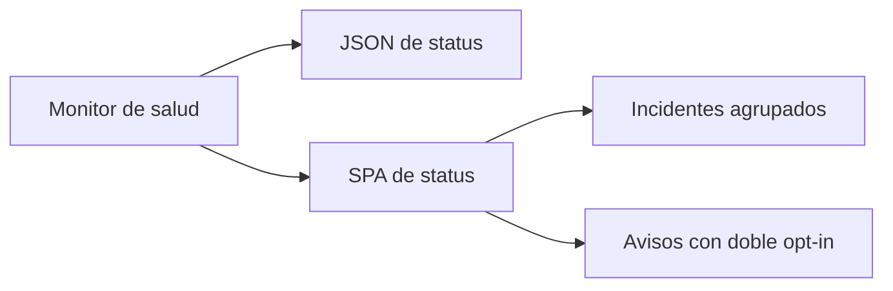

> **Ambientes:** Test `https://cryptobank.qbank.cl/platform` (`pk_test_...`) - Live `https://api.qbank.cl/platform` (`pk_...`).

La superficie pública de status reúne en un solo lugar la disponibilidad de
pagos. Muestra el estado de los corredores habilitados, un heatmap de 90 días,
historial de incidentes agrupados y avisos opcionales por correo. Es agnóstica
al proveedor: las respuestas públicas solo identifican flujo, país, moneda y
método.



## Página pública de status

- `GET /status/{orgToken}` entrega la SPA top-tier por defecto. Incluye estado
general, uptime, MTTR, cantidad de incidentes, heatmap diario de 90 días,
grupos de payouts y payins, filtros, buscador y modal de suscripción.
- La SPA soporta inglés, español y chino; usa nombre, colores y logo de tu
organización; y permite abrir un incidente con `?incident=<id>`. También
puedes acotar la vista con `flow`, `country`, `currency` y `method`.
- `?ui=legacy` conserva la página antigua renderizada en el servidor como ruta
de compatibilidad. No es la experiencia por defecto.
- La SPA usa assets `/_next/*` self-hosted del mismo origen. No carga recursos
desde CDN externos; todo recurso del navegador se sirve desde el mismo origen.
Cada respuesta HTML
recibe un nonce CSP por request; los assets son inmutables y tienen cache largo.

Solo aparecen corredores habilitados para la organización. Un corredor
habilitado pero caído sigue visible y afecta el estado general; uno desactivado
por el operador no aparece en las filas ni en el historial.

## JSON de status

```bash
curl "https://api.qbank.cl/platform/v1/status/{orgToken}"
```

El campo plano `incidents` se mantiene por compatibilidad y está **deprecated**;
para el historial nuevo usa el endpoint agrupado de abajo. Los campos aditivos
para la SPA son:

```json
{
  "brand": {"name":"CBPay","website":"https://cbpayapp.com","primary_hex":"FBC140","header_hex":"2E2E2E","accent_hex":"","grey_hex":"","logo_url":"","symbol_url":""},
  "status": "degraded",
  "generated_at": "2026-11-17T15:00:00Z",
  "corridors": [],
  "incidents": [],
  "incidents_total_90d": 2,
  "mttr_mins_90d": 45,
  "incidents_daily": [
    {"date":"2026-11-16","degraded":1,"down":0},
    {"date":"2026-11-17","degraded":0,"down":1}
  ]
}
```

`logo_data_uri` y `symbol_data_uri` se agregan solo si solicitas
`?brand_assets=1` y la organización tiene esos assets. Pídelos solo cuando la
UI necesite una marca autocontenida y no los guardes en logs ni analytics.

## Historial de incidentes agrupados

```bash
curl "https://api.qbank.cl/platform/v1/status/{orgToken}/incidents?page=1&page_size=50&from=2026-11-01T00:00:00Z&to=2026-11-17T23:59:59Z&flow=payout&country=US&currency=USD&method=bank_transfer&severity=down&status=resolved"
```

Cada ventana no operativa se agrupa desde su primera transición a `degraded` o
`down` hasta la recuperación. Ventanas que comienzan con una diferencia de
hasta cinco minutos se juntan en un incidente. El test del código cubre tres
corredores US/USD que comienzan el `2026-11-14T11:10:00Z` y se recuperan cinco
minutos después: el resultado es un incidente resuelto, con tres elementos en
`affected` y `duration_mins: 5`.

```json
{
  "page": 1,
  "page_size": 50,
  "total": 1,
  "incidents": [{
    "id": "<id-estable-del-incidente>",
    "title": "<la UI lo localiza>",
    "severity": "down",
    "status": "resolved",
    "started_at": "2026-11-14T11:10:00Z",
    "resolved_at": "2026-11-14T11:15:00Z",
    "duration_mins": 5,
    "affected": [
      {"flow":"payout","country":"US","currency":"USD","method":"bank_transfer","worst":"down"},
      {"flow":"payout","country":"US","currency":"USD","method":"wire","worst":"down"},
      {"flow":"payin","country":"US","currency":"USD","method":"bank_transfer","worst":"down"}
    ],
    "updates": [
      {"at":"2026-11-14T11:15:00Z","status":"operational","message":"<mensaje humano de recuperación>"},
      {"at":"2026-11-14T11:10:00Z","status":"down","message":"<mensaje humano de investigación>"}
    ]
  }]
}
```

Los filtros opcionales son `flow` (`payout` o `payin`), `country`, `currency`,
`method`, `severity` (`degraded` o `down`), `status` (`open` o `resolved`) y
`from`/`to`. `page` parte en 1; `page_size` parte en 50 y llega hasta 200.
Filtro inválido responde `invalid_filter`; rango inválido o invertido,
`invalid_range`. Un token desconocido o mal formado responde `404` sin revelar
si existe una organización.

## Suscribirse a avisos

El flujo usa doble opt-in. La solicitud inicial es neutra para no revelar si un
correo ya está suscrito.

```bash
curl -X POST "https://api.qbank.cl/platform/v1/status/{orgToken}/subscriptions" \
  -H "Content-Type: application/json" \
  -d '{"email":"ops@example.com","flows":"all","lang":"es"}'
```

```json
{"ok": true}
```

`flows` acepta `all`, `payout` o `payin` y por defecto es `all`; `lang` acepta
`en`, `es` o `zh`. Un correo inválido responde `invalid_email` y un flujo
inválido, `invalid_filter`. El honeypot `company_website`, si viene lleno, se
acepta en silencio y se descarta.

El link de confirmación dura 24 horas y es de un solo uso:

```bash
curl -H "Accept: application/json" \
  "https://api.qbank.cl/platform/v1/status/{orgToken}/subscriptions/confirm?token=<token-hex-minusculas-de-64-caracteres>"
```

```json
{"ok": true, "confirmed": true}
```

Confirmación, gestión y baja también pueden responder HTML brandeado cuando
usas `Accept: text/html`. Esas páginas no tienen JavaScript y usan CSP estricta.
La gestión muestra el email enmascarado y el filtro vigente:

```bash
curl -X POST "https://api.qbank.cl/platform/v1/status/{orgToken}/subscriptions/preferences" \
  -H "Content-Type: application/json" \
  -d '{"token":"<token-de-baja>","flows":"payin"}'
```

```json
{"ok": true, "flows": "payin"}
```

La baja acepta `GET` o `POST` y es idempotente:

```bash
curl -X POST "https://api.qbank.cl/platform/v1/status/{orgToken}/subscriptions/unsubscribe" \
  -H "Content-Type: application/json" \
  -d '{"token":"<token-de-baja>"}'
```

```json
{"ok": true, "unsubscribed": true}
```

Los límites son 10 solicitudes por IP por hora, 3 por email por hora y 60
operaciones con token por IP por hora. El límite responde `rate_limited`. Los
tokens son capacidades aleatorias de 256 bits; solo se guardan sus hashes. Los
emails se cifran en reposo y nunca se escriben en logs. Los avisos se envían de
forma individual y se deduplican por suscriptor y ventana del incidente.

## Estados de un corredor

| Estado | Significado | Acción sugerida |
|---|---|---|
| `operational` | Procesa normalmente. | Sigue operando. |
| `degraded` | Se observaron errores de infraestructura elevados. | Muestra una advertencia y sigue el feed de incidentes. |
| `down` | Fallas consecutivas o chequeos fallidos. | Considera ocultarlo hasta que se recupere. |

La página es observabilidad, no un gate de despacho. Nunca reenvíes una
operación financiera porque el corredor esté degradado o caído; usa su estado
normal y, cuando el contrato lo permita, reintenta solo con la misma
`idempotency_key`.

## Preguntas frecuentes

#### ¿Un corredor down rechaza todos mis requests?
    No. El monitor no bloquea despachos. Las operaciones nuevas pueden fallar
por el flujo normal de la API; usa availability y el feed de incidentes para
lo que muestras.
#### ¿El ID del incidente sirve para un deep link estable?
    Sí. El ID es determinista para la hora de inicio y los corredores afectados,
y la SPA puede abrirlo con `?incident=<id>`.
#### ¿Puedo saber qué proveedor está detrás?
    No. El status público es agnóstico al proveedor y solo expone dimensiones
del corredor y mensajes humanos normalizados.
#### ¿Por qué no recibí el correo de confirmación?
    La respuesta POST es neutra por diseño. Revisa la dirección y solicita una
nueva suscripción; no uses la respuesta para inferir si ya existía una.
