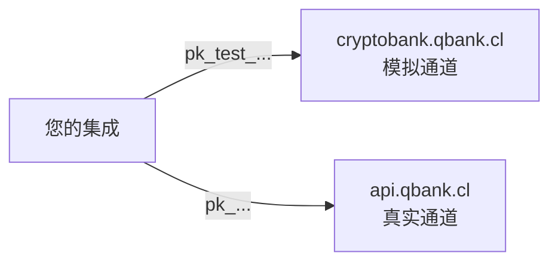

CBPay 运行在**两个环境**上：**test**（沙盒，模拟资金）和 **live**
（生产，真实资金）。两者完全隔离 —— URL 独立、API 密钥独立、数据独立
—— 并暴露完全相同的 API：基于 test 构建的集成只需更换 base URL 和
密钥即可在 live 运行。

| | Test（沙盒） | Live（生产） |
|---|---|---|
| Base URL | `https://cryptobank.qbank.cl/platform` | `https://api.qbank.cl/platform` |
| API 密钥 | `pk_test_...` | `pk_...` |
| 资金 | 模拟（不会发生任何真实转移） | **真实且不可逆** |
| 通道 | 内部模拟器 —— 始终可用、结果确定 | 真实银行通道 |
| 响应头 | `CBPay-Environment: test` | `CBPay-Environment: live` |

> **注**
密钥绝不跨环境：`pk_test_` 密钥会被 live 拒绝，live 的 `pk_` 密钥也会
被 test 拒绝。没有任何开关需要切换 —— 环境由您请求的地址决定。


## 测试环境的行为

测试环境**完全自包含**：所有通道（付款、收款、转账、加密货币、银行
账户、卡片、身份验证）均由内部模拟器提供服务，因此永远不依赖任何第三
方的可用性。操作以**确定性**方式解析：

- 您创建的任何操作都会被接受，并在几秒后（默认约 10 秒）达到
  `completed`，触发与 live 相同的 webhook。
- 特定的**魔法值**可以强制触发其他所有结果，让您无需猜测即可测试
  失败处理逻辑。

### 魔法值

| 产品 | 值 | 结果 |
|---|---|---|
| 付款（payouts） | 金额以 `.99` 结尾（如 `100.99`） | 延迟后失败（`failed`，余额退回） |
| 付款（payouts） | 金额以 `.77` 结尾 | 永远停留在 `processing`（测试您的超时处理） |
| 付款（payouts） | 收款人姓名包含 `REJECT` | 立即被拒绝 |
| QR 出金（玻利维亚与巴西/PIX） | 金额（或二维码的固定金额）以 `.99` 结尾 | 确认失败（`failed`，自动退款） |
| 巴西 QR 出金（PIX） | `qr_payload` 不是有效的 BR Code | 扫码返回 `400`（CRC/格式无效，与生产一致） |
| 收款（QR / 支付页面） | 金额以 `.99` 结尾 | 收款单过期且未支付 |
| 收款（QR / 支付页面） | 金额以 `.77` 结尾 | 永远停留在 `pending` |
| 收款（QR / 支付页面） | 其他任意金额 | 延迟后自动支付并入账您的余额 |
| 卡支付页面（`card`） | 金额以 `.99` 结尾 | 发卡行拒绝扣款（页面允许持卡人换卡重试） |
| 卡支付页面（`card`） | 金额以 `.77` 结尾 | 扣款发出后出现不明确失败 —— 会话进入人工复核（绝不自动重试） |
| 卡支付页面（`card`） | 金额以 `.55` 结尾 | 3-D Secure 认证触发挑战（页面内模拟 step-up） |
| 卡支付页面（`card`） | 金额以 `.44` 结尾 | 3-D Secure 认证未返回合格的 ECI —— 捕获前过滤器拒绝该尝试 |
| 卡支付页面（`card`） | 持卡人姓名包含 `REJECT` | 3-D Secure 认证失败 |
| Collect（主动扣款） | OTP `000000` | 批准扣款；其他任何 OTP 都会失败 |
| 登录 / 2FA 验证码 | `000000` | 在所有渠道（SMS、WhatsApp、邮件）均有效 —— 不会真正发送任何消息 |
| 身份验证（KYC/KYB） | 姓名或 external id 包含 `REJECT` | 验证以 `rejected` 结束 |
| 身份验证（KYC/KYB） | 姓名或 external id 包含 `HOLDREVIEW` | 风险等级返回 `medium` —— 灰色地带，自动判定引擎将其转入人工审核队列而非自动通过 |
| 身份验证（KYC/KYB） | 姓名或 external id 包含 `MANUALREVIEW` | 所有信号保持干净，但验证绝不会自行了结——保持 `pending_review`，直到自动判定引擎（或人工）做出决定。用于演练引擎的自动通过/拒绝路径 |
| 身份验证（KYC/KYB） | 其他任意值 | 延迟后自动通过（文件始终通过 OCR） |
| AML/CFT 筛查 | 姓名包含 `SANCTION` | 命中筛查，风险 `prohibited` |
| AML/CFT 筛查 | 姓名包含 `PEP` | 命中筛查，风险 `high` |
| 加密货币提现地址 | 以 `SANC` 结尾 | 被制裁闸门拦截 |
| 加密货币提现地址 | 以 `HIGH` / `MED` 结尾 | 评估为高 / 中风险 |
| 加密货币提现 | 任意地址（非魔法值） | 延迟后以 `SIMTX...` 交易 id 确认 |

> **提示**
测试环境中的加密货币**充值**通过控制台（或您的平台管理员）入账 ——
没有真实链可供转入。提现、余额、冻结与 webhook 的行为与 live 完全
一致。
### PIX 二维码示例（巴西 QR 出金）

测试环境的扫码与生产一致地校验 BR Code，因此需要**真实的** PIX
payload。可直接使用以下示例（或用任意静态 PIX 二维码生成器自行
生成）：

```text 固定金额 75.00 BRL（正常流程）
00020126360014br.gov.bcb.pix0114+5511998765432520400005303986540575.005802BR5913LOJA DA MARIA6009SAO PAULO62110507PED423163040BF9
```

```text 开放金额（在确认步骤由您指定金额）
00020126380014br.gov.bcb.pix0116loja@example.com5204000053039865802BR5913LOJA DA MARIA6009SAO PAULO62070503***63045EFE
```

```text 固定金额 80.99 BRL（确认失败 —— 魔法值 .99）
00020126360014br.gov.bcb.pix0114+5511998765432520400005303986540580.995802BR5913LOJA DA MARIA6009SAO PAULO62110507PEDFAIL63045211
```

### 与 live 的差异

- 任何真实的资金、卡片、邮件或短信都不会离开测试环境。
- **账户生而已验证**：每个新的测试账户都以 `kyc_status: approved`
  开始，因此您可以立即演练所有产品 —— 没有入驻闸门。在 live 中，
  账户生而未验证，必须先完成 KYC/KYB 才能转出资金。
- **账户生而带有数据**：每个新的测试账户都自带约 6 个月的真实感演示
  历史，覆盖所有产品（payouts、payins、转账、加密、兑换、卡片、
  banking、联系人……），余额、对账单和分析报表开箱即用 —— 您可以在
  创建任何操作之前就构建仪表盘和报表。
- 银行目录是虚构的（`Simulated National Bank` 等）。
- 汇率是真实的（与 live 同源），因此金额看起来真实。
- 测试数据与 live 完全独立：不从生产复制任何内容。请将测试数据视为
  可丢弃的。

## 从控制台使用测试模式

控制台的 **test/live 开关**一键切换您的会话所在环境 —— 无需单独注册，
也无需再次登录。如果您的账户尚不存在于 test，首次切换时会自动创建 ——
与所有测试账户一样，生而已验证并带有演示历史。
API 密钥按环境管理：在测试模式下创建您的 `pk_test_` 密钥。

## 在本地开发中测试 webhook

回调 URL 必须是**公网 HTTPS**：创建订阅时会拒绝 `localhost`、私有 IP
和 `.local` 域名。在本机开发时请使用 HTTPS 隧道：

```bash Cloudflare Tunnel（免费）
# 安装 cloudflared 并暴露本地端口
cloudflared tunnel --url http://localhost:3000
# → https://<random>.trycloudflare.com  ← 用作 callback_url
```

```bash ngrok
ngrok http 3000
# → https://<random>.ngrok-free.app  ← 用作 callback_url
```

然后使用该公网 URL 创建订阅（注意测试环境的 base URL）：

```bash
curl -X POST https://cryptobank.qbank.cl/platform/v1/webhooks/subscriptions \
  -H "X-API-Key: pk_test_..." \
  -H "Content-Type: application/json" \
  -d '{
    "event_type": "payin_credited",
    "callback_url": "https://your-tunnel.trycloudflare.com/webhooks/cbpay",
    "secret": "a-long-random-secret"
  }'
```

> **提示**
失败的投递最多重试 **5 次（递增退避）**，即使隧道中断几分钟也不会丢失
事件。请始终验证 HMAC 签名 —— 完整方法见
[webhooks](https://docs.cbpayapp.com/zh/webhooks#signature-verification)。
## 在测试环境演练每个流程

| 产品 | 测试方式 |
|---|---|
| 付款 | 使用任意收款人创建；几秒内完成。用魔法金额强制触发失败 |
| 收款 | 创建 QR 收款或支付页面；延迟后自动支付并入账余额 |
| 转账 | 创建第二个测试账户并在两者之间转账（免费） |
| 加密货币 | 从控制台入账测试充值，然后提现到任意地址 |
| 身份验证（KYC/KYB） | 您自己的账户生而已通过。要演练验证流程本身，请对第三方运行 KYC/KYB 验证 —— 几秒内自动通过（姓名包含 `REJECT` 可强制拒绝，包含 `HOLDREVIEW` 则转入人工审核队列，包含 `MANUALREVIEW` 则保持未决，交由自动判定引擎处理） |
| AML/CFT | 筛查 `John SANCTION` 和 `Maria PEP` 来演练命中处理 |
| 卡片 | 发行一张卡并从控制台模拟消费 |
| 2FA | 启用后在所有地方使用验证码 `000000` |

## 上线前检查清单

在将集成指向 live 环境之前：

- [ ] 将 base URL 换成 `https://api.qbank.cl/platform`，密钥换成您在 live 模式签发的 `pk_...`。
- [ ] API 密钥保存在密钥管理器中（绝不放在前端或代码仓库）。
- [ ] 每个资金操作都发送由您内部 id 派生的 `idempotency_key`（不是每次尝试随机生成的 UUID）。
- [ ] 遇到超时或 `5xx` 时**不要换新密钥重试**：使用相同密钥重试，或用 `GET` 查询状态。
- [ ] 验证每个 webhook 的 HMAC 签名并快速返回 `2xx`（异步处理）。
- [ ] 正确处理非终态（`pending`、`processing`），不要假设成功 —— live 的清算时间比模拟的 10 秒更长。
- [ ] 在 live 重新创建了 webhook 订阅（test 的订阅不会迁移）。
- [ ] 查询 `GET /v1/services` 只展示已启用的产品 —— 见[服务](https://docs.cbpayapp.com/zh/concepts/services)。
- [ ] 每天通过 `GET /v1/movements` 或[对账单](https://docs.cbpayapp.com/zh/guides/statement)对账。
- [ ] 与 CBPay 团队保持沟通渠道，处理 `unassigned` 充值或事故。

> **重要**
在 **live** 中，每个操作一旦完成即真实且不可逆。`completed` 的付款
已经到达收款人账户；唯一的冲正途径在 API 之外（联系 CBPay 团队）。
#### 测试模式收费吗？
    不收费。手续费从模拟余额中扣除，您可以在不花真钱的情况下演练完整
    的计费逻辑。
#### 可以在 test 使用 live 密钥（或反之）吗？
    不可以。每个环境只接受自己的密钥（test 用 `pk_test_`，live 用
    `pk_`）。另一个环境的密钥会返回 `401`。
#### 如何知道是哪个环境响应的？
    每个响应都带有 `CBPay-Environment` 头（`test` 或 `live`），
    `GET /healthz` 也返回 `livemode`。
#### 我测试账户里的演示历史是从哪来的？
    它在账户创建时生成：约 6 个月确定性、账务一致的演示操作，覆盖
    所有产品。它不是真实数据，也不是从生产复制的 —— 两个环境不共享
    任何内容。请将测试数据视为可丢弃的。
#### webhook 在 test 会触发吗？
    会 —— 完全相同的事件，使用您 test 订阅的密钥签名。请将其指向您的
    开发隧道。
