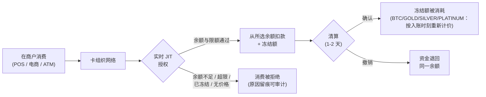

> **环境：** 测试 `https://cryptobank.qbank.cl/platform` (`pk_test_...`) - 正式 `https://api.qbank.cl/platform` (`pk_...`).

CBPay 卡片以 **Just-In-Time 方式直接从账户的中央余额消费**：无需预充值，也无需在余额之间搬动资金。每张卡选择其消费来源余额（`spending_asset`：**USD、USDT、USDC、BTC、GOLD、SILVER 或 PLATINUM**，默认为 USD）。USD、USDT 和 USDC 与美元 1:1；BTC 和 GOLD 则**按每个事件发生时刻的价格**换算。每笔消费都会实时针对该资产的可用余额及该卡自身的限额进行授权，扣款会立即出现在流水记录中。



## 您可以持有多少张卡

| 账户类型 | 虚拟卡 | 实体卡 | 可为第三方发卡？ |
|---|---|---|---|
| 个人 | **总计 1 张有效卡** | 新实体卡发行暂时不可用 | 否 |
| 企业 | **不限** | 新实体卡发行暂时不可用 | 可以：指定人员（如员工） |

每张卡都从**账户在其所配置资产中的中央余额**消费（`spending_asset`，默认 USD）。精细化控制通过按卡设置的消费限额实现（单笔、每日、每月），限额始终以**美元**计量，并可随时修改。

## 选择消费余额（USD、USDT、USDC、BTC、GOLD、SILVER 或 PLATINUM）

在创建卡片时设置 `spending_asset`，或之后通过 `PATCH` 修改。它只影响未来的消费：进行中的授权保持其原扣款资产（其撤销也会退回同一资产）。

```bash
curl -X PATCH https://api.qbank.cl/platform/v1/cards/{card_id} \
  -H "Authorization: Bearer <token>" \
  -H "Content-Type: application/json" \
  -d '{ "spending_asset": "BTC" }'
```

**USD、USDT 和 USDC** 均与美元 1:1，因此换算为精确的 1:1，无兑换费：一笔 25.00 USD 的消费会扣除所选资产的 25.000000。

**BTC 和 GOLD** 按每个事件发生时刻的有效价格换算（即您在 `GET /v1/rates` 的 `settlement` 区块中看到的同一结算价格）：

- **授权**：预留消费金额在您资产中的等值**加上一小笔缓冲额**（这不是收费：它用于覆盖到清算为止的价格波动，并在入账时退回）。如果该时刻无法获得执行价格，消费会被**拒绝**（`pricing_unavailable`）——绝不会用不可信的价格换算您的余额。
- **清算（入账）**：最终金额按入账时刻的价格重新换算；缓冲额的多余部分退回您的余额（若价格波动超出缓冲范围，则补扣差额）。
- **授权撤销**：退回**精确的**预留金额，不做任何换算。
- **入账后的退款与调整**：按事件发生时刻的价格重新换算。价格可能在消费与退款之间发生变动——您收到的是该时刻价格下您资产中的等值，而非原始数量。
- BTC/GOLD/SILVER/PLATINUM 消费与您账户的**波动性资产限额**共享（单笔操作及 24 小时交易量，可在 `GET /v1/settlement` 中查看）。

| 错误 / 拒绝 | 出现位置 | 原因 | 解决方案 |
|---|---|---|---|
| `spending_asset_unavailable` | PATCH 返回 400 / 消费被拒 | 该资产不存在或未启用消费 | 使用 `USD`、`USDT`、`USDC`、`BTC`、`GOLD`、`SILVER` 或 `PLATINUM` |
| `settlement_asset_disabled` | PATCH 返回 400 | 您的运营方已禁用该资产 | 检查 `GET /v1/settlement`（`enabled_assets`） |
| `pricing_unavailable` | 消费被拒（BTC/GOLD/SILVER/PLATINUM） | 授权时无法获得执行价格 | 重试该消费；若持续出现，切换到 USDT/USDC |
| `settlement_limit_exceeded` | 消费被拒（BTC/GOLD/SILVER/PLATINUM） | 该消费超过波动性资产的单笔操作限额 | 减小消费金额，或改用 USDT/USDC 消费 |
| `settlement_daily_limit_exceeded` | 消费被拒（BTC/GOLD/SILVER/PLATINUM） | 账户已达到 24 小时波动性资产交易量上限 | 等待，或改用 USDT/USDC 消费 |

> **注**
若所选资产的余额不足，消费会以 `insufficient_funds` 被拒绝——不会自动回退到其他余额。
> **重要**
使用 BTC/GOLD/SILVER/PLATINUM 时，您的余额在一笔消费的各事件之间（授权、入账、退款）会暴露于价格波动。每次换算都使用其时刻的有效价格——CBPay 绝不会向后重新计价，也不会"以防万一"多扣：授权缓冲额始终在清算时退回。
## 费用（由您的运营方配置，可以为 0）

| 服务 | 计费时机 |
|---|---|
| `card_creation_virtual` | 发行虚拟卡时 |
| `card_creation_physical` | 发行实体卡时 |
| `card_purchase_virtual` | **每笔虚拟卡消费**（按消费美元金额计 percent + 固定额） |
| `card_purchase_physical` | **每笔实体卡消费**（按消费美元金额计 percent + 固定额） |
| `card_monthly` | 每张有效卡的月费（余额不足时卡片会被冻结——不产生欠款） |
| `card_cancellation` | 注销卡片时 |

具体金额见 `GET /v1/rates`（`fees` 字段）。若发卡失败，所有发卡费用都会**自动退款**。

### 按笔消费手续费（生命周期）

按笔手续费与消费走同一生命周期：

- **授权**：预估手续费与消费金额一起计入**预授权冻结**，币种为卡片的
  `spending_asset`（百分比按消费的美元金额计算；BTC/GOLD/SILVER/PLATINUM 按该事件同一
  价格折算）。
- **清算**：按当时生效的配置**重新计算**手续费并收取最终值
  （流水中的 `card_fee`）；与预估值的差额随保证金调整一并释放或补收。
- **撤销与下调调整**：按退款比例**退回**手续费（`card_fee_refund`）。

若运营商在授权与清算之间调整了费率，将按清算时的费率收取——与
BTC/GOLD/SILVER/PLATINUM 按事件计价的规则一致。被拒消费（`declined`）**不收费**。

## 创建卡片

流程取决于您的账户是**个人**还是**企业**——请选择对应的标签页。共同规则：**持卡人每个账户只验证一次**，即首次发卡时验证；后续发卡直接复用，无需数据。`idempotency_key` 始终必填（使用相同 key 的重试会返回原始卡片，绝不会重复扣费）。

> **重要**
新实体卡发行暂时不可用。请求中使用 `physical: true` 会返回 `400 physical_temporarily_unavailable`；该限制在幂等重放之后检查，因此已存在的实体卡请求仍会返回原始卡片。已经发行的实体卡继续正常使用。
#### 个人账户

个人账户**为自己**发卡（最多 1 张有效卡；新实体卡发行暂时不可用）。

**您的第一张卡**会在发卡方创建并验证您的持卡人。由于您的账户已通过[身份验证](https://docs.cbpayapp.com/zh/guides/kyc)，您的数据和证件会**从验证中自动填充**——您只需补充发卡方专属字段（`occupation`、`salary_usd`）；任何显式提供的字段都优先于自动填充：

```bash
curl -X POST https://api.qbank.cl/platform/v1/cards \
  -H "Authorization: Bearer <token>" \
  -H "Content-Type: application/json" \
  -d '{
    "physical": false,
    "idempotency_key": "card-v-1",
    "cardholder": {
      "occupation": "52201",
      "place_of_work": "Andina SpA",
      "salary_usd": 1800
    }
  }'
```

`occupation` 是**目录代码**（[见下文](#occupation-and-business-activity-catalog-codes)），`salary_usd` 为美元整数。如果您的验证是通过向导完成的，而缺少发卡方要求的某些数据或证件，请在 `cardholder` 中显式补充（`first_name`、`email`、`address`、`id_front_url`…，格式与往常相同）。

**第二次发卡请求**：个人账户一旦已有一张有效卡或一条开放申请，就不能再申请，返回 `409 card_limit_reached`：

```bash
curl -X POST https://api.qbank.cl/platform/v1/cards \
  -H "Authorization: Bearer <token>" \
  -H "Content-Type: application/json" \
  -d '{ "physical": false, "idempotency_key": "card-v-2" }'
```

实体卡请求即使账户没有卡，也会返回 `400 physical_temporarily_unavailable`。请改为申请虚拟卡。

#### 企业账户

企业账户可发行**不限数量的卡片**，有两种模式：

**A. 为企业自身发卡**（公司卡）。首次发卡会用公司数据创建企业持卡人；之后的发卡无需任何数据：

```bash First card (creates the company holder)
curl -X POST https://api.qbank.cl/platform/v1/cards \
  -H "Authorization: Bearer <token>" \
  -H "Content-Type: application/json" \
  -d '{
    "physical": false,
    "idempotency_key": "card-corp-1",
    "cardholder": {
      "kind_of_business": "J63",
      "legal_representation": "Carlos Soto, General Manager",
      "email": "finance@andina.cl",
      "certificate_of_good_standing_url": "https://files.example.com/kyb/standing.pdf",
      "business_license_url": "https://files.example.com/kyb/license.pdf",
      "register_shareholder_url": "https://files.example.com/kyb/shareholders.pdf",
      "id_shareholders_url": "https://files.example.com/kyb/shareholder-ids.pdf",
      "address_verification_shareholders_url": "https://files.example.com/kyb/addresses.pdf",
      "address": {
        "line1": "Av. Apoquindo 4500",
        "city": "Santiago",
        "region": "RM",
        "postal_code": "7550000",
        "country": "CL"
      }
    }
  }'
```

```bash Subsequent cards (no data, with limits)
curl -X POST https://api.qbank.cl/platform/v1/cards \
  -H "Authorization: Bearer <token>" \
  -H "Content-Type: application/json" \
  -d '{
    "physical": false,
    "idempotency_key": "card-f-ops-1",
    "limits": { "per_transaction": "500.00", "monthly": "5000.00" }
  }'
```

**B. 为指定人员发卡**（例如员工）：添加 `cardholder.kind: "person"`，并附上该人员[**已批准** KYC](https://docs.cbpayapp.com/zh/guides/kyc) 的 `verification_id`——其身份和证件来自该验证；您只需补充发卡方字段：

```bash
curl -X POST https://api.qbank.cl/platform/v1/cards \
  -H "Authorization: Bearer <token>" \
  -H "Content-Type: application/json" \
  -d '{
    "physical": false,
    "idempotency_key": "card-emp-77",
    "limits": { "monthly": "1500.00" },
    "cardholder": {
      "kind": "person",
      "verification_id": "c3d4e5f6-a7b8-4c9d-0e1f-2a3b4c5d6e7f",
      "occupation": "52201",
      "place_of_work": "Andina SpA",
      "pep": false,
      "salary_usd": 1800
    }
  }'
```

- 未提供 `verification_id`（或验证未获批准）：`422 verification_required` / `422 verification_not_approved`。验证必须是 KYC（个人）；KYB 会返回 `422 verification_kind_mismatch`。
- 显式提供的 `cardholder` 字段优先于自动填充（当发卡方要求验证中没有的某份证件时很有用）。
- 响应中包含 `cardholder_kind: "person"` 以及所使用的
  `verification_id`。

## 卡面印刷姓名

请求中的卡面印刷姓名是可选的。当已批准资料中的法定姓名超过发卡方
22 字节的打印限制，或您需要较短的显示姓名时，请发送
`cardholder.first_name` 和 `cardholder.last_name`。如果省略其中一个字段，
系统会在自动填充阶段使用已批准的 KYC/KYB 资料。显式字段始终优先于资料
中的值。

系统会先去除两侧空格，再计算两个字段合计的 UTF-8 字节数。合计超过
22 时，API 会在创建 hold 或收取费用**之前**返回
`422 cardholder_name_too_long`。这是字节限制，不是 Unicode 字符数限制。

```bash
curl -X POST https://api.qbank.cl/platform/v1/cards \
  -H "Authorization: Bearer <token>" \
  -H "Content-Type: application/json" \
  -d '{
    "physical": false,
    "idempotency_key": "card-print-name-1",
    "cardholder": {
      "first_name": "Ana",
      "last_name": "Rojas"
    }
  }'
```

响应会在 `cardholder_name` 中返回最终采用的姓名：

```json
{
  "card_id": "3c2b1a09-8d7e-6f5a-4b3c-2d1e0f9a8b7c",
  "cardholder_kind": "account",
  "cardholder_name": "Ana Rojas",
  "status": "active"
}
```

## 发卡方字段与 AML/CFT 派生的 PEP

首次发行会在发卡方创建持卡人。平台会在**收取发卡费用或创建
hold 之前**校验发卡方字段。复用已有账户持卡人时，不会再次要求这些字段。

| 持卡人 | 创建时必填 | 值如何解析 |
|---|---|---|
| 个人账户持卡人 | `occupation`、`place_of_work`、`salary_usd`、`email` | `occupation` 必须是目录代码；`place_of_work` 不能为空；`salary_usd` 必须非负；`first_name`/`last_name` 默认从已批准验证中补齐，除非显式提供，组装后不能为空；`email` 必须包含 `@` |
| 企业账户持卡人 | `kind_of_business`、`registered_name`、`email` | `kind_of_business` 必须是目录代码；`registered_name` 与 `email` 按 request、账户 display name 或 KYB 法定名称补齐，email 再以账户 email 兜底；必须包含 `@` |
| 指定人员 | `occupation`、`place_of_work`、`salary_usd`、`email`、`pep` | 目录代码，姓名来自已批准 KYC 或显式值（组装后不能为空），含 `@` 的 email 和显式布尔值 `pep`；指定人员没有账户 screening |

对于账户持卡人，受支持的 PEP 来源是账户 AML/CFT 身份验证的 screening。
screening gate 是强制的：显式 `pep: true` **不能**绕过
`422 screening_required`；screening 存在后，发送给发卡方的值是 request
布尔值与 screening 结果的保守 OR，因此 request 的 `false` 不会覆盖
screening 的 `true`。审核清单显示 **`Politically exposed person (screening)`**。

如果 request 没有提供，企业的联系人和法定代表会从 KYB 的 UBO
自动补齐。企业文件 URL 会按以下顺序从 KYB expediente 使用 fallback：

| 发卡方字段 | KYB fallback 顺序 |
|---|---|
| `certificate_of_good_standing_url` | `certificateOfGoodStanding`，然后 `legalPresence` |
| `register_shareholder_url` | `registerShareholder`、`ownershipStructure`，然后 `controlStructure` |
| `id_shareholders_url` | `idShareholders`、`uboIdentity`、`identity`、`ownershipStructure`，然后 `controlStructure` |
| `address_verification_shareholders_url` | `addressVerificationShareholders`、`uboProofOfAddress`，然后 `proofOfAddress` |

`business_license_url` 没有 fallback。如果组装后的持卡人仍缺少发卡方
要求的数据，API 返回 HTTP `422` 及缺失键，并且不会调用发卡方：

```json
{
  "error": "issuer_data_incomplete",
  "message": "missing issuer data: place_of_work"
}
```

### 目录

请使用实时目录，不要手写 label 或自行发明代码：

```bash
curl "https://api.qbank.cl/platform/v1/cards/catalog/occupations?q=director" \
  -H "Authorization: Bearer <token>"

curl "https://api.qbank.cl/platform/v1/cards/catalog/business-activities?q=software" \
  -H "Authorization: Bearer <token>"
```

每个响应的结构为
`{"items":[{"code":"...","label":"..."}],"meta":{"retrieved":"..."}}`。
在 `occupation` 或 `kind_of_business` 中发送 `items[].code`；如
`"Engineer"` 这样的 label 不是有效代码。防火墙审核清单使用同一套
代码校验：值即使存在，不在目录中也会显示 `ok: false`。

#### 如果账户还没有 AML/CFT screening，会怎样？
系统无法派生持卡人的 PEP。完成已批准的 AML/CFT 身份验证后，用同一个卡片
request 重试；不要猜测 PEP 值。
#### 指定人员如何提供 PEP？
指定人员不是账户持卡人，因此 request 必须包含显式布尔值
`cardholder.pep`，没有默认值。
### 可用性与发卡错误

| HTTP | 代码 | 含义与解决方案 |
|---|---|---|
| 400 | `physical_temporarily_unavailable` | 新实体卡发行暂时暂停。请申请虚拟卡；已发行的实体卡继续正常使用。 |
| 409 | `card_limit_reached` | 个人账户已有一张有效卡或一条开放申请。请先取消或处理现有申请。 |
| 422 | `issuer_data_incomplete` | request、验证自动填充和 KYB 派生数据组装后仍缺少或存在无效的发卡方字段。根据 `message` 中列出的键修正后重试。 |
| 422 | `screening_required` | 账户没有可用于派生持卡人 PEP 的 AML/CFT 身份验证 screening。完成 screening 后用同一个 request 重试。 |

### 职业与经营活动（目录代码）

指定**个人**时，`occupation` 必须是官方目录中的**代码**（不是自由文本）；指定**企业**时，`kind_of_business` 同样如此。可以查询（支持用 `?q=` 搜索）：

```bash
# Occupations (persons)
curl "https://api.qbank.cl/platform/v1/cards/catalog/occupations?q=director" \
  -H "Authorization: Bearer <token>"

# Business activities (companies)
curl "https://api.qbank.cl/platform/v1/cards/catalog/business-activities?q=software" \
  -H "Authorization: Bearer <token>"
```

每一项为 `{ "code": "...", "label": "..." }`。在 `occupation` / `kind_of_business` 中使用其 `code`。目录之外的值在到达发卡方之前就会返回 `400 invalid_occupation` 或 `400 invalid_kind_of_business`。`salary_usd` 以**美元**计（整数）。

## 实体卡：激活

实体卡初始状态为 `pending_activation`，出于安全考虑在运输途中处于**未激活**状态。持卡人拿到卡后：

```bash
curl -X POST https://api.qbank.cl/platform/v1/cards/{card_id}/activate \
  -H "Authorization: Bearer <token>"
```

## 显示 PAN 与 CVV（敏感数据）

只有**持有该卡的账户**可以显示它们（组织管理员永远不行）。响应为一次性：展示给持卡人后即丢弃。

```bash
curl -X POST https://api.qbank.cl/platform/v1/cards/{card_id}/reveal \
  -H "Authorization: Bearer <token>"
```

```json
{
  "card_id": "3c2b1a09-8d7e-6f5a-4b3c-2d1e0f9a8b7c",
  "pan": "5339880000001234",
  "cvv": "123",
  "exp_date": "202907",
  "note": "sensitive data: display once, never store"
}
```

> **重要**
**切勿存储或记录 PAN/CVV。** CBPay 同样不做持久化：响应直接来自发卡方（PCI 标准）。
## 限额与冻结/解冻

```bash Update limits
curl -X PATCH https://api.qbank.cl/platform/v1/cards/{card_id} \
  -H "Authorization: Bearer <token>" \
  -H "Content-Type: application/json" \
  -d '{ "limits": { "per_transaction": "200.00", "daily": "0" } }'
```

`"0"` 表示移除某项限额。要冻结（立即拒绝所有消费）：

```bash Freeze
curl -X PATCH https://api.qbank.cl/platform/v1/cards/{card_id} \
  -H "Authorization: Bearer <token>" \
  -H "Content-Type: application/json" \
  -d '{ "frozen": true }'
```

## 交易及其生命周期

```bash
curl "https://api.qbank.cl/platform/v1/cards/{card_id}/transactions?from=2026-07-01&to=2026-07-08&page=1&page_size=50" \
  -H "Authorization: Bearer <token>"
```

```json
{
  "page": 1,
  "page_size": 50,
  "transactions": [
    {
      "transaction_id": "7a1b2c3d-4e5f-6071-8293-a4b5c6d7e8f9",
      "card_id": "3c2b1a09-8d7e-6f5a-4b3c-2d1e0f9a8b7c",
      "kind": "purchase",
      "merchant": "MERPAGO*SUPERMERCADO",
      "mcc": "5411",
      "amount_usd": "25.00",
      "amount_usdt": "25.000000",
      "spend_asset": "USDC",
      "spend_amount": "25.000000",
      "fee_asset": "USDC",
      "fee_amount": "0.300000",
      "status": "settled",
      "decline_reason": "",
      "auth_number": "123456",
      "created_at": "2026-07-09T15:04:05Z",
      "updated_at": "2026-07-10T09:00:00Z"
    }
  ]
}
```

`spend_asset` / `spend_amount` 显示这笔消费实际从哪个余额扣款，以及在该资产中扣了多少（`amount_usd` / `amount_usdt` 仍为美元参考值）。对于 BTC/GOLD/SILVER/PLATINUM，已授权交易的 `spend_amount` 包含预留缓冲额；清算后显示最终金额。

`fee_asset` / `fee_amount` 为按笔消费手续费的币种与金额（`settled` 后为最终值；`authorized` 状态时为预估值）。`fee_refunded_amount` 在撤销或下调调整产生退款后出现。若运营商未配置按笔手续费，交易中**不会包含** `fee_*` 字段——保持历史行为不变。

| 状态 | 含义 |
|---|---|
| `authorized` | 已实时批准：金额已从所选余额的可用额中扣除并置于冻结额中 |
| `settled` | 在卡组织清算时确认（冻结额被消耗；BTC/GOLD/SILVER/PLATINUM 按入账时刻重新计价） |
| `reversed` | 已撤销：资金退回同一余额（未清算则退回精确金额；已清算则按当时价格重新换算） |
| `declined` | 已拒绝，附带原因：`insufficient_funds`、`card_limit_exceeded`、`card_frozen`、`account_blocked`、`spending_asset_unavailable`、`spending_asset_disabled`、`pricing_unavailable`、`settlement_limit_exceeded`、`settlement_daily_limit_exceeded` |

如果清算金额与授权金额不同（小费、商户换汇），调整会自动应用：为正则补扣差额，为负则退回差额。

## 注销卡片

不可逆。若已配置，会计收 `card_cancellation` 费用。

```bash
curl -X POST https://api.qbank.cl/platform/v1/cards/{card_id}/cancel \
  -H "Authorization: Bearer <token>"
```

## Webhooks

| 事件 | 触发时机 |
|---|---|
| `card_transaction` | 某笔消费被授权、撤销或调整 |
| `card_status_changed` | 卡片状态发生变化（包括因月费未付而自动冻结） |

订阅方式与其他事件相同（参见 [Webhooks](https://docs.cbpayapp.com/zh/webhooks)）。

## 常见问题

#### 我需要给卡片预充值吗？
不需要。卡片自身不持有余额：每笔消费都实时针对账户余额（该卡的消费资产）进行授权。只要余额足够且消费符合限额，就会被批准。
#### 如果我公司的多张卡同时消费会怎样？
它们都从账户的中央余额消费。每次授权都以原子方式扣款：无论多少张卡并行操作，消费总额都不可能超过该资产的可用余额。
#### 消费以什么货币扣款？
消费以美元处理，并从卡片配置的余额（`spending_asset`）扣款。USD、USDT 和 USDC 与美元 1:1，无兑换费；BTC 和 GOLD 按每个事件发生时刻的有效价格换算（与 `GET /v1/rates` 的 `settlement` 区块中的价格相同）。
#### 不同的卡可以从不同的余额消费吗？
可以：`spending_asset` 是按卡设置的。例如，一家企业可以让公司卡消费 USDT、员工卡消费 USDC、个人卡消费 BTC。通过 `PATCH` 修改只对未来的消费生效。
#### BTC/GOLD/SILVER/PLATINUM 消费中我看到的预留缓冲额是什么？
卡组织清算在授权后 1-2 天到达，期间 BTC/黄金价格可能波动。因此授权时会预留消费等值金额外加一个小的百分比。这不是收费：清算时，消费按当时的价格重新换算，多预留的部分会自动退回您的余额。
#### 如果消费时 BTC/黄金价格不可用会怎样？
该消费会被拒绝（`pricing_unavailable`）——CBPay 绝不会用不可信的价格换算您的余额。这是暂时性状况（价格源降级）：几分钟后重试，或将卡片切换到 USDT/USDC。无法被拒绝的事件（已批准消费的清算、退款）永远不会被阻塞：它们会按最后已知价格加上审慎溢价处理，并在流水中留痕可审计。
#### 我的一笔 BTC 消费被退款了——为什么收到的数量不一样？
退款按退款时刻的价格换算，而非消费时刻的价格：您收到的是退款美元金额在您资产中的等值。如果 BTC 自消费以来上涨，您收到的 BTC 会更少（美元价值相同）；如果下跌，则更多。您的 BTC/GOLD/SILVER/PLATINUM 余额始终暴露于价格波动——这是用波动性资产消费的本质。
#### 为什么我的消费手续费在授权与清算之间发生了变化？
授权时在冻结额中预留的是预估手续费；清算时按当时生效的配置重新计算——若运营商在两个事件之间调整了费率，则按清算时的费率收取。与预估值的差额随消费调整一并释放或补收，不会产生单独的手续费流水。
#### 如果月费扣款时没有余额会怎样？
卡片会被自动冻结（`card_status_changed` 事件，`reason: monthly_fee_unpaid`）。不会产生欠款；余额补足后，用 `PATCH { "frozen": false }` 解冻即可。
#### 我可以为公司以外的人发卡吗？
企业账户可以为任何指定人员发卡。该人员必须拥有[已批准的 KYC 验证](https://docs.cbpayapp.com/zh/guides/kyc)——您在 `cardholder` 中传入其 `verification_id`，其数据和证件会自动填充。卡片始终从发卡企业账户的余额消费。
## 卡片列表、汇总与组织交易流

`GET /v1/cards` 同时支持账户凭证（仅查看自己的卡片）和组织管理员
（需要 `ops:read`）。组织管理员可以添加 `account_id` 缩小范围。
bank-partner 凭证不能使用 `/v1/cards`；该角色不会显示卡片管理区。

列表支持 `page`（默认 `1`）、`page_size`（默认 `50`，最大 `200`）以及：

| 筛选项 | 行为 |
|---|---|
| `q` | 搜索账户邮箱/显示名称、持卡人姓名、卡片 ID 和账户 ID |
| `physical` | 只能是 `true` 或 `false`；其他值返回 `400 invalid_filter` |
| `cardholder_kind` | `account`、`person` 或卡片实际使用的值 |
| `spending_asset` | 规范账本资产，例如 `USD`、`USDT`、`USDC`、`BTC`、`GOLD`、`SILVER` 或 `PLATINUM`；不支持的值返回 `400 invalid_filter` |
| `from`、`to` | 可选 `YYYY-MM-DD` 日期范围；格式错误返回 `400 invalid_range` |

响应包含 `total`，增强读取还可能包含 `account_display_name`、
`account_email`、`last_txn_at` 和 `billed_through`：

```bash
curl "https://api.qbank.cl/platform/v1/cards?q=finance&physical=false&spending_asset=USDT&from=2026-10-01&to=2026-10-25&page=1&page_size=50" \
  -H "Authorization: Bearer <token>"
```

```json
{
  "page": 1,
  "page_size": 50,
  "total": 1,
  "cards": [{
    "card_id": "6c1f0000-0000-4000-8000-000000000001",
    "account_id": "9b1d0000-0000-4000-8000-000000000001",
    "account_display_name": "Andina SpA",
    "account_email": "finance@example.com",
    "physical": false,
    "cardholder_kind": "account",
    "status": "active",
    "spending_asset": "USDT",
    "last_txn_at": "2026-10-24T15:04:05Z",
    "billed_through": "2026-10"
  }]
}
```

组织管理员可以调用 `GET /v1/cards/summary?account_id=...`。它只返回
不含 PII 的汇总：`total`、`by_status`、`new_30d`、`spend_24h_usdt`、
`spend_30d_usdt` 和 `declined_24h`。

```bash
curl "https://api.qbank.cl/platform/v1/cards/summary?account_id=9b1d0000-0000-4000-8000-000000000001" \
  -H "Authorization: Bearer <admin-token>"
```

```json
{
  "total": 12,
  "by_status": {"active": 10, "frozen": 2},
  "new_30d": 3,
  "spend_24h_usdt": "1250.000000",
  "spend_30d_usdt": "18400.000000",
  "declined_24h": 4
}
```

`GET /v1/cards/transactions` 是组织级交易流（账户凭证只看到自己的
账户）。它支持 `card_id`（UUID）、`account_id`、`status`、`merchant`、
`mcc`、`from`、`to`、`page` 和 `page_size`。格式错误的 `card_id` 返回
`400 invalid_filter`。每个项目还可能包含 `cardholder_name`、
`card_status`、`account_display_name` 和 `account_email`。

```bash
curl "https://api.qbank.cl/platform/v1/cards/transactions?status=settled&merchant=market&mcc=5411&from=2026-10-01&to=2026-10-25&page=1&page_size=50" \
  -H "Authorization: Bearer <token>"
```

```json
{
  "page": 1,
  "page_size": 50,
  "total": 1,
  "transactions": [{
    "transaction_id": "7a1b0000-0000-4000-8000-000000000001",
    "card_id": "6c1f0000-0000-4000-8000-000000000001",
    "account_id": "9b1d0000-0000-4000-8000-000000000001",
    "account_display_name": "Andina SpA",
    "account_email": "finance@example.com",
    "cardholder_name": "Operations",
    "card_status": "active",
    "merchant": "MARKET",
    "mcc": "5411",
    "status": "settled",
    "amount_usd": "25.00",
    "amount_usdt": "25.000000",
    "created_at": "2026-10-24T15:04:05Z"
  }]
}
```

`GET /v1/cards/{card_id}` 增加 `spent_daily` 和 `spent_monthly`。它们按
JIT 执行使用的相同 UTC 时间窗口计算实际已授权和已清算金额（UTC
午夜及当前 UTC 月第一天）；拒绝和冲正交易不计入。

#### 账户可以查看其他账户的卡片吗？
不可以。账户凭证只能访问自己的账户。组织管理员需要 `ops:read`，
并可用 `account_id` 缩小组织范围。
#### 汇总会暴露客户信息吗？
不会。汇总只包含计数和金额。卡片和交易流中的账户上下文取决于调用者范围。
#### 筛选项或日期无效时会怎样？
无效的 `physical`、`spending_asset` 或 `card_id` 返回
`400 invalid_filter`；无效的 `from`/`to` 日期返回 `400 invalid_range`。
API 不会静默忽略筛选项。
## USD 作为主账本资产

账户的 `settlement_asset` 与 `payin_settlement_asset` 默认值为 `USD`，可随时用
`PUT /v1/settlement` 更改；进行中的操作不会重新报价。

USD 账本金额使用美分（两位小数）。直接入账、扣账、费用以及支持 USD
资产字段的 payout、checkout、POS 和卡片流程使用 USD。USD 与 USDT 之间
的 swap 按 1:1 计价，不使用 FX 预言机。BOB、MXN、ARS 仍是独立的法币
账本资产；v1 中这些资产的 money-out 定价仍不可用。

USD 主账户的 payin 直接入账时，响应包含 `credit_asset: USD` 以及以美分
表示的 fiat 入账金额；`usdt_credited` 仍用于 USD 等值报表。争议 hold
跟随实际入账资产：USD 入账使用 `hold_asset: USD`。`disputed` 与 `held` 使用 hold 资产的单位；
`disputed_usdt` 与 `held_usdt` 是归一化后的等值字段。
