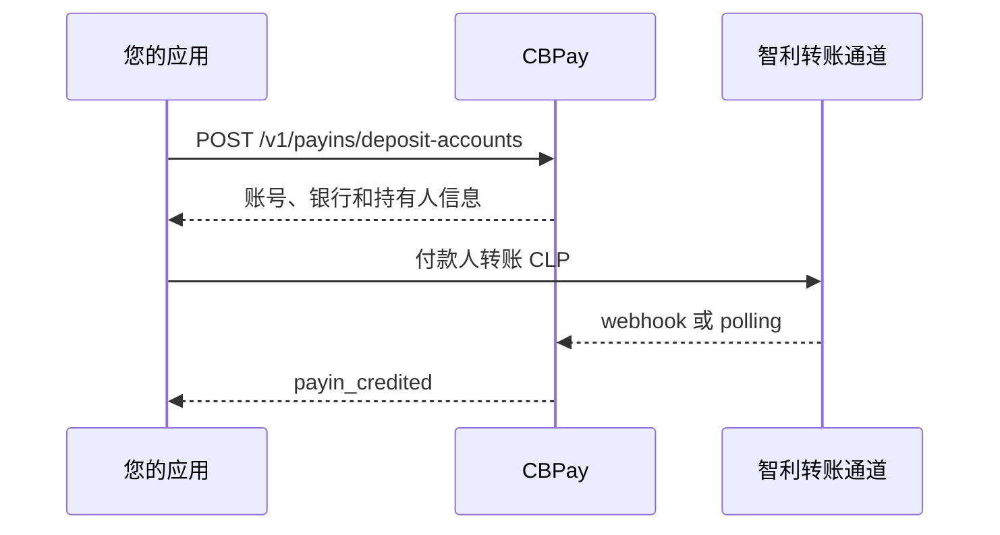

> **环境：** 测试 `https://cryptobank.qbank.cl/platform` (`pk_test_...`) - 正式 `https://api.qbank.cl/platform` (`pk_...`).

本指南介绍智利比索（CLP）的 `fintoc` 方法。它面向集成方，不暴露
上游服务商身份：平台返回虚拟收款账户，并使用标准 payout 合约。本功能
不会改变现有的 `CL/CLP/bank_transfer` 通道。

> **重要**
CLP 没有小数单位。请发送正整数比索，例如 `"150000"`；`"150000.50"`
会返回 `400 invalid_amount`。
## Fondeo 与 Banking 槽位

同一个 `CL/CLP/fintoc` 走廊支持两种用途，响应结构不变
（`purpose`、`label`、派生 `balance` 和流水）：

- `purpose: "fondeo"`（默认）将 CLP 入账转换到主余额。
- `purpose: "banking"` 接收、保留并展示该工具的派生 CLP 余额。不发起
  payout：CL payout 始终从 root 账户发送，也不设置物理 sweep-exempt 标记。

企业可为每个额外 fondeo 或 Banking 账户使用不同幂等键；每个企业/走廊的
Banking 上限为 50 个工具。个人账户可在此走廊创建第二个 Banking 虚拟槽位。
重复使用同一幂等键会返回原账户。

## 在虚拟账户接收 CLP



先读取目录：

```bash
curl "https://api.qbank.cl/platform/v1/payins/methods?country=CL" \
  -H "Authorization: Bearer <token>"
```

KYC/KYB 批准后会自动创建账户。企业管理员也可以使用同一接口补建：

```bash
curl -X POST "https://api.qbank.cl/platform/v1/payins/deposit-accounts" \
  -H "Authorization: Bearer <token>" \
  -H "Idempotency-Key: cl-fintoc-account-001" \
  -H "Content-Type: application/json" \
  -d '{"country":"CL","currency":"CLP","method":"fintoc","idempotency_key":"cl-fintoc-account-001"}'
```

`201` 示例：

```json
{
  "country": "CL",
  "currency": "CLP",
  "account_number": "123456789",
  "account_id": "acc_7f3a",
  "instrument_id": "4f81c2d0-1111-2222-3333-444455556666",
  "status": "active",
  "bank_code": "0012",
  "bank_name": "BancoEstado",
  "account_currency": "CLP",
  "holder_name": "CBPay Operations SpA",
  "holder_tax_id": "76543210-8",
  "holder_account_type": "checking"
}
```

请原样展示账号、银行、持有人姓名、RUT 和账户类型。平台按虚拟账号
匹配入账；webhook 是首选，polling 是幂等后备。使用 `payin_credited`
后，再用带有 `from`/`to` 和分页的 payins 列表读取权威记录。
持有人是拥有创建该专用账户所用 CPF 的公司，而不是付款人或最终用户。

## 发送 CLP payout

```bash
curl "https://api.qbank.cl/platform/v1/payouts/methods?country=CL" -H "Authorization: Bearer <token>"
curl "https://api.qbank.cl/platform/v1/payouts/banks?country=CL&method=fintoc" -H "Authorization: Bearer <token>"
```

`bank_code` 可以是目录中的 SBIF 数字代码（例如 `"0012"`），也可以是
已路由的钱包代码（例如 `"cl_mach"`）。账号必须只包含数字；账户类型为
`checking`（活期）或 `sight`（视同活期/即期）。

```bash
curl -X POST "https://api.qbank.cl/platform/v1/payouts" \
  -H "Authorization: Bearer <token>" \
  -H "Idempotency-Key: cl-payout-8841" \
  -H "Content-Type: application/json" \
  -d '{"country":"CL","currency":"CLP","method":"fintoc","amount":"150000","beneficiary":{"name":"María López","tax_id":"11111111-1","bank_code":"0012","account_number":"12345678","account_type":"checking"},"idempotency_key":"cl-payout-8841"}'
```

响应为 `202`，初始状态为 `processing`。查询 payout 或监听
`payout_status_changed`。`partially_succeeded` 仍是 processing，并返回
已结算金额和剩余金额；审核后只为剩余金额创建新 payout。
`reversed`、`returned`、`failed` 和 `rejected` 是失败结果。超时后不要
用新 key 重发；请使用相同 key 查询原操作。

## 状态、错误和 FAQ

| 状态/错误 | 含义和操作 |
|---|---|
| `pending` / `processing` | 等待对账，查询同一资源。 |
| `completed` | 最终成功。 |
| `partially_succeeded` | 部分结算，检查 `status_message` 后只处理余额。 |
| `failed`、`rejected`、`reversed` | 最终失败，检查 `status_code`。 |
| `400 invalid_amount` | 发送正整数 CLP。 |
| `422 invalid_beneficiary` | 检查 RUT、数字账号、目录银行和账户类型。 |
| `502 provider_ambiguous` | 不要使用新 key；查询原 payout。 |

现有的 `fintoc` checkout 会返回托管 `payment_url`，而 Business Accounts
会返回可重复使用的账号；两者不是同一流程。Webhook 必须验证签名并按
delivery ID 去重。

#### 这是同一个 fintoc checkout 吗？
    不是。checkout 返回托管 `payment_url`；Business Accounts 返回可重复
    使用的账号，并按账号匹配入账。
#### 超时后可以重试吗？
    不要使用新的幂等键重新发送。请使用相同 key 查询原操作并等待对账。
#### 为什么专用账户的持有人不是我？
    专用 CLP 账户号码签发给拥有创建账户所用 CPF 的公司。付款人或最终
    用户不是账户持有人；请原样显示 CBPay 返回的持有人字段。
参阅 [webhooks](https://docs.cbpayapp.com/zh/webhooks)、[errors](https://docs.cbpayapp.com/zh/errors) 和
[幂等性](https://docs.cbpayapp.com/zh/concepts/idempotency)。
