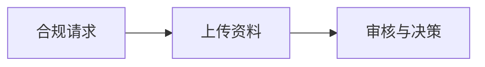

> **环境：** 测试 `https://cryptobank.qbank.cl/platform` (`pk_test_...`) - 正式 `https://api.qbank.cl/platform` (`pk_...`).


## A+B 交付：合同签署与资料补交

本节是门户和 API 的实现契约。示例使用公开平台路由，响应字段是 handler
规范化后的字段。

### 行内补交：验证邮箱、添加号码并解锁

新绑定且未验证的手机号会进入**四小时冷却期**。门户必须显示合规 CTA，
并允许使用独立因素：已验证邮箱或 TOTP。发送到新号码的代码不能解除此
保护。

```bash
curl -X POST https://api.qbank.cl/platform/v1/otp/challenges \
  -H "Authorization: Bearer <CBPAY_TOKEN>" -H "Content-Type: application/json" \
  -d '{"action":"phone_change","channel":"email"}'

curl -X POST https://api.qbank.cl/platform/v1/me/phone/unlock-cooldown \
  -H "Authorization: Bearer <CBPAY_TOKEN>" \
  -H "X-OTP-Token: <VERIFIED_PHONE_CHANGE_TOKEN>"
```

成功响应为 `{"status":"unlocked","channel":"email"}`；没有冷却时为
`{"status":"not_locked"}`。缺失或已用代码返回 `401 invalid_otp`；电话
因素返回 `403 independent_factor_required`。没有独立因素时等待四小时，
结果可通过 `GET /v1/me` 查看。

组织管理员可以只清除标记，不改变号码或 `phone_verified`：

```bash
curl -X POST https://api.qbank.cl/platform/v1/accounts/<ACCOUNT_ID>/phone/clear-cooldown \
  -H "Authorization: Bearer <ADMIN_TOKEN>"
```

响应为 `{"status":"cleared","account_id":"<ACCOUNT_ID>"}`，操作会审计。

### 门户和向导中的键入签名

合同向导提供**绘制签名**和**键入全名**。两者都产生 `signature_png`。
键入时发送渲染后的 PNG、模式和完全一致的姓名：

```bash
curl -X POST https://api.qbank.cl/platform/v1/me/contracts/envelopes/<ENVELOPE_ID>/sign \
  -H "Authorization: Bearer <CBPAY_TOKEN>" -H "Content-Type: application/json" \
  -H "X-OTP-Token: <FRESH_OTP>" \
  -d '{"signer_name":"Jordan Lee","signer_title":"Director","consent":true,
       "signature_png":"<PNG_BASE64>","signature_mode":"typed","typed_name":"Jordan Lee"}'
```

`signature_mode` 为 `drawn`（默认）或 `typed`。键入模式必须提供
`typed_name` 且与 `signer_name` 完全一致，否则返回 `422 typed_name_mismatch`；
未知模式返回 `422 invalid_signature_mode`。OTP 始终放在 header。

### KYB 向导：英国和通用国家

英国公司使用 `country: "uk"`；向导会询问公司编号、注册信息、董事、
最终受益人以及控制/签署角色。其他国家使用 `country: "generic"` 和
ISO alpha-2 的 `generic_country`：

```bash
curl -X POST https://api.qbank.cl/platform/v1/kyb/links \
  -H "Authorization: Bearer <CBPAY_TOKEN>" -H "Content-Type: application/json" \
  -H "Idempotency-Key: kyb-cust-456-uk-1" \
  -d '{"external_customer_id":"cust_456","country":"uk","label":"Northwind Ltd"}'
```

选择的国家会贯穿法律存在和相关方步骤；不要把通用国家替换成区域目录值。

### 验证邮件与语言

存在可操作的 link 或 submission 时，邮件包含**继续合规** CTA，并使用同一个
向导 token。语言跟随资料 locale（`en`、`es` 或 `zh`），否则回退英文。
邮件送达不是状态真相。

### 原生资料上传：`multipart` 与 `raw`

presign 响应通过 `method` 和 `shape` 告诉门户使用哪种传输：

```json
{"upload_url":"https://api.qbank.cl/platform/v1/kyc/submissions/sub_123/documents/upload",
 "key":"native/sub_123/identity/abc","expires_in":900,"method":"POST","shape":"multipart"}
```

`multipart` 使用 `file`、`category` 和保留的 `key` 字段 POST；`raw` 使用相同
`Content-Type` PUT 二进制。两种流程都以 `POST .../{submissionID}/documents/confirm`
结束，再用 `GET .../documents` 查询。代理上限为 24 MiB，core 每个文件上限为
15 MiB。

合规请求资料后，条目会返回 `uploaded_after_request: true`。显示**请求后上传**
badge，并同时显示 `outcome` 与 `effective_outcome`；后者优先使用人工决议，
否则使用 OCR 结果。

## 状态与错误

| 状态或错误 | 含义 | 操作 |
|---|---|---|
| `phone_binding_cooldown` | 新号码处于四小时窗口。 | 使用已验证邮箱/TOTP、请管理员清除或等待。 |
| `uploaded_after_request: true` | 文件回应了合规资料请求。 | 显示 badge 并等待验证。 |
| `typed_name_mismatch` | 键入姓名与 `signer_name` 不同。 | 发送完全一致的签署人姓名。 |

完整响应契约请参阅[错误目录](https://docs.cbpayapp.com/zh/errors)。

## 常见问题

#### 新号码能解除自己的冷却吗？不能。使用已验证邮箱或认证器应用，或等待四小时。#### 门户应使用哪种上传 shape？使用 presign 返回的 `shape`，不要从 storage URL 推断。
