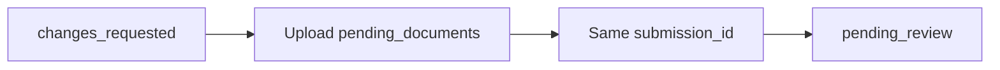

> **环境：** 测试 `https://cryptobank.qbank.cl/platform` (`pk_test_...`) - 正式 `https://api.qbank.cl/platform` (`pk_...`).

> This page is temporarily provided in English while the Chinese translation
> is scheduled. Field names and behavior are identical in every locale.

## Continue the current case

Your account has one **current verification case**. A later `rejected` record
does not invalidate an earlier case that is still actionable. If a request is
already open, `POST /v1/me/verification/link` returns
`409 self_verification_in_progress` without a new URL. Call
`GET /v1/me/verification` and reopen the existing `link.url`; do not create a
second case or change the idempotency key.

The current submission exposes `pending_documents`,
`documents_received`, and `changes_requested_comments` while remediation is
possible. Upload the requested documents in the existing wizard. Resubmit in
place: `submission_id` remains unchanged and no new submission is created.
After the last required document is accepted, the case returns to
`pending_review` and the portal shows **Waiting for approval**.

#### Why did I receive a 409?
    A current self-verification case already exists. Reuse its open link.
See the [error catalog](https://docs.cbpayapp.com/zh/errors) for actionable error codes.
