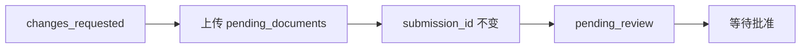

> **环境：** 测试 `https://cryptobank.qbank.cl/platform` (`pk_test_...`) - 正式 `https://api.qbank.cl/platform` (`pk_...`).

## 继续当前案件

你的账户只有**一个当前验证案件**。之后出现的 `rejected` 记录不会使仍可补正的早期案件失效。当已有请求在进行中时，`POST /v1/me/verification/link` 会返回 `409 self_verification_in_progress`，且不返回新 URL：

```json
{
  "error": {
    "code": "self_verification_in_progress",
    "message": "a verification is already in progress"
  }
}
```

调用 `GET /v1/me/verification` 并重新打开已有的 `link.url`。不要创建第二个案件，也不要更换幂等键。

## 原地重新提交

只要还可以补正，当前提交件就会暴露：

```json
{
  "submission_id": "sub_123",
  "status": "changes_requested",
  "pending_documents": ["proofOfResidence"],
  "documents_received": ["identity"],
  "changes_requested_comments": "Upload a legible proof of residence.",
  "documents_gate": { "ok": false, "total": 2, "matched": 1 }
}
```

在现有向导中上传 `pending_documents` 里的每一项。向导会**原地**重新提交：`submission_id` 不变，也不会创建新的提交件。最后一项所需文件通过后，案件自动回到 `pending_review`，门户显示**等待批准**。



#### 为什么我收到了 409？
    已存在一个当前 self 验证案件。请读取当前验证并复用其开放链接。
#### 重新提交会创建新的审核吗？
    不会。现有提交件会被更新，所要证据齐全后回到审核。
可操作的错误码见[错误目录](https://docs.cbpayapp.com/zh/errors)。
