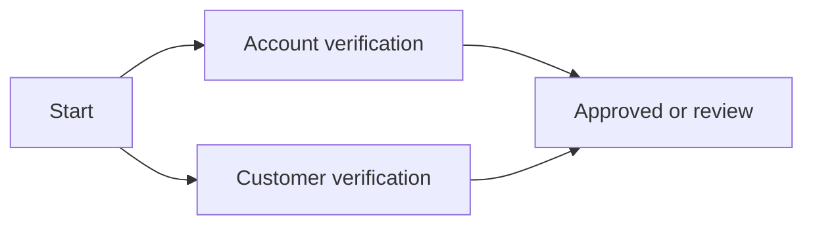

选择总览以验证账户和客户身份。

## 验证流程

- [KYC 总览](https://docs.cbpayapp.com/zh/guides/kyc-overview)
- [OCR 与活体证据](https://docs.cbpayapp.com/zh/guides/kyc-ocr)
- [错误](https://docs.cbpayapp.com/zh/errors)

#### Which page should I start with?Start with the overview, then use the OCR page for evidence details.
