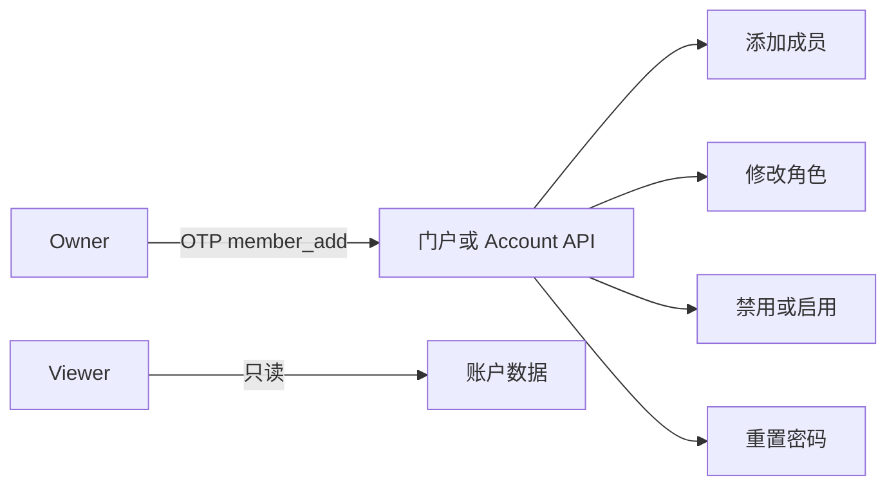
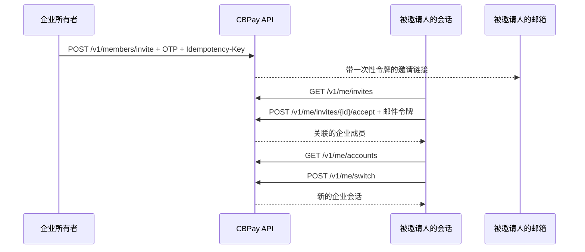

> **环境：** 测试 `https://cryptobank.qbank.cl/platform` (`pk_test_...`) - 正式 `https://api.qbank.cl/platform` (`pk_...`).

公司账户可以邀请同一组织中已经存在的账户。被邀请人保留一个登录，
从人类会话接受邀请；CBPay 随后为该企业创建 `operator` 或 `viewer`
角色的成员。

> **注**
邀请和账户切换器需要人类会话。API key 不能接受或拒绝邀请、列出登录
可用账户，也不能切换账户上下文。
## 角色与权限

| 角色 | 读取账户数据 | 操作产品 | 管理成员和凭证 |
|---|---:|---:|---:|
| `owner` | 是 | 是 | 是 |
| `operator` | 是 | 是 | 否 |
| `viewer` | 是 | 否 | 否 |

`viewer` 只有只读权限，不能创建或修改交易、凭证、成员或账户设置。每个
公司账户必须至少保留一个 `owner`。



## 多账户流程



邀请有效期为七天。接受邀请同时证明已登录会话和邮箱令牌的持有权。
会话邮箱必须与被邀请邮箱完全相同；仅有令牌不能接受邀请。

## 邀请现有账户

邀请需要同一组织中已存在、有效且已验证的账户。它不会创建新登录。
可邀请的角色是 `operator` 或 `viewer`；已有 owner 可以之后提升成员角色。

```bash
export CBPAY_API="https://api.qbank.cl/platform"
export OWNER_SESSION="<owner-session-token>"
export INVITEE_SESSION="<invitee-human-session-token>"
export INVITE_ID="7f3a9c1e-4b5d-4e6f-8a9b-0c1d2e3f4a5b"

curl -X POST "$CBPAY_API/v1/members/invite" \
  -H "Authorization: Bearer $OWNER_SESSION" \
  -H "Content-Type: application/json" \
  -H "Idempotency-Key: company-invite-ops-001" \
  -H "X-OTP-Token: <member-add-otp>" \
  -d '{"email":"ops@example.com","role":"operator"}'
```

```json
{
  "invite_id": "7f3a9c1e-4b5d-4e6f-8a9b-0c1d2e3f4a5b",
  "company_account_id": "1a2b3c4d-5e6f-4a7b-8c9d-0e1f2a3b4c5d",
  "company_name": "Acme SpA",
  "email": "ops@example.com",
  "role": "operator",
  "status": "pending",
  "invited_by": "owner@example.com",
  "delivery": "link",
  "expires_at": "2026-12-02T12:00:00Z",
  "created_at": "2026-11-25T12:00:00Z"
}
```

每次邀请都发送 `Idempotency-Key`。相同 payload 使用相同 key 重试时，
API 返回原邀请且不会再次发送邮件；相同 key 配不同数据会返回
`idempotency_conflict`。

## 查看、接受或拒绝

被邀请人使用人类会话查看邀请。支持 `status=pending|accepted|declined|
revoked|expired`、`page` 和 `page_size`；默认 50，最大 200。

```bash
curl "$CBPAY_API/v1/me/invites?status=pending&page=1&page_size=50" \
  -H "Authorization: Bearer $INVITEE_SESSION"
```

邮件链接提供不透明令牌。不要记录或暴露它：

```bash
curl -X POST "$CBPAY_API/v1/me/invites/$INVITE_ID/accept" \
  -H "Authorization: Bearer $INVITEE_SESSION" \
  -H "Content-Type: application/json" \
  -d '{"token":"<token-from-the-invitation-email>"}'
```

```json
{
  "member_id": "9a8b7c6d-5e4f-4a3b-8c9d-0e1f2a3b4c5d",
  "account_id": "1a2b3c4d-5e6f-4a7b-8c9d-0e1f2a3b4c5d",
  "role": "operator",
  "linked": true
}
```

拒绝邀请也要求邮箱对应的会话，但不需要邮件令牌：

```bash
curl -X POST "$CBPAY_API/v1/me/invites/$INVITE_ID/decline" \
  -H "Authorization: Bearer $INVITEE_SESSION"
```

接受和拒绝可以安全重复；如果并发决定已经生效，API 返回真实状态。
过期邀请必须由企业 owner 重新发送或创建。

## 企业端列出、重新发送或撤销

使用 `status`、`page` 和 `page_size` 查看企业邀请：

```bash
curl "$CBPAY_API/v1/members/invites?status=pending&page=1&page_size=50" \
  -H "Authorization: Bearer $OWNER_SESSION"
```

只有 `pending` 邀请可以重新发送或撤销，两个操作都需要 owner 的
`member_add` OTP。重新发送会轮换邮件令牌并续期七天，不会创建第二个邀请。

```bash
curl -X POST "$CBPAY_API/v1/members/invites/$INVITE_ID/resend" \
  -H "Authorization: Bearer $OWNER_SESSION" \
  -H "X-OTP-Token: <member-add-otp>"

curl -X POST "$CBPAY_API/v1/members/invites/$INVITE_ID/revoke" \
  -H "Authorization: Bearer $OWNER_SESSION" \
  -H "X-OTP-Token: <member-add-otp>"
```

邀请没有公开 webhook。使用两个 GET endpoint 读取状态；接受后，关联
成员会出现在 `GET /v1/members`。

## 关联账户与账户切换器

接受后，`linked: true` 表示企业成员属于被邀请人主账户的同一登录族。
它在企业中拥有独立角色和状态，但凭证只能由主账户管理，包括密码、
邮箱、2FA、passkey 和社交登录关联。

```bash
curl "$CBPAY_API/v1/me/accounts" \
  -H "Authorization: Bearer $INVITEE_SESSION"
```

响应列出 `account_id`、类型、名称、`member_id`、角色和 `primary`。
使用目标 `account_id` 切换并签发新的会话：

```bash
curl -X POST "$CBPAY_API/v1/me/switch" \
  -H "Authorization: Bearer $INVITEE_SESSION" \
  -H "Content-Type: application/json" \
  -d '{"account_id":"1a2b3c4d-5e6f-4a7b-8c9d-0e1f2a3b4c5d"}'
```

响应包含新的 `access_token`、`refresh_token`、过期时间、`account_id`、
`member_id` 和 `role`。当前会话仍然有效。请像保存登录 token 一样安全
保存它们，绝不要放进 URL 或日志。要管理关联凭证，请切换到
`primary: true` 的账户；否则会返回 `primary_account_required` 或
`linked_login_managed_by_primary`。

## 邀请状态

| 状态 | 含义 | 下一步 |
|---|---|---|
| `pending` | 可以接受或拒绝。 | 接受、重新发送或撤销。 |
| `accepted` | 已创建关联企业成员。 | 管理成员或切换账户。 |
| `declined` | 被邀请人拒绝。 | 需要时创建新邀请。 |
| `revoked` | owner 已撤销。 | 需要时创建新邀请。 |
| `expired` | 七天有效期已过。 | 重新发送或创建新邀请。 |

## 在门户中管理成员

### 打开公司账户设置

以 `owner` 身份登录，打开公司账户设置，然后进入成员区域。
### 添加或选择成员

添加成员时填写 email、至少八个字符且非常见的密码以及三个角色之一。编辑成员
时，先选择成员，再修改角色或状态。
### 确认操作

添加成员、修改角色、禁用或启用登录以及重置密码时，门户要求 OTP 后，
完成 `member_add` OTP 验证。验证成功后操作立即生效。
Owner 不能禁用自己的登录。请让另一位 owner 执行该操作。最后一位
owner 也不能被降级。

## 使用 API 管理成员

以下示例都使用人类会话 token：

```bash
export CBPAY_API="https://api.qbank.cl/platform"
export SESSION_TOKEN="<human-session-token>"
export MEMBER_ID="5a4b3c2d-1e0f-9a8b-7c6d-5e4f3a2b1c0d"
```

### 1. 读取自己的成员档案

此 endpoint 用来区分当前登录成员和公司账户：

```bash
curl "$CBPAY_API/v1/me/member" \
  -H "Authorization: Bearer $SESSION_TOKEN"
```

```json
{
  "id": "5a4b3c2d-1e0f-9a8b-7c6d-5e4f3a2b1c0d",
  "email": "ops@example.com",
  "role": "operator",
  "status": "active",
  "created_at": "2026-07-07T12:00:00Z"
}
```

API key 会返回 `404 member_not_found`，因为 API key 不是人类成员。

### 2. 添加和列出成员

添加成员仅适用于公司账户。如果省略 `role`，默认值是 `operator`：

```bash
curl -X POST "$CBPAY_API/v1/members" \
  -H "Authorization: Bearer $SESSION_TOKEN" \
  -H "Content-Type: application/json" \
  -d '{
    "email": "ops@example.com",
    "password": "another-secure-pass",
    "role": "operator"
  }'
```

响应会返回创建的成员：

```json
{
  "id": "5a4b3c2d-1e0f-9a8b-7c6d-5e4f3a2b1c0d",
  "email": "ops@example.com",
  "role": "operator",
  "status": "active",
  "created_at": "2026-07-07T12:00:00Z"
}
```

显示编辑表单前，先列出当前公司的成员：

```bash
curl "$CBPAY_API/v1/members" \
  -H "Authorization: Bearer $SESSION_TOKEN"
```

```json
{
  "members": [
    {
      "id": "5a4b3c2d-1e0f-9a8b-7c6d-5e4f3a2b1c0d",
      "email": "ops@example.com",
      "role": "operator",
      "status": "active",
      "created_at": "2026-07-07T12:00:00Z"
    }
  ]
}
```

### 3. 修改成员角色

只有公司账户的 owner 可以修改角色。允许的值是 `owner`、`operator` 和
`viewer`。

```bash
curl -X PUT "$CBPAY_API/v1/members/$MEMBER_ID/role" \
  -H "Authorization: Bearer $SESSION_TOKEN" \
  -H "Content-Type: application/json" \
  -H "X-OTP-Token: <member-add-otp>" \
  -d '{"role":"operator"}'
```

```json
{
  "member_id": "5a4b3c2d-1e0f-9a8b-7c6d-5e4f3a2b1c0d",
  "role": "operator",
  "changed": true
}
```

### 4. 禁用或启用成员

禁用成员会立即撤销该成员的全部会话。使用 `active` 可以重新启用登录。

```bash
curl -X PUT "$CBPAY_API/v1/members/$MEMBER_ID/status" \
  -H "Authorization: Bearer $SESSION_TOKEN" \
  -H "Content-Type: application/json" \
  -H "X-OTP-Token: <member-add-otp>" \
  -d '{"status":"disabled"}'
```

```json
{
  "member_id": "5a4b3c2d-1e0f-9a8b-7c6d-5e4f3a2b1c0d",
  "status": "disabled",
  "changed": true,
  "sessions_revoked": 2
}
```

### 5. 重置成员密码

重置密码也会撤销该成员的全部会话。修改自己的密码时，请使用
`POST /v1/me/password`。

```bash
curl -X POST "$CBPAY_API/v1/members/$MEMBER_ID/reset-password" \
  -H "Authorization: Bearer $SESSION_TOKEN" \
  -H "Content-Type: application/json" \
  -H "X-OTP-Token: <member-add-otp>" \
  -d '{"password":"another-secure-pass"}'
```

```json
{
  "member_id": "5a4b3c2d-1e0f-9a8b-7c6d-5e4f3a2b1c0d",
  "status": "password_reset",
  "sessions_revoked": 1
}
```

## 错误与处理方式

| HTTP | 错误 | 处理方式 |
|---:|---|---|
| 400 | `invalid_role` | 只发送 `owner`、`operator` 或 `viewer`。 |
| 403 | `owner_required` | 使用 owner 会话登录。 |
| 403 | `company_only` | 使用公司账户；个人账户不能使用成员功能。 |
| 403 | `otp_required` | 请求并验证 `member_add` OTP，然后发送其 token。 |
| 404 | `member_not_found` | 使用人类成员会话，而不是 API key。 |
| 409 | `last_owner_required` | 降级前必须保留至少一个 owner。 |
| 409 | `self_action_forbidden` | 请另一位 owner 修改你的状态或密码。 |
| 404 | `invitee_not_found` | 组织中没有使用该邮箱的账户；对方需先创建账户。 |
| 409 | `invitee_not_ready` | 被邀请账户尚未验证邮箱。 |
| 409 | `already_member` | 该邮箱已可访问此企业。 |
| 410 | `invite_expired` | 邀请已过期；请重新邀请。 |
| 409 | `company_not_active` | 该企业已不再有效；邀请已关闭。 |
| 403 | `primary_account_required` | 请切换到主账户管理凭据。 |
| 403 | `linked_login_managed_by_primary` | 请在主账户中重置密码或更换邮箱。 |
| 403 | `switch_unavailable` | 该账户目前无法切换。 |
| 400 | `invalid_email` | 发送现有账户的有效邮箱地址。 |
| 400 | `idempotency_key_required` | 在邀请请求中添加 `Idempotency-Key`。 |
| 400 | `invalid_token` | 使用最新邀请邮件中的令牌。 |
| 400 | `invalid_status` | 使用 `pending`、`accepted`、`declined`、`revoked` 或 `expired`。 |
| 401 | `not_found` | 当前邮箱或账户上下文无法访问该邀请。 |
| 409 | `idempotency_conflict` | 重用原 payload，或选择新的 key。 |
| 409 | `invalid_state` | 邀请不再是 pending；先读取当前状态。 |
| 429 | `too_many_attempts` | 稍后再试，不要反复重新发送。 |

完整错误目录请参阅[错误参考](https://docs.cbpayapp.com/zh/errors)。

> 按邮箱付款始终解析到邮箱持有者自己的账户：向多账户用户的邮箱付款会记入其个人账户，而不会记入其运营的企业。

#### 邀请会创建新账户吗？
不会。邮箱必须属于组织中符合条件的现有账户。邀请只是为该登录增加
企业访问权限。
#### 只使用邮件令牌可以接受邀请吗？
不可以。需要邮箱完全匹配的人工会话，以及最新邀请邮件中的令牌。
#### linked 是什么意思？
企业成员与主账户共享凭证族。企业角色和状态独立，但密码、邮箱、2FA、
passkey 和社交关联只能在主账户中管理。
#### 在哪里管理关联凭证？
在 `GET /v1/me/accounts` 中找到 `primary: true` 的账户并切换过去。
#### 通过邮箱付款的 payee 收款到哪里？
始终记入邮箱持有人的个人账户，而不是该用户操作的企业账户。
