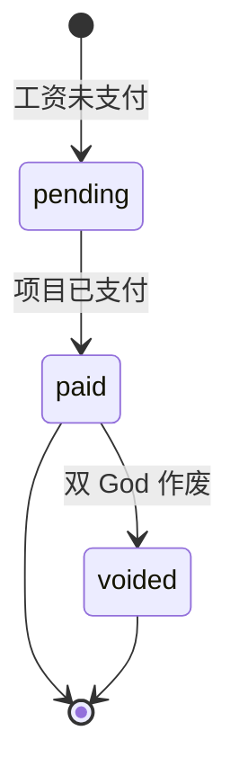

## 可以做什么

门户只显示经过身份验证账户自己的工资单。可以按工资期间筛选列表、打开详情或下载品牌 PDF。项目变为 `paid` 或 `voided` 后才有工资单；其他账户的工资单返回 `404 not_found`。

如需在 sandbox 测试，请将 `api.qbank.cl` 替换为 `cryptobank.qbank.cl`，并使用 sandbox 凭据和模拟资金。

## 列表和筛选

```bash
curl "https://api.qbank.cl/platform/v1/me/pay-slips?period=2026-10&page=1&page_size=50" \
  -H "Authorization: Bearer $ACCOUNT_TOKEN"
```

响应为 `{pay_slips, page, page_size, total}`。省略 `period` 可列出所有期间。`period` 必须使用 `YYYY-MM`；`page_size` 最大为 200。

## 打开详情

使用列表返回的 `id`：

```bash
curl "https://api.qbank.cl/platform/v1/me/pay-slips/slip_01" \
  -H "Authorization: Bearer $ACCOUNT_TOKEN"
```

JSON 包含 `period`、雇主和员工显示字段、应发项、扣除项、毛额/净额、货币、美元估值、付款方式、掩码目的地、付款时间和 `core_ref`。目的地会按设计进行掩码。

## 下载 PDF

```bash
curl "https://api.qbank.cl/platform/v1/me/pay-slips/slip_01/pdf" \
  -H "Authorization: Bearer $ACCOUNT_TOKEN" -o wage-slip.pdf
```

响应类型为 `application/pdf`。PDF 使用账户的品牌和语言。生成失败返回 `500 receipt_render_failed`；重试读取，若仍失败请提供请求 ID。



## 状态

| 状态 | 含义 | 操作 |
|---|---|---|
| `pending` | 工资尚未支付，工资单不可用。 | 付款后重新读取。 |
| `paid` | 工资单已封存，可以读取并下载 PDF。 | 打开详情或下载 PDF。 |
| `voided` | 工资单保留，可用于审计历史。 | 保留用于审计。 |

## 错误

| HTTP | 错误代码 | 解决方法 |
|---:|---|---|
| 400 | `invalid_period` | 发送 `YYYY-MM` 格式的日历期间。 |
| 404 | `not_found` | 确认工资单 ID 属于当前账户，且项目已支付或作废。 |
| 500 | `receipt_render_failed` | 重试 PDF 读取；不要创建另一笔工资操作。 |

参阅[公开错误目录](https://docs.cbpayapp.com/zh/errors)。

## 常见问题

#### 可以查看其他员工的工资单吗？不可以。系统通过关联账户强制执行所有权，不会披露其他账户的工资单。#### 为什么批准工资后工资单还不存在？批准会封存项目，但工资单在付款后创建。项目变为 `paid` 或 `voided` 后再读取。#### 下载 PDF 会转移资金吗？不会。门户接口都是只读操作。
