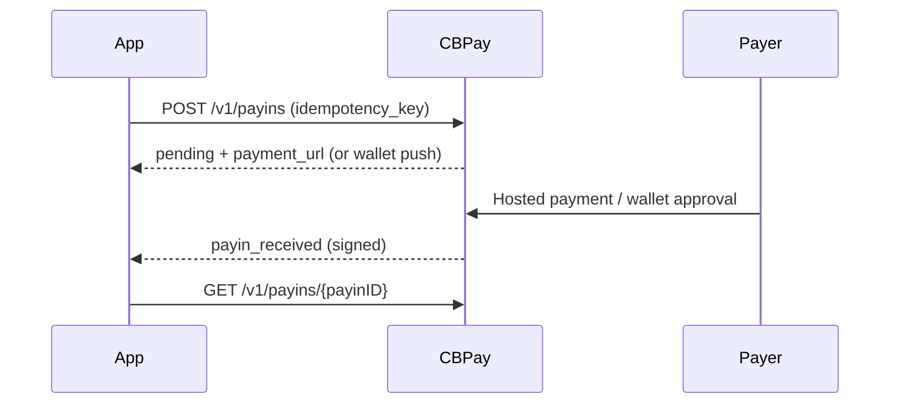

> **环境：** 测试 `https://cryptobank.qbank.cl/platform` (`pk_test_...`) - 正式 `https://api.qbank.cl/platform` (`pk_...`).

本页介绍当前启用的区域通道。公共 API 与供应商无关；集成方只选择
国家、货币和中性方法。实时目录是可用性的唯一依据。

## 通道矩阵

| 国家 | 货币 | Payout | Payin | 金额格式 |
|---|---|---|---|---|
| PY | PYG | `bank_transfer` | `bank_transfer`、`wallet` | 最多 2 位小数 |
| CO | COP | `bank_transfer` | `bank_transfer`、`wallet` | 只能是整数 |
| EC | USD | `bank_transfer` | `wallet` | 最多 2 位小数 |
| BR | BRL | `pix`、`bank_transfer` | `pix`（hosted redirect） | 最多 2 位小数 |

Hosted payin 在需要时接受 `payer_name`、`payer_document` 和
`payer_phone`。Payout 的 `flow_type` 是 `B2C`、`B2B` 或 `P2P`，由服务端
控制的通道配置决定。

## Hosted payin 与 wallet

PY 的 `bank_transfer` 和 `wallet`、CO 的 `bank_transfer`、EC 的 `wallet`
会返回 `payment_url`。创建时使用 `idempotency_key`，等待签名的
`payin_received` webhook，然后用 `GET /v1/payins/{payinID}` 查询。

```bash
curl -X POST https://api.qbank.cl/platform/v1/payins \
  -H "Authorization: Bearer <token>" \
  -H "Content-Type: application/json" \
  -d '{"country":"PY","currency":"PYG","method":"wallet","amount":"7500.00",
       "payer_name":"Ana Torres","payer_document":"1234567",
       "idempotency_key":"py-wallet-20261012-001"}'
```

CO/COP/`wallet` 是 collect push，不返回 URL。付款人在钱包应用中批准，
结果通过 webhook 返回，通常约 15 分钟。CO/COP/`bank_transfer` 使用
hosted PSE checkout。COP 金额必须为整数。

## 巴西

巴西提供两个 payout 方法和一个 hosted PIX payin。请以
`GET /v1/payouts/methods` 与 `GET /v1/payins/methods` 的实时结果为准。

### PIX 与 TED payout

PIX 使用 `method: "pix"` 和 PIX key：CPF、CNPJ、邮箱、巴西手机号
（`+55` 加 10 位固话或 11 位手机号）或随机 EVP/UUID key。CPF 与 CNPJ 会校验巴西
校验位；此方法不需要银行或账户字段。

TED 使用 `method: "bank_transfer"`，并提供银行、分行、账户类型、账户
号码、姓名和 CPF/CNPJ。银行代码必须来自 `GET /v1/payouts/banks`；
分行和账户类型必填。CPF/CNPJ 会在发送前校验；部分目的银行只接受
非 CPF 文档，请遵循目录和返回的校验错误。

两种 BRL 方法最多接受两位小数。遇到不明确的 timeout 时，使用相同的
幂等 key 查询原 payout，不要创建替代操作。

### Hosted PIX payin

创建 `BR/BRL/pix` 时金额至少为 `1` BRL，并发送 `payer_name` 与
`payer_document`。响应包含 `payment_url`，初始状态为 `pending`；将
付款人重定向到该 URL。

```bash
curl -X POST https://api.qbank.cl/platform/v1/payins \
  -H "Authorization: Bearer <token>" \
  -H "Content-Type: application/json" \
  -H "Idempotency-Key: br-pix-20261013-001" \
  -d '{"country":"BR","currency":"BRL","method":"pix","amount":"25.00",
       "payer_name":"Ana Torres","payer_document":"52998224725",
       "idempotency_key":"br-pix-20261013-001"}'
```

BRL 使用最多两位小数，最小金额为 `"1"`。重试时使用相同 key 以获取
原来的 hosted charge。

## Payout 与安全

在表单中展示选项前先调用 `GET /v1/payouts/methods` 和
`GET /v1/payouts/banks`。遇到 timeout 或 5xx 时保留同一个 key 并查询
原资源；CBPay 不会自动重发不明确的资金操作。

入站 callback 会被认证，出站 webhook 带有 `X-Webhook-Signature`。重复
投递必须以幂等方式处理。

## 生命周期与 webhook



Payin 的最终状态是 `completed` 和 `failed`；`pending` 和 `processing`
是过渡状态。

## 常见错误

| HTTP | 代码 | 处理 |
|---:|---|---|
| 400 | `invalid_amount` | COP 使用整数；PYG/USD 最多 2 位小数。 |
| 400 | `payin_corridor_unsupported` | 重新读取实时目录。 |
| 409 | `idempotency_conflict` | 使用原 payload 或新的 key。 |
| 422 | `invalid_payload` | 修正收款人或付款人字段。 |
| 502/503 | `payin_provider_failed` / `payins_unavailable` | 使用同一个 key 做对账。 |

## FAQ

#### 可以选择供应商或 PY fallback 吗？
不可以。集成方只能选择中性通道；variant 由服务端控制并签名。
#### timeout 后应该怎么做？
保留相同的 idempotency key 并查询原资源，不要创建第二笔资金操作。
#### payin 可以查询多久？
上游查询只支持创建后 12 个月内；请保留 CBPay charge 和 webhook 记录。
