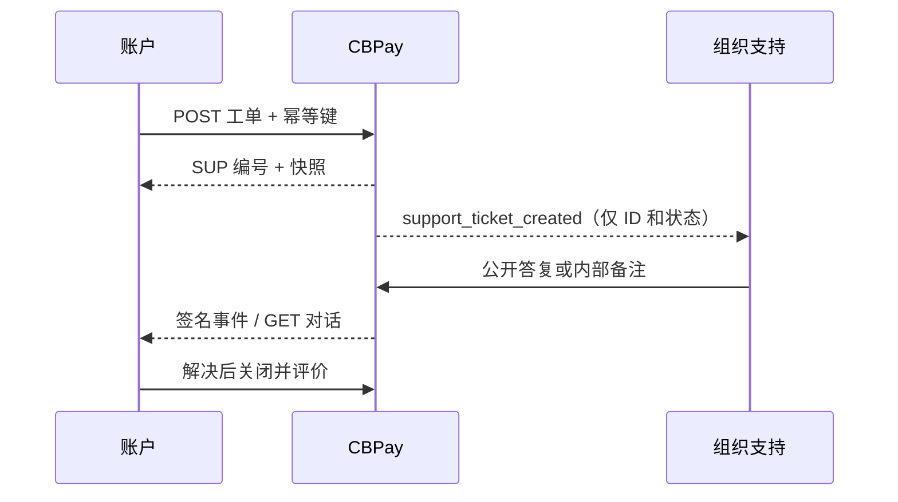

支持工单把账户的问题与相关交易放在一起。对于错误、疑问、延迟或金额不符，请从交易创建工单；没有来源交易时才使用 `kind: general`。交易工单保存只读的收据快照。



## 创建工单

`kind` 必须是 `payout`、`payin`、`payin_refund`、`transfer`、`crypto_withdrawal`、`crypto_deposit`、`swap`、`card_purchase`、`banking_operation`、`wallet_send` 或 `wallet_deposit`。发送 `resource_id`；`general` 工单必须使用 `general` 类别并省略该字段。

```bash
curl -X POST https://api.qbank.cl/platform/v1/support/tickets \
  -H "Authorization: Bearer $ACCOUNT_TOKEN" -H "Content-Type: application/json" \
  -H "Idempotency-Key: support-payout-2026-0001" \
  -d '{"kind":"payout","resource_id":"payout-123","subject":"付款延迟","category":"delay","priority":"high","message":"请检查此付款。","idempotency_key":"support-payout-2026-0001"}'
```

首次请求返回 `201`。 `idempotency_key` 最多 128 个字符；超过限制会返回 `400 invalid_payload`。 幂等键按账户限定：去重使用 `(组织、账户、idempotency_key)`，不同账户可以独立使用相同密钥。使用相同密钥重放会返回原工单并带有 `idempotency_hit: true`，不会创建重复工单。同一交易已有开放工单时返回 `409 ticket_already_open`，并附上现有工单。

## 查看并继续对话

使用 `GET /v1/support/tickets?from=2026-10-01&to=2026-10-31&page=1&page_size=50` 列表。还可以按 `status`、`category`、`priority` 和 `kind` 过滤；`page_size` 最大为 200。详情包括 `snapshot`、公开消息和附件元数据。内部备注永远不会返回给账户。

```bash
curl -X POST https://api.qbank.cl/platform/v1/support/tickets/TICKET_ID/messages \
  -H "Authorization: Bearer $ACCOUNT_TOKEN" -H "Content-Type: application/json" \
  -d '{"body":"这里是更多背景信息。"}'
```

账户消息会把 `pending_customer`、`on_hold` 或 `resolved` 重新打开为 `open`。`closed` 是终态，请创建新工单。

## 附件

使用 multipart 字段 `file` 上传一个 `PDF`、`PNG` 或 `JPG`，最大 10 MiB。服务器会检查真实文件签名。下载是经过认证的二进制响应，不要公开 `download_url`。

## 关闭和评价

`POST /v1/support/tickets/{id}/close` 具有收敛性：关闭已关闭工单会返回当前详情。解决后只能评价一次，`rating` 为 1 到 5，评论最多 1,000 个字符。重复评价返回 `409 already_rated`。

## 状态、SLA 和错误

| 状态 | 含义 | 操作 |
|---|---|---|
| `open` | 等待支持处理 | 必要时补充信息 |
| `pending_customer` | 支持已答复，等待账户 | 回复或关闭 |
| `on_hold` | 支持暂时暂停 | 等待或补充信息 |
| `resolved` | 支持已解决 | 评价或发送消息重新打开 |
| `closed` | 终态 | 创建新工单 |

默认首次回复 SLA 按 low、normal、high、urgent 分别为 4 小时、2 小时、1 小时和 30 分钟；解决 SLA 为 48、24、8 和 4 小时。组织可以配置这些值，`sla_breached` 由服务器计算。

| HTTP | 代码 | 解决方案 |
|---:|---|---|
| 400 | `idempotency_key_required` | 在 body 或 `Idempotency-Key` header 发送密钥。 |
| 400 | `invalid_kind` 等验证错误 | 使用规定的枚举和值限制。 |
| 404 | `not_found` | 确认交易或工单属于当前账户。 |
| 409 | `ticket_already_open` | 继续返回的开放工单。 |
| 409 | `ticket_closed`、`already_rated` | 创建新工单或保留原评价。 |
| 503 | `storage_unavailable` | 等待后只重新上传一次，不创建重复工单。 |

请参阅[错误目录](https://docs.cbpayapp.com/zh/errors)和[webhook 事件](https://docs.cbpayapp.com/zh/webhooks#支持工单事件)。

## 常见问题

#### 可以不关联交易创建工单吗？可以。使用 `kind: general`，省略 `resource_id` 并设置 `category: general`。#### 账户能看到内部备注吗？不能。内部备注仅供组织管理员查看，也不会出现在账户响应或事件中。#### 事件是否包含消息正文？不包含。事件只有 ID 和状态；请使用认证接口读取对话。????:https://cryptobank.qbank.cl/platform
