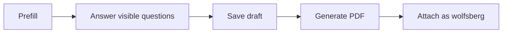

> **环境：** 测试 `https://cryptobank.qbank.cl/platform` (`pk_test_...`) - 正式 `https://api.qbank.cl/platform` (`pk_...`).

> This page is temporarily provided in English while the Chinese translation
> is scheduled. Field names and behavior are identical in every locale.

## Complete the questionnaire

Company onboarding includes the 15-section Wolfsberg CBDDQ v1.4 questionnaire
with conditional follow-up questions and a final declaration. Matching
company-profile values are prefilled and saved as a local draft while you
move between sections. **Generate PDF** creates the branded
`wolfsberg-cbddq-v1.4-*.pdf`, attached to the native KYB submission with
category `wolfsberg`. If upload fails, retry from the saved draft.

#### Can I submit an incomplete questionnaire?
    No. Complete all visible required questions and the final declaration.
See the [error catalog](https://docs.cbpayapp.com/zh/errors) if the PDF upload fails.
