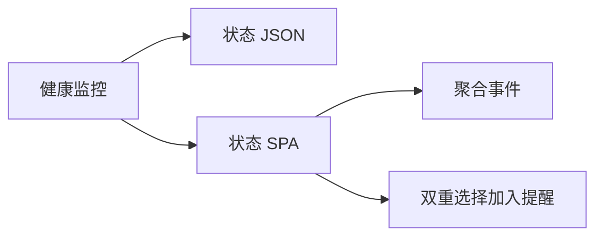

> **环境：** 测试 `https://cryptobank.qbank.cl/platform` (`pk_test_...`) - 正式 `https://api.qbank.cl/platform` (`pk_...`).

公开状态页将支付可用性集中展示在一个地方：启用通道的当前状态、90 天
heatmap、聚合事件历史以及可选的邮件提醒。它与服务商无关；公开响应只
显示流程、国家、币种和方式。



## 公开状态页

- `GET /status/{orgToken}` 默认提供 top-tier SPA，包含总体状态、运行率、
MTTR、事件数量、90 天每日 heatmap、payout 和 payin 通道分组、筛选、搜索
以及订阅弹窗。
- SPA 支持英语、西班牙语和中文，使用机构名称、颜色和 logo，并可通过
`?incident=<id>` 深链接打开事件。也可以用 `flow`、`country`、`currency`
和 `method` 缩小视图。
- `?ui=legacy` 保留旧的服务端渲染页面，作为兼容路径；默认不是旧页面。
- SPA 只使用同源、自托管的 `/_next/*` 资源，不加载外部 CDN 的 JavaScript、
字体或其他资源。每个 HTML 响应使用请求级 CSP nonce；资源不可变并使用
长期缓存。

页面只列出机构已启用的通道。已启用但中断的通道仍会显示并影响总体状态；
运营方停用的通道不会出现在列表或事件历史中。

## 状态 JSON

```bash
curl "https://api.qbank.cl/platform/v1/status/{orgToken}"
```

旧的扁平 `incidents` 字段为兼容而保留，并已 **deprecated**；新的历史请
使用下面的聚合 endpoint。SPA 使用的增量字段如下：

```json
{
  "brand": {"name":"CBPay","website":"https://cbpayapp.com","primary_hex":"FBC140","header_hex":"2E2E2E","accent_hex":"","grey_hex":"","logo_url":"","symbol_url":""},
  "status": "degraded",
  "generated_at": "2026-11-17T15:00:00Z",
  "corridors": [],
  "incidents": [],
  "incidents_total_90d": 2,
  "mttr_mins_90d": 45,
  "incidents_daily": [
    {"date":"2026-11-16","degraded":1,"down":0},
    {"date":"2026-11-17","degraded":0,"down":1}
  ]
}
```

只有在请求 `?brand_assets=1` 且机构拥有相应资源时，响应才会加入
`logo_data_uri` 和 `symbol_data_uri`。仅在界面需要自包含品牌时请求它们；
不要把这些 data URI 写入日志或 analytics。

## 聚合事件历史

```bash
curl "https://api.qbank.cl/platform/v1/status/{orgToken}/incidents?page=1&page_size=50&from=2026-11-01T00:00:00Z&to=2026-11-17T23:59:59Z&flow=payout&country=US&currency=USD&method=bank_transfer&severity=down&status=resolved"
```

每条通道的非正常窗口从第一次进入 `degraded` 或 `down` 开始，到恢复为止。
开始时间相差不超过五分钟的窗口会合并为一个事件。代码测试覆盖了
`2026-11-14T11:10:00Z` 开始、五分钟后恢复的三个 US/USD 通道；结果是一个
已解决事件，包含三个 `affected` 项和 `duration_mins: 5`。

```json
{
  "page": 1,
  "page_size": 50,
  "total": 1,
  "incidents": [{
    "id": "<stable-incident-id>",
    "title": "<由界面本地化>",
    "severity": "down",
    "status": "resolved",
    "started_at": "2026-11-14T11:10:00Z",
    "resolved_at": "2026-11-14T11:15:00Z",
    "duration_mins": 5,
    "affected": [
      {"flow":"payout","country":"US","currency":"USD","method":"bank_transfer","worst":"down"},
      {"flow":"payout","country":"US","currency":"USD","method":"wire","worst":"down"},
      {"flow":"payin","country":"US","currency":"USD","method":"bank_transfer","worst":"down"}
    ],
    "updates": [
      {"at":"2026-11-14T11:15:00Z","status":"operational","message":"<human-readable resolved message>"},
      {"at":"2026-11-14T11:10:00Z","status":"down","message":"<human-readable investigating message>"}
    ]
  }]
}
```

可选筛选项为 `flow`（`payout` 或 `payin`）、`country`、`currency`、`method`、
`severity`（`degraded` 或 `down`）、`status`（`open` 或 `resolved`）以及
`from`/`to`。`page` 默认 1；`page_size` 默认 50，最大 200。无效筛选返回
`invalid_filter`；无效或倒置的日期范围返回 `invalid_range`。未知或格式错误
的机构令牌返回 `404`，不会泄露机构是否存在。

## 订阅状态提醒

订阅采用双重选择加入。初始请求始终返回中性结果，不会泄露某个邮箱是否
已经订阅。

```bash
curl -X POST "https://api.qbank.cl/platform/v1/status/{orgToken}/subscriptions" \
  -H "Content-Type: application/json" \
  -d '{"email":"ops@example.com","flows":"all","lang":"zh"}'
```

```json
{"ok": true}
```

`flows` 可为 `all`、`payout` 或 `payin`，默认 `all`；`lang` 可为 `en`、`es` 或
`zh`。邮箱无效返回 `invalid_email`，流程无效返回 `invalid_filter`。如果
honeypot 字段 `company_website` 非空，服务会静默接受并丢弃请求。

确认链接有效期为 24 小时且只能使用一次：

```bash
curl -H "Accept: application/json" \
  "https://api.qbank.cl/platform/v1/status/{orgToken}/subscriptions/confirm?token=<64位小写十六进制令牌>"
```

```json
{"ok": true, "confirmed": true}
```

确认、管理和退订链接在 `Accept: text/html` 下也会返回品牌化 HTML。这些页面
不含 JavaScript，并使用严格 CSP。管理 endpoint 显示掩码邮箱和当前流程筛选：

```bash
curl -X POST "https://api.qbank.cl/platform/v1/status/{orgToken}/subscriptions/preferences" \
  -H "Content-Type: application/json" \
  -d '{"token":"<unsubscribe-token>","flows":"payin"}'
```

```json
{"ok": true, "flows": "payin"}
```

退订支持 `GET` 或 `POST`，并且是幂等的：

```bash
curl -X POST "https://api.qbank.cl/platform/v1/status/{orgToken}/subscriptions/unsubscribe" \
  -H "Content-Type: application/json" \
  -d '{"token":"<unsubscribe-token>"}'
```

```json
{"ok": true, "unsubscribed": true}
```

限制为每个 IP 每小时 10 次订阅请求、每个邮箱每小时 3 次，以及每个 IP 每小时
60 次令牌操作。超限返回 `rate_limited`。令牌是随机生成的 256 位 capability，
数据库只保存 hash。邮箱静态加密且不会写入日志。提醒逐个发送，不会把无关
收件人放在同一个 `To` 中，并按订阅和事件窗口去重。

## 通道状态

| 状态 | 含义 | 建议 |
|---|---|---|
| `operational` | 正常处理。 | 正常运营。 |
| `degraded` | 观察到基础设施错误率升高。 | 显示提示并关注事件流。 |
| `down` | 连续故障或健康检查失败。 | 可考虑暂时隐藏，直到恢复。 |

状态页是可观测性，不是操作闸门。不要因为通道降级或中断就重新发送金融
操作；按正常状态处理，并在 API 合约允许时只使用同一个 `idempotency_key`
重试。

## 常见问题

#### down 通道会拒绝所有请求吗？
    不会。监控不会阻止发起操作。新操作可能沿正常 API 流程失败；请使用
availability 和事件流决定界面展示内容。
#### 事件 ID 可以作为稳定的深链接吗？
    可以。事件 ID 由开始时间和受影响通道确定，SPA 可以使用 `?incident=<id>`
打开它。
#### 可以知道背后的服务商吗？
    不可以。公开状态数据与服务商无关，只提供通道维度和经过归一化的人类可读
消息。
#### 为什么没有收到确认邮件？
    POST 响应出于设计保持中性。请检查地址并重新订阅；不要通过响应推断是否
已经存在订阅。
