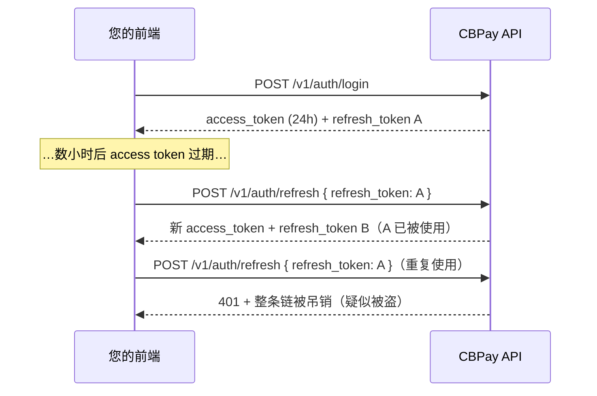

除注册和登录外，每次调用都必须在 `Authorization` 请求头中携带
凭证：

```
Authorization: Bearer <token>
```

也可使用 `X-API-Key: <token>` 作为替代请求头。

## 注册与邮箱验证

注册采用先验证模式：绝不直接创建会话。公共端点对新邮箱和重复邮箱均返回 `201 pending_verification`，因此调用方无法利用它枚举账户。邮箱所有者会收到验证码；请使用 `POST /v1/auth/register/confirm` 完成流程。

```bash
curl -X POST https://api.qbank.cl/platform/v1/auth/register \
  -H "Content-Type: application/json" \
  -d '{"org":"cbpay","type":"person","email":"ana@example.com","password":"a-secure-password","display_name":"Ana","country":"CL"}'
```

```json
{"status":"pending_verification","note":"check your email for the verification code; complete registration with POST /v1/auth/register/confirm"}
```

确认验证码以验证邮箱。该端点返回 `201 pending_2fa_enrollment`，包含有效 30 分钟的 `pending_token`、`factors`、`passkeys_available`、`next` 和 `account`，不会创建会话。只有完成[注册后的强制 2FA 注册](#注册后的强制-2fa-注册)中的 TOTP 或通行密钥注册后才会签发会话：

```bash
curl -X POST https://api.qbank.cl/platform/v1/auth/register/confirm \
  -H "Content-Type: application/json" \
  -d '{"org":"cbpay","email":"ana@example.com","code":"123456"}'
```

格式错误的验证码返回 `400 invalid_code`；无效或过期的验证码统一返回 `401 invalid_code`。如果无法查询验证服务，API 返回 `502 otp_check_failed`。确认成功后返回上面的待注册结构；请将 token 交给注册向导。

## 身份验证滥用限制

登录失败按归一化账户（组织/邮箱）计数：15 分钟内失败 8 次后，窗口期内的后续尝试返回相同的 `401 invalid_credentials`，且不再执行 bcrypt。待验证的注册成员也会收到该统一响应，无法使用注册密码登录。

密码找回特意防止枚举。`POST /v1/auth/password/forgot` 即使账户发送配额用尽也返回相同的 `200` 响应体；每个账户每小时最多发送 5 次真实验证码。`POST /v1/auth/password/reset` 允许每个账户每 15 分钟尝试 8 次验证码。通过邮箱成功重置会验证邮箱并清除 `register_pending`。

企业成员也可能收到管理员发起的恢复链接。将其中的 `token` 与 `org`、
`new_password` 提交到 `POST /v1/auth/password/reset-link`；链接只能使用
一次，60 分钟后过期。此成员流程与平台管理员密码重置流程相互独立。

## 凭证类型

<Tabs>
<Tab title="JWT 会话（有登录的用户）">

通过 `POST /v1/auth/login` 获取（注册需先确认邮箱，见下文），有效期
**24 小时**。适用于用户需要登录的应用。除 `access_token` 外，您还会收到
一个**刷新令牌（refresh token）**，无需再次输入密码即可续期会话 ——
见[会话续期](#session-renewal-refresh-tokens)。

```bash
curl -X POST https://api.qbank.cl/platform/v1/auth/login \
  -H "Content-Type: application/json" \
  -d '{ "org": "cbpay", "email": "ana@example.com", "password": "…" }'
```

```json
{
  "access_token": "eyJ…",
  "expires_at": "2026-07-14T15:20:49Z",
  "refresh_token": "rt_6a1e6c22-….XXXXXXXX…",
  "refresh_expires_at": "2026-08-12T15:20:49Z",
  "account_id": "…",
  "role": "owner"
}
```

企业账户可以拥有多个具有不同角色的**成员** —— 见下文
[企业成员](#company-members)。

<Note>
如果账户策略要求**登录时进行 OTP 验证**，响应会返回
`otp_required: true` 及一个 `pending_token`（而非会话）：第二步在
`POST /v1/auth/login/otp` 使用通过 SMS/WhatsApp 收到的验证码完成。
完整流程见[安全与双因素认证](/zh/security-2fa)。
</Note>

<Note>
您还可以提供**使用 Google、Apple、Microsoft 或 Facebook 注册和登录**
（免密码）—— 见[社交登录](/zh/guides/social-login)。
</Note>

</Tab>
<Tab title="API 密钥（服务器到服务器）">

格式为 `pk_<key_id>.<secret>`。永不过期，且不绑定任何会话。
签发方式：

```bash
curl -X POST https://api.qbank.cl/platform/v1/api-keys \
  -H "Authorization: Bearer <session-token>" \
  -H "Content-Type: application/json" \
  -d '{ "label": "production-backend" }'
```

```json
{
  "api_key_id": "…",
  "key_id": "a1b2c3d4e5f60718",
  "token": "pk_a1b2c3d4e5f60718.XXXXXXXX…",
  "note": "store this token now; it cannot be retrieved again"
}
```

<Warning>
明文令牌**仅显示一次**。服务器端只存储其哈希 —— 如果丢失，请签发
新的密钥。
</Warning>

</Tab>
</Tabs>

## 会话续期（刷新令牌） {#session-renewal-refresh-tokens}

`access_token` 有效期为 24 小时；`refresh_token`（`rt_…`）可让您在
**无需重新登录**的情况下换取新的令牌对，有效期 30 天，每次使用自动
续期，自最初登录起最长 90 天。它是**一次性的**：每次兑换都会返回新的
`refresh_token`，旧的立即失效（轮换）。



```bash
curl -X POST https://api.qbank.cl/platform/v1/auth/refresh \
  -H "Content-Type: application/json" \
  -d '{ "refresh_token": "rt_6a1e6c22-….XXXXXXXX…" }'
```

```json
{
  "access_token": "eyJ…",
  "expires_at": "2026-07-14T15:20:50Z",
  "refresh_token": "rt_9f2b1c30-….YYYYYYYY…",
  "refresh_expires_at": "2026-08-12T15:20:50Z",
  "account_id": "…",
  "role": "owner"
}
```

前端必须了解的安全规则：

- **严格轮换**：兑换时，该设备之前的 access token 立即被吊销（每条链
  只有一个存活的 access token）。请始终用响应中的令牌替换两个令牌。
- **重复使用 = 被盗**：如果已兑换过的刷新令牌再次被提交，该设备的整条
  链（令牌和会话）将被吊销，并在 `GET /v1/me/security/events` 中记录
  `refresh_token_reuse` 事件。用户必须重新登录。
- **随会话失效**：退出登录（`DELETE /v1/me/sessions/{id}`）、
  `POST /v1/me/sessions/revoke-all` 或修改/重置密码也会使关联的刷新
  令牌失效。
- 任何拒绝都返回 `401 invalid_refresh_token` —— 收到该错误时请引导用户
  重新登录。
- 请将刷新令牌保存在安全存储中（移动端使用 Keychain/Keystore；Web 端
  建议内存 + 重新登录，或由您的后端使用 httpOnly Cookie）。`pk_` API
  密钥不使用刷新机制：它们永不过期。

<AccordionGroup>
<Accordion title="应该多久刷新一次？">
在 access token 即将过期时（参考 `expires_at`），或在正常调用收到
`401` 时刷新。避免多处并行刷新：同一令牌的两次兑换同时到达时，一次
成功、另一次收到 `401` 且不受惩罚 —— 但兑换一个**已被轮换**的令牌会
吊销整条链。
</Accordion>
<Accordion title="90 天后会发生什么？">
链的绝对上限是自最初登录起 90 天：即使每天刷新，到达上限后刷新会返回
`401`，用户必须重新认证（密码、通行密钥或社交登录）。
</Accordion>
<Accordion title="刷新对 API 密钥适用吗？">
不适用：`pk_` API 密钥永不过期且没有会话。刷新仅用于人类用户的 JWT
会话。
</Accordion>
</AccordionGroup>

## 访问级别

您的凭证（会话 JWT 或 API 密钥）操作的是**您自己的账户**：余额、
付款、收款、转账、加密资产、KYC/KYB 以及您自己的 webhook。如果某个
端点返回 `403 account_required` 或 `403 org_admin_required`，说明该
操作属于其他凭证级别 —— 请联系 CBPay 团队。

## 您的账户资料

```bash
# Read the profile (includes kyc_status and type)
curl https://api.qbank.cl/platform/v1/me \
  -H "Authorization: Bearer <token>"

# Update profile fields (all optional)
curl -X PATCH https://api.qbank.cl/platform/v1/me \
  -H "Authorization: Bearer <token>" \
  -H "Content-Type: application/json" \
  -d '{
    "display_name": "Comercial Andina SpA",
    "tax_id": "76.543.210-8",
    "phone": "+56 9 1234 5678",
    "country": "CL",
    "locale": "en"
  }'
```

```json
{
  "id": "9b1deb4d-3b7d-4bad-9bdd-2b0d7b3dcb6d",
  "type": "company",
  "display_name": "Comercial Andina SpA",
  "email": "legal@andina.cl",
  "tax_id": "76.543.210-8",
  "phone": "+56 9 1234 5678",
  "country": "CL",
  "status": "active",
  "kyc_status": "approved",
  "created_at": "2026-06-01T12:00:00Z"
}
```

`PATCH /v1/me` 接受 `display_name`、`tax_id`、`phone`、`country` 和 `locale`
（只需发送有变更的字段）。空 `locale` 会存为 `en`；无效值返回 `400 invalid_locale`。
`email`、`status` 和 `kyc_status` 不可自行管理：由管理员处理。
见[语言与 locale](/zh/guides/locale)。

## 企业成员

**企业**账户可以拥有多个各自登录、权限级别不同的用户：

| 角色 | 权限 |
|---|---|
| `owner` | 全部权限：可操作、管理成员和凭证 |
| `operator` | 日常操作（创建成员时的默认角色） |
| `viewer` | 只读 |

```bash
# Add a member (company accounts only)
curl -X POST https://api.qbank.cl/platform/v1/members \
  -H "Authorization: Bearer <token>" \
  -H "Content-Type: application/json" \
  -d '{
    "email": "finance@andina.cl",
    "password": "a-strong-password",
    "role": "viewer"
  }'

# List members
curl "https://api.qbank.cl/platform/v1/members?page_size=50" \
  -H "Authorization: Bearer <token>"
```

```json
{
  "page": 1,
  "page_size": 50,
  "members": [
    { "id": "…", "email": "legal@andina.cl", "role": "owner", "status": "active" },
    { "id": "…", "email": "finance@andina.cl", "role": "viewer", "status": "active" }
  ]
}
```

在个人账户上调用 `POST /v1/members` 会返回 `403 company_only`。

## 最佳实践

- 将 API 密钥保存在密钥管理器中；切勿写入代码或暴露在浏览器中。
- 每个环境/服务使用一个密钥（配上有意义的 `label`），以便在不中断
  服务的情况下轮换。

<Steps>
  <Step title="零停机轮换">
    通过 `POST /v1/api-keys` 签发新密钥（使用新的 label）。
  </Step>
  <Step title="部署">
    更新您的服务以使用新密钥。
  </Step>
  <Step title="停用旧密钥">
    流量迁移完成后，请联系 CBPay 团队吊销旧密钥。
  </Step>
</Steps>

- JWT 会话面向前端；自动化流程应始终使用 API 密钥。

## 注册后的强制 2FA 注册

邮箱确认只证明邮箱所有权，不再创建会话。`POST /v1/auth/register/confirm` 返回 `201`、`status: "pending_2fa_enrollment"`、有效 30 分钟的 `pending_token`、`expires_at`、`factors`、`passkeys_available`、`next`、`note` 和 `account`。只可将 token 用于 `/v1/auth/register/2fa/*`。

TOTP 先调用 `totp/begin`，再用 `pending_token` 和六位 `code` 调用 `totp/confirm`；成功响应包含会话和 10 个一次性 `recovery_codes`。通行密钥先调用 `passkey/begin`，把 `options.publicKey` 交给 `navigator.credentials.create()`，再用 `pending_token`、`challenge_id`、可选 `name` 和 `credential` 调用 `passkey/finish`。受邀成员和 org-admin 创建账户的成员首次登录也使用同一向导。

通行密钥登录也遵循注册门控：`must_enroll_2fa` 为 `true` 时，`POST /v1/auth/passkey/login/finish` 返回 `pending_2fa_enrollment`，成员完成注册向导后才获得会话。仍处于 `RegisterPending`（邮箱未验证）的成员在确认邮箱前会收到 `invalid_credential`；这与 2FA 注册门控是两个独立流程。

`totp/begin` 和 `passkey/begin` 在之前的尝试已保存因子、但清理标志被中断时，也可能返回带正常会话的 `201`；该崩溃恢复会完成注册。正常 begin 响应包含 `totp_secret`、`otpauth_uri`、可选的 `qr_png_base64`、`steps` 和 `note`（不包含 `expires_at`）。
