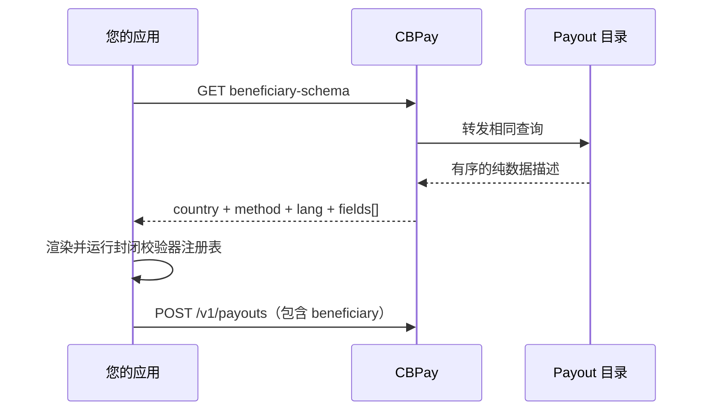

import { EnvUrls } from "/snippets/env-urls.jsx";

<EnvUrls lang="zh" />

## 此接口的用途

`GET /v1/payouts/beneficiary-schema` 返回一个 payout 通道的
`beneficiary` 数据字段描述。请在 `POST /v1/payouts` 前调用它，不要在
客户端维护按国家硬编码的表单表格。响应按渲染顺序返回，并包含本地化
label、placeholder、提示、错误、条件规则以及封闭的客户端校验器名称。

这是只读目录：不会验证或创建 payout，不会执行校验代码，也不会暴露任何
处理服务商的身份。

## 请求

```bash
curl "https://api.qbank.cl/platform/v1/payouts/beneficiary-schema?country=CL&method=fintoc&lang=zh" \
  -H "Authorization: Bearer <token>"
```

`country` 是 ISO alpha-2 目的国，`method` 是 payout 通道。`lang` 支持
`en`、`es`、`zh`，省略时默认为 `en`。全局 `swift` 和 `sepa` 会通过
`*:swift` 或 `*:sepa` 通配符匹配任意请求国家，响应仍返回请求的国家。



## 响应

```json
{
  "country": "CL",
  "method": "fintoc",
  "lang": "zh",
  "fields": [
    { "key": "name", "label": "收款人姓名", "kind": "text" },
    {
      "key": "tax_id",
      "label": "RUT",
      "placeholder": "12.345.678-5",
      "hint": "系统会校验校验位",
      "kind": "text",
      "validator": "chilean_rut",
      "error": "RUT 无效：请检查校验位"
    },
    { "key": "bank_code", "label": "银行", "kind": "bank" },
    {
      "key": "account_type",
      "label": "账户类型",
      "kind": "select",
      "options": [
        { "value": "checking", "label": "支票账户" },
        { "value": "vista", "label": "活期账户" }
      ]
    },
    {
      "key": "account_number",
      "label": "账号",
      "kind": "text",
      "hint": "仅限数字",
      "validator": "cl_account_number",
      "error": "账号无效：只能使用数字（最多 20 位）"
    }
  ]
}
```

### 字段描述契约

每个字段包含 `key`、`label` 和 `kind`。`kind` 可为 `text`、`phone`、
`bank`、`select`、`geoCountry`、`geoState` 或 `geoCity`。`fields` 的
顺序就是渲染顺序。

| 属性 | 含义 |
|---|---|
| `placeholder`、`hint`、`error` | 已按请求语言翻译的显示文本。 |
| `options` | `select` 的封闭值；提交 `value`，显示 `label`。 |
| `show_if`、`required_if` | 当前表单满足 `{key, equals}` 时显示或必填。 |
| `required_when_country_has_subdivisions` | 国家有目录中的州/省时要求州/省。 |
| `default_value`、`fixed_value` | 初始值或不可编辑值。 |
| `validator` | 对非空值运行的简单封闭校验器名称。 |
| `validator_with_values` | 接收当前表单值的封闭跨字段校验器名称。 |
| `validate_fn_when` | 运行格式校验器的条件。 |
| `optional` | 非必填；如果提交仍会校验。 |
| `wide`、`collapsible`、`collapsible_group` | 仅为渲染提示。 |
| `default_from_corridor_country` | 使用通道国家预填，但仍可编辑。 |
| `country_key`、`state_key` | 地理级联字段的数据来源。 |

后端只发送校验器名称。请在每个 frontend 中实现封闭注册表；未知名称
必须安全地视为校验错误，不能把 API 字符串当作代码执行。

## 支持的通道

目录包含 20 个精确的国家/方式组合，以及全局 `*:swift` 和 `*:sepa`
回退。可用性仍由 `GET /v1/payouts/methods` 决定。找不到组合时返回
`404 payout_corridor_unsupported`。

业务字段和完整创建示例请参阅
[payout 通道指南](/zh/guides/payout-corridors)。

## 错误与安全重试

| HTTP | 代码 | 处理方式 |
|---:|---|---|
| 400 | `invalid_payload` | 同时提供 `country` 和 `method`。 |
| 400 | `invalid_language` | 使用 `en`、`es` 或 `zh`，或省略 `lang`。 |
| 404 | `payout_corridor_unsupported` | 刷新方式目录，不要渲染该通道。 |
| 401/403 | 认证或 scope 错误 | 使用账户范围内的 token。 |

这是只读请求，不需要幂等键。网络失败后可以重复读取；不确定的资金
操作绝不能使用新 key 重发，应使用原幂等键查询原 payout 状态。

## FAQ

<AccordionGroup>
<Accordion title="响应是否包含可执行的校验代码？">
不包含。`validator` 和 `validator_with_values` 只是封闭集合中的名称，
校验实现属于 frontend，不能执行字符串。
</Accordion>
<Accordion title="它是否替代方式目录？">
不替代。方式目录说明哪些通道已启用，本接口说明选择通道后要显示哪些字段。
</Accordion>
<Accordion title="没有 optional 的字段是否必填？">
是，除非同一个描述符中的条件改变了必填状态。最终提交仍由 payout
接口执行完整校验。
</Accordion>
<Accordion title="可以缓存响应吗？">
可以按 `country`、`method`、`lang` 短暂缓存。方式目录变化时刷新，并在
`404` 时停止创建 payout。
</Accordion>
<Accordion title="为什么平台响应与 core 相同？">
平台不修改这个静态目录，只做 proxy。集成方应使用平台 URL，不依赖内部服务。
</Accordion>
</AccordionGroup>
