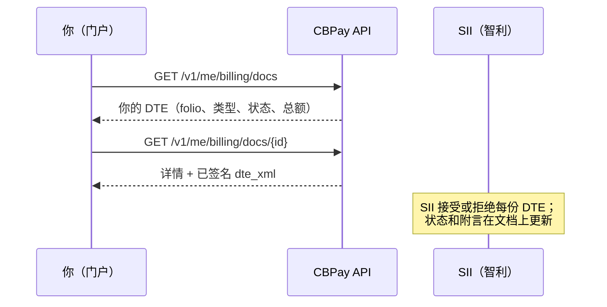

import { EnvUrls } from "/snippets/env-urls.jsx";

<EnvUrls lang="zh" />

CBPay 在智利向你收取的每笔佣金都有其电子税务文档（DTE），直接开具给
智利税务机关（SII）。门户的**账单**部分（报表 → 账单，个人和企业账户
都有）列出你的文档，包括 folio、类型、状态、总额和开具日期，每份详情
都可以下载**已签名的 DTE XML** 用于记账。你只能看到自己账户的文档。



## 文档类型与状态

| 类型 | 含义 |
|---|---|
| `33` | 电子发票（含税，含增值税） |
| `34` | 免税电子发票 |
| `61` | 电子贷项通知单（作废一张发票） |

| 状态 | 含义 |
|---|---|
| `queued` / `processing` / `stamped` / `sent` / `verify` | 正在发往 SII |
| `accepted` | SII 已接受（最终） |
| `rejected` | SII 已拒绝（最终，未开具任何费用） |
| `failed` | 临时错误，自动重试 |
| `paused` | 账单暂停期间保持 |
| `cancelled` | 加盖前发票作废（未联系 SII，无需通知单） |

作废的发票会显示原文档及其作废的 `61` 通知单；两者都计入月度销售账簿。

## 下载 DTE XML

打开任意文档并使用**下载 XML**：你会得到已加盖并发送给 SII 的确切字节
（ISO-8859-1），包括电子印章（TED）和 SII 授权（CAF）。原样交给你的会计，
不要重新编码。

```bash
curl "https://api.qbank.cl/platform/v1/me/billing/docs?page=1&page_size=50&status=accepted&from=2026-10-01T00:00:00Z&to=2026-11-01T00:00:00Z" \
  -H "Authorization: Bearer $CBPAY_TOKEN"
```

```bash
curl "https://api.qbank.cl/platform/v1/me/billing/docs/dte-7c9e2f1a" \
  -H "Authorization: Bearer $CBPAY_TOKEN"
```

<Note>
你只能看到向自己账户开具的文档：他人的 ID 返回 `404 not_found`，与不
存在的 ID 完全相同。内部价格拆分从不暴露。
</Note>

## 错误

| HTTP | 代码 | 原因与解决 |
|---|---|---|
| 400 | `invalid_status` | 未知的状态过滤器。使用上表中的状态。 |
| 400 | `invalid_range` | 日期范围错误。发送 RFC3339 日期时间。 |
| 403 | `account_required` | 使用账户凭证调用（成员会话或账户 API 密钥）。 |
| 404 | `not_found` | 该 ID 不存在或不属于你的账户。 |

## 常见问题

<AccordionGroup>
  <Accordion title="其他国家的发票在哪里？">
    本部分仅涵盖智利 DTE。其他国家的发票显示在你常用的发票列表中。
  </Accordion>
  <Accordion title="可以下载被拒绝文档的 XML 吗？">
    如果存在就可以：详情包含已加盖的内容。被拒绝的文档从未开具费用，
    因此无需作废。
  </Accordion>
  <Accordion title="需要向 SII 申报吗？">
    不需要。CBPay 自行申报月度销售账簿；XML 仅用于你自己的会计记录。
  </Accordion>
  <Accordion title="为什么会看到贷项通知单（61）？">
    你的一张发票在 SII 接受后作废，因此平台开具了引用原文档的贷项通知
    单。出于可追溯性，两份文档都保持可见。
  </Accordion>
</AccordionGroup>
