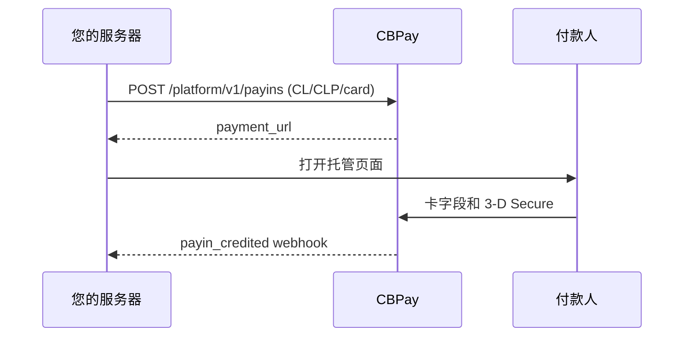

import { EnvUrls } from "/snippets/env-urls.jsx";

<EnvUrls lang="zh" />

当智利付款人需要使用银行卡支付 CLP 时使用此通道。您的服务器创建
payin，CBPay 返回托管的 `payment_url`。请在弹窗或重定向中打开它。卡
数据留在托管字段中；发卡行要求时，3-D Secure 在结账模态框内完成。



## 创建 payin

```bash
curl -X POST https://api.qbank.cl/platform/v1/payins \
  -H "Authorization: Bearer <token>" \
  -H "Idempotency-Key: cl-card-order-8841" \
  -H "Content-Type: application/json" \
  -d '{"country":"CL","currency":"CLP","method":"card","amount":"150000","description":"订单 8841","idempotency_key":"cl-card-order-8841"}'
```

```json
{"payin_id":"7a2b…","status":"pending","country":"CL","currency":"CLP","method":"card","amount":"150000","payment_url":"https://api.qbank.cl/pay/cards/9f3XkT…"}
```

`idempotency_key` 必须放在 body 或 `Idempotency-Key` header 中。CLP
必须是整数；`"150000.50"` 返回 422 `core_rejected`。使用相同 key 重放
会返回原 payin，并带有 `idempotency_hit: true`；结果不明确时不要创建
新 key。

## 托管结账与已保存卡

在弹窗中打开 `payment_url`。结账页仅在 `CL/CLP/card` 下显示等待模态框，
提交前校验整数 CLP，并以状态指示器显示可用性。保存卡需要集成方提出
保存选项并取得付款人同意。之后的 one-click 和 MIT 扣款通过服务器端
已保存卡接口完成；PAN 不会发送到您的服务器。

通用 checkout 只有在目录报告可用时才会报价 `CL/CLP/card`。显示该选项
前请读取 `GET /platform/v1/payins/methods`。

### 付款人证件（可选）

对于银行卡收款，`customer` 会作为 `bill_to` 发送到核心服务。你可以提供
`document_type` 和 `document_number` 用于反欺诈评分。证件可选：省略两个字段
也有效。对于 `CL`，提供号码时 `document_type` 默认为 `RUT`，
`document_number` 必须是有效的智利 RUT（模 11，可带或不带标点）。无效
RUT 会在扣款 claim 前返回 `400 invalid_payload`。其他国家接受最多 50 个
字符的纯文本；不接受 markup 或更长的值。

```json
{
  "customer": {
    "first_name": "Ana",
    "last_name": "Rojas",
    "email": "payer@example.com",
    "country": "CL",
    "document_type": "RUT",
    "document_number": "11.111.111-1"
  },
  "save_card": true
}
```

### 确认银行卡是否已保存

当提供 `save_card: true` 且付款人同意保存时，已批准的 `complete` 响应会包含
`card_saved`。`true` 表示凭据已保存，可以通过已保存银行卡流程使用。`false`
表示付款成功但银行卡没有保存；应清楚提示付款人，不能再次扣款。未提供或未
请求保存时不会返回此字段。

## 发卡行分期

对于智利 CLP 银行卡收款，托管结账页可以提供发卡行分期。付款人先为新卡
完成 token 化；只有 token 返回延期付款选项时，页面才显示受理的期限
`3`、`6`、`12`、`24`、`36` 和 `48`，并按发卡行返回的最大期限限制。付款人
确认后，结账页在公开的 `complete` 请求中发送期限：

```json
{
  "payment_token": "tok_…",
  "months": 6
}
```

`months` 必须是整数。省略它，或发送 `0` 或 `1`，表示一次性付款。`2` 到
`48` 表示请求发卡行分期。该值会在扣款 claim 前校验；`-2` 或 `99` 返回
`400 invalid_payload`，且不会消耗尝试次数。

分期只适用于智利发卡行分期流程中通过 front-token 完成 token 化的新卡。
不适用于已保存银行卡的 MIT 扣款，且不包含 Commerce Installments Beta。
真实的 verify rail 会拒绝分期请求；支持的路径是 Kushki front-token rail
和模拟器。结果不明确时，绝不要提交第二笔扣款。

付款获批时，响应会在回单中包含获批期限；同一数值也会保存在扣款审计
payload 中：

```json
{
  "status": "paid",
  "transaction_id": "710000000000123",
  "months": 6
}
```

| HTTP | 代码 | 解决方法 |
|---:|---|---|
| 400 | `invalid_payload` | 发送 `0` 到 `48` 的整数；一次性付款使用 `0`、`1` 或省略。 |
| 200 | `failed_attempt` | 如果使用已保存银行卡请求分期，请改用新卡；该失败可以重新尝试。 |
| 200 | `review` | 如果真实 rail 中已有资金在途，请读取会话并对账；不要盲目重试。 |

## UF 银行卡收款

智利银行卡通道也接受 `currency: "UF"`。金额必须使用最多两位小数的
十进制字符串：

```bash
curl -X POST https://api.qbank.cl/platform/v1/payins \
  -H "Authorization: Bearer <token>" \
  -H "Idempotency-Key: cl-uf-card-order-8842" \
  -H "Content-Type: application/json" \
  -d '{"country":"CL","currency":"UF","method":"card","amount":"1.50","description":"订单 8842","idempotency_key":"cl-uf-card-order-8842"}'
```

响应会在 payin 和回单中保留 `currency: "UF"` 与 `amount: "1.50"`。银行卡
通道原生收取 UF 金额，并在内部换算为 CLP；`1 UF` 约为 `41,274 CLP`，
准确值取决于适用的 UF 汇率。UF 金额可以与发卡行分期组合：在上面的
front-token `complete` 请求中使用相同的 `months` 字段。获批期限会返回在
回单中。

UF 最多接受两位小数。`"1.50"` 有效，而 `"1.501"` 会在扣款 claim 前返回
422 `core_rejected`(消息为 "amount has too many decimals for this currency")。CLP 仍然必须是整数，因此 `"150000.50"` 会返回同样
诚实且既有的预检拒绝。结果不明确时请读取资源，不要提交第二笔
扣款。

要读取当前换算上下文，请调用：

```bash
curl https://api.qbank.cl/v1/rates/usd/local \
  -H "Authorization: Bearer <token>"
```

响应包含来自 OXR `CLF` ISO 来源的 `uf` 键。结算会按适用的 spot 汇率将
UF 换算为 USDT；显示的 UF 汇率不保证固定的结算价格。

获批的 UF webhook 会保留 UF 货币和金额：

```json
{
  "event": "payin_credited",
  "payin_id": "7a2b…",
  "country": "CL",
  "currency": "UF",
  "amount": "1.50",
  "status": "credited"
}
```

## 预授权收款（hold）

使用 `capture_method: "manual"` 时，托管结账页只授权（hold）不扣款。之后可通过集成或管理后台捕获（全额扣款）或作废（释放，不移动资金）：

```bash
curl -X POST https://api.qbank.cl/platform/v1/payins \
  -H "Authorization: Bearer <token>" \
  -H "Content-Type: application/json" \
  -d '{"country":"CL","currency":"CLP","method":"card","amount":"10000","capture_method":"manual","description":"Order 8843","idempotency_key":"cl-manual-order-8843"}'
```

hold 未关闭前，payin 保持 `pending` 并带有 `capture_method: "manual"`。发卡行会自动释放未捕获的 hold（借记卡 7 天、信用卡 28 天）；到期后 payin 关闭为 expired 并通知你。

```bash
# 按授权金额全额捕获。
curl -X POST https://api.qbank.cl/platform/v1/payins/7a2b…/captures \
  -H "Authorization: Bearer <token>" \
  -H "Content-Type: application/json" \
  -d '{"idempotency_key":"cap-order-8843"}'
# 或释放 hold，不移动资金。
curl -X POST https://api.qbank.cl/platform/v1/payins/7a2b…/voids \
  -H "Authorization: Bearer <token>" \
  -H "Content-Type: application/json" \
  -d '{"idempotency_key":"void-order-8843"}'
# 历史记录（分页）。
curl "https://api.qbank.cl/platform/v1/payins/7a2b…/captures?page_size=50" \
  -H "Authorization: Bearer <token>"
```

规则：v1 只捕获全额（否则返回 `partial_capture_unsupported`）；manual 要求交互式支付（已存卡直接扣款）且不可与分期叠加。`201` 表示完成（`verdict: completed`，捕获按常规流程入账）；`202` 表示不明确 —— 请使用相同 key 重试，绝不换新 key。不需要 OTP（捕获是给你入账，作废不移动资金）。并发的捕获+作废走 single-flight：一个成功，另一个返回 `409`。

## 查询、撤销和退款

```bash
curl https://api.qbank.cl/platform/v1/payins/7a2b… -H "Authorization: Bearer <token>"
curl "https://api.qbank.cl/platform/v1/payins?from=2026-11-01&to=2026-11-30&country=CL&currency=CLP&method=card&page=1&page_size=50" -H "Authorization: Bearer <token>"
```

结算前可以撤销已授权付款。退款是半自动的：创建后可能为 `pending`，
由签名通知完成。两者都要求幂等性；不明确的发送不会自动重试。

| 状态 | 含义 |
|---|---|
| `pending` | 托管结账等待付款人 |
| `credited` | 已确认并入账 |
| `failed` | 已明确拒付 |
| `refunded` | 已确认退款 |
| `review` | 需要对账；不要再次扣款 |

## 错误

| HTTP | 代码 | 解决方法 |
|---:|---|---|
| 400 | `invalid_amount` | 发送正数十进制金额（非数字或负数会在分发前被拒绝） |
| 400 | `idempotency_key_required` | 发送 body 字段或 header |
| 409 | `idempotency_conflict` | 使用原 payload 和原 key |
| 409 | `already_captured` / `hold_released` / `hold_expired` | hold 已关闭：读取其 captures/voids，不要换新 key 重试 |
| 422 | `core_rejected` | 显示托管页失败，不要盲目重试 —— 包括小数位数违规（CLP 必须为整数，UF 最多两位小数） |
| 422 | `payin_not_capturable` / `preauth_not_supported` | 只有待处理的手动银行卡 payin 可捕获或作废 |
| 422 | `partial_capture_unsupported` | v1 只捕获授权全额 |
| 202 | `action_pending` | 捕获/作废正在核对；使用相同 key 重试 |
| 503 | `core_unavailable` | 读取 payin，仅使用相同 key 重试 |

## Webhook

处理前必须验证签名。相关事件为 `payin_credited`、`payin_refunded`、
`dispute` 和 `card_stored`。

```json
{"event":"payin_credited","payin_id":"7a2b…","country":"CL","currency":"CLP","amount":"150000","status":"credited"}
```

## 常见问题

<AccordionGroup>
<Accordion title="CLP 或 UF 可以发送小数吗？">
CLP 必须是整数。UF 最多接受两位小数，例如 `"1.50"`；三位或更多小数会
返回 422 `core_rejected`。
</Accordion>
<Accordion title="创建请求超时怎么办？">
读取资源，或使用相同幂等 key 重复请求。不要发送新的扣款。
</Accordion>
<Accordion title="退款什么时候完成？">
在签名通知确认前，退款可能保持 `pending`。
</Accordion>
<Accordion title="hold 有效期多久？">
借记卡 7 天、信用卡 28 天（发卡行政策）。请在此之前捕获或作废；到期的 hold 会自动关闭并通知。
</Accordion>
<Accordion title="可以先捕获一半、之后再捕获一半吗？">
v1 不支持：捕获按授权全额执行。部分捕获是已规划的未来阶段。
</Accordion>
<Accordion title="hold 可以与分期或已存卡叠加吗？">
不可以：预授权要求在托管页使用新卡全额支付。已存卡直接扣款，分期一次性结算。
</Accordion>
</AccordionGroup>
