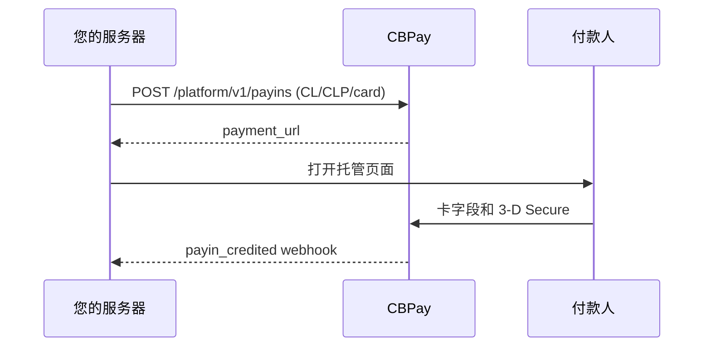

import { EnvUrls } from "/snippets/env-urls.jsx";

<EnvUrls lang="zh" />

当智利付款人需要使用银行卡支付 CLP 时使用此通道。您的服务器创建
payin，CBPay 返回托管的 `payment_url`。请在弹窗或重定向中打开它。卡
数据留在托管字段中；发卡行要求时，3-D Secure 在结账模态框内完成。



## 创建 payin

```bash
curl -X POST https://api.qbank.cl/platform/v1/payins \
  -H "Authorization: Bearer <token>" \
  -H "Idempotency-Key: cl-card-order-8841" \
  -H "Content-Type: application/json" \
  -d '{"country":"CL","currency":"CLP","method":"card","amount":"150000","description":"订单 8841","idempotency_key":"cl-card-order-8841"}'
```

```json
{"payin_id":"7a2b…","status":"pending","country":"CL","currency":"CLP","method":"card","amount":"150000","payment_url":"https://api.qbank.cl/pay/cards/9f3XkT…"}
```

`idempotency_key` 必须放在 body 或 `Idempotency-Key` header 中。CLP
必须是整数；`"150000.50"` 返回 `400 invalid_amount`。使用相同 key 重放
会返回原 payin，并带有 `idempotency_hit: true`；结果不明确时不要创建
新 key。

## 托管结账与已保存卡

在弹窗中打开 `payment_url`。结账页仅在 `CL/CLP/card` 下显示等待模态框，
提交前校验整数 CLP，并以状态指示器显示可用性。保存卡需要集成方提出
保存选项并取得付款人同意。之后的 one-click 和 MIT 扣款通过服务器端
已保存卡接口完成；PAN 不会发送到您的服务器。

通用 checkout 只有在目录报告可用时才会报价 `CL/CLP/card`。显示该选项
前请读取 `GET /platform/v1/payins/methods`。

### 付款人证件（可选）

对于银行卡收款，`customer` 会作为 `bill_to` 发送到核心服务。你可以提供
`document_type` 和 `document_number` 用于反欺诈评分。证件可选：省略两个字段
也有效。对于 `CL`，提供号码时 `document_type` 默认为 `RUT`，
`document_number` 必须是有效的智利 RUT（模 11，可带或不带标点）。无效
RUT 会在扣款 claim 前返回 `400 invalid_payload`。其他国家接受最多 50 个
字符的纯文本；不接受 markup 或更长的值。

```json
{
  "customer": {
    "first_name": "Ana",
    "last_name": "Rojas",
    "email": "payer@example.com",
    "country": "CL",
    "document_type": "RUT",
    "document_number": "11.111.111-1"
  },
  "save_card": true
}
```

### 确认银行卡是否已保存

当提供 `save_card: true` 且付款人同意保存时，已批准的 `complete` 响应会包含
`card_saved`。`true` 表示凭据已保存，可以通过已保存银行卡流程使用。`false`
表示付款成功但银行卡没有保存；应清楚提示付款人，不能再次扣款。未提供或未
请求保存时不会返回此字段。

## 查询、撤销和退款

```bash
curl https://api.qbank.cl/platform/v1/payins/7a2b… -H "Authorization: Bearer <token>"
curl "https://api.qbank.cl/platform/v1/payins?from=2026-11-01&to=2026-11-30&country=CL&currency=CLP&method=card&page=1&page_size=50" -H "Authorization: Bearer <token>"
```

结算前可以撤销已授权付款。退款是半自动的：创建后可能为 `pending`，
由签名通知完成。两者都要求幂等性；不明确的发送不会自动重试。

| 状态 | 含义 |
|---|---|
| `pending` | 托管结账等待付款人 |
| `credited` | 已确认并入账 |
| `failed` | 已明确拒付 |
| `refunded` | 已确认退款 |
| `review` | 需要对账；不要再次扣款 |

## 错误

| HTTP | 代码 | 解决方法 |
|---:|---|---|
| 400 | `invalid_amount` | 发送整数 CLP 金额 |
| 400 | `idempotency_key_required` | 发送 body 字段或 header |
| 409 | `idempotency_conflict` | 使用原 payload 和原 key |
| 422 | `core_rejected` | 显示托管页失败，不要盲目重试 |
| 503 | `core_unavailable` | 读取 payin，仅使用相同 key 重试 |

## Webhook

处理前必须验证签名。相关事件为 `payin_credited`、`payin_refunded`、
`dispute` 和 `card_stored`。

```json
{"event":"payin_credited","payin_id":"7a2b…","country":"CL","currency":"CLP","amount":"150000","status":"credited"}
```

## 常见问题

<AccordionGroup>
<Accordion title="可以发送带小数的 CLP 吗？">
不可以。智利比索没有小数单位，请发送整数字符串。
</Accordion>
<Accordion title="创建请求超时怎么办？">
读取资源，或使用相同幂等 key 重复请求。不要发送新的扣款。
</Accordion>
<Accordion title="退款什么时候完成？">
在签名通知确认前，退款可能保持 `pending`。
</Accordion>
</AccordionGroup>
