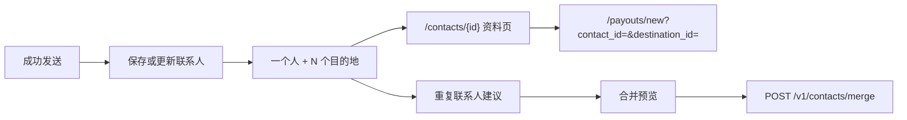

import { EnvUrls } from "/snippets/env-urls.jsx";

<EnvUrls lang="zh" />

联系人代表一个人，而不是一个目的地。同一个人可以拥有多个可复用目的地：已关联的 CBPay 账户、按通道保存的出金收款人，以及按链保存的加密货币地址。成功发送资金时会自动保存，也可以主动创建或导入联系人。



## 统一通讯录

当发送流程没有电话、邮箱或已关联账户可用于识别人时，平台会按规范化显示名称合并自动保存。规范化会忽略大小写、重音符号和重复空格。如果仍有多个候选联系人，平台不会猜测；发送流程保持原有目的地行为，用户可以稍后在通讯录中选择。

一个联系人可以包含：

- 一个已关联的 CBPay 目的地；
- 一个或多个出金目的地，每个目的地有国家、货币和方法；
- 一个或多个加密货币目的地，每个目的地有区块链和地址。

通讯录只属于当前账户。联系人和目的地按所有者隔离，不会跨账户读取。

## 门户中的联系人

门户的 `/contacts` 页面提供工具栏，可按搜索词、来源、仅 CBPay、收藏、目的地类型、国家和排序筛选。页面显示服务器返回的 `total`，并支持分页。展开目的地后，搜索也会匹配标签、出金通道字段以及加密货币网络或地址。

每一行都可以打开 `/contacts/{id}`。资料页工具栏提供返回、编辑和删除，显示收藏状态、目的地数量以及按类型分组的目的地卡片。每张卡片都可以重命名标签、删除目的地，或点击 **发送**。该操作打开 `/payouts/new?contact_id=<contact_id>&destination_id=<destination_id>`，从而使用指定的已保存目的地。

合并操作会先打开预览，显示联系人、目的地和保留联系人，然后才提交；建议本身不会自动合并。

## 列出和筛选联系人

需要在同一列表响应中取得目的地时使用 `expand=destinations`。这是批量展开，不会为每个联系人单独发请求。`dest_type` 和 `dest_country` 必须同时使用该展开参数。支持的筛选项包括 `q`、`source`、`has_destinations`、`sort`、`has_cbpay`、`favorite`、`page` 和 `page_size`，响应会返回 `total`。

```bash
curl "https://api.qbank.cl/platform/v1/contacts?q=carlos&source=import&has_destinations=true&sort=recent&expand=destinations&dest_type=payout&dest_country=CL&page=1&page_size=50" \\
  -H "Authorization: Bearer <token>"
```

```json
{
  "page": 1,
  "page_size": 50,
  "total": 1,
  "contacts": [{
    "contact_id": "3f8a1b2c-4d5e-6f70-8a9b-0c1d2e3f4a5b",
    "display_name": "Carlos Soto",
    "has_cbpay": true,
    "destinations": [{
      "destination_id": "bb22c3d4-5e6f-7a80-9b0c-1d2e3f4a5b6c",
      "type": "payout",
      "country": "CL",
      "currency": "CLP",
      "method": "bank_transfer",
      "label": "Cuenta principal"
    }]
  }]
}
```

无效的布尔值、排序、来源或目的地筛选会安全失败并返回 `400 invalid_filter`。未知展开值返回 `400 invalid_expand`。

## 创建、读取和更新

也可以直接创建联系人：

```bash
curl -X POST https://api.qbank.cl/platform/v1/contacts \\
  -H "Authorization: Bearer <token>" -H "Content-Type: application/json" \\
  -d '{"display_name":"Carlos Soto","phone":"+56987654321","favorite":true}'
```

```json
{
  "contact_id": "3f8a1b2c-4d5e-6f70-8a9b-0c1d2e3f4a5b",
  "display_name": "Carlos Soto",
  "phone": "+56987654321",
  "has_cbpay": true,
  "source": "manual",
  "favorite": true,
  "destinations": [],
  "created_at": "2026-11-13T12:00:00Z",
  "updated_at": "2026-11-13T12:00:00Z"
}
```

`GET /v1/contacts/{contact_id}` 返回完整资料及目的地。`PATCH /v1/contacts/{contact_id}` 支持部分更新名称、别名、电话、邮箱或收藏状态；修改电话会重新执行 CBPay 匹配。

```bash
curl -X PATCH https://api.qbank.cl/platform/v1/contacts/3f8a1b2c-4d5e-6f70-8a9b-0c1d2e3f4a5b \\
  -H "Authorization: Bearer <token>" -H "Content-Type: application/json" \\
  -d '{"display_name":"Carlos Soto","alias":"Carlitos","favorite":true}'
```

`DELETE /v1/contacts/{contact_id}` 会删除联系人及其已保存目的地。

## 添加和标记目的地

使用 `POST /v1/contacts/{contact_id}/destinations` 添加出金、加密货币或 CBPay 目的地。平台按指纹去重。

```bash
curl -X PATCH https://api.qbank.cl/platform/v1/contacts/3f8a1b2c-4d5e-6f70-8a9b-0c1d2e3f4a5b/destinations/bb22c3d4-5e6f-7a80-9b0c-1d2e3f4a5b6c \\
  -H "Authorization: Bearer <token>" -H "Content-Type: application/json" \\
  -d '{"label":"Cuenta principal"}'
```

响应返回更新后的目的地。使用 `DELETE /v1/contacts/{contact_id}/destinations/{destination_id}` 只删除该目的地。

## 查找重复联系人并预览合并

建议接口只读，并按折叠后的名称分组。建议是候选项，不会自动合并：

```bash
curl https://api.qbank.cl/platform/v1/contacts/duplicates \\
  -H "Authorization: Bearer <token>"
```

```json
{
  "groups": [{
    "name": "juan perez",
    "contact_ids": ["3f8a1b2c-4d5e-6f70-8a9b-0c1d2e3f4a5b", "9c1d2e3f-4a5b-6c7d-8e9f-0a1b2c3d4e5f"],
    "display_names": ["Juan Pérez", "JUAN PEREZ"],
    "contacts_count": 2,
    "destinations_count": 3
  }]
}
```

确认预览后，可以提交 2 到 20 个不同的联系人 ID，并在需要时指定保留联系人：

```bash
curl -X POST https://api.qbank.cl/platform/v1/contacts/merge \\
  -H "Authorization: Bearer <token>" -H "Content-Type: application/json" \\
  -d '{"contact_ids":["3f8a1b2c-4d5e-6f70-8a9b-0c1d2e3f4a5b","9c1d2e3f-4a5b-6c7d-8e9f-0a1b2c3d4e5f"],"surviving_contact_id":"3f8a1b2c-4d5e-6f70-8a9b-0c1d2e3f4a5b"}'
```

`200` 响应是完整的保留联系人，并包含 `merged_contact_ids`。目的地在一个事务中移动；缺失或属于其他账户的 ID 返回 `404`，不会产生部分合并。

<Warning>
`POST /v1/contacts/merge` 不是幂等操作。成功合并后源联系人已被删除，盲目重试会返回 `404`。遇到不明确的 timeout 不要重新发送；先读取联系人和建议，再由客户端决定。
</Warning>

## 错误和状态

| HTTP | 错误 | 含义 | 处理 |
|---|---|---|---|
| 400 | `invalid_filter` / `invalid_expand` | 筛选或展开不支持 | 使用文档中的值；目的地筛选先加 `expand=destinations` |
| 400 | `batch_too_large` | 合并超过 20 个联系人 | 拆分并逐次人工确认 |
| 404 | `not_found` | 联系人或目的地不存在或属于其他账户 | 重新读取资料，不要猜测 ID |
| 409 | `duplicate` | 电话或邮箱会与其他联系人冲突 | 编辑已有联系人或检查重复建议 |

联系人变更是同步的：成功的 `200` 或 `201` 是最终结果；`4xx` 表示拒绝且没有部分修改。联系人没有 webhook；从联系人发起的资金操作继续遵循 payout、转账或提现本身的状态和幂等规则。

## 常见问题

<AccordionGroup>
<Accordion title="一个人有多个银行账户时需要多个联系人吗？">不需要。保留一个联系人，按国家、货币和方法添加多个出金目的地。</Accordion>
<Accordion title="为什么同名联系人没有自动合并？">建议机制是保守的。如果存在多个候选，平台不会推断身份；请使用预览并选择保留联系人。</Accordion>
<Accordion title="timeout 后可以重试合并吗？">不要盲目重试。合并不是幂等的；先读取联系人和建议，成功后源 ID 已不存在。</Accordion>
<Accordion title="如何从资料页发送？">在目的地卡片上点击发送。门户会打开 `/payouts/new?contact_id=...&destination_id=...` 并带上目的地上下文。</Accordion>
<Accordion title="其他账户能读取我的目的地吗？">不能。读取和写入只允许当前已认证账户。</Accordion>
<Accordion title="删除目的地后会怎样？">只删除该目的地；联系人和其他目的地仍然保留。</Accordion>
</AccordionGroup>
