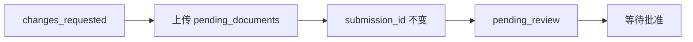

import { EnvUrls } from "/snippets/env-urls.jsx";

<EnvUrls lang="zh" />

## 继续当前案件

你的账户只有**一个当前验证案件**。之后出现的 `rejected` 记录不会使仍可补正的早期案件失效。当已有请求在进行中时，`POST /v1/me/verification/link` 会返回 `409 self_verification_in_progress`，且不返回新 URL：

```json
{
  "error": {
    "code": "self_verification_in_progress",
    "message": "a verification is already in progress"
  }
}
```

调用 `GET /v1/me/verification` 并重新打开已有的 `link.url`。不要创建第二个案件，也不要更换幂等键。

如果可补正的链接在提交件仍为 `changes_requested` 或
`more_info_required` 时过期，打开链接会自动将其重新开放 90 天。其状态
为 `opened`，响应会报告 `changes_requested` 以及
`next_step: resubmit`。已终止或已撤销的链接仍保持关闭。

## 原地重新提交

只要还可以补正，当前提交件就会暴露：

```json
{
  "submission_id": "sub_123",
  "status": "changes_requested",
  "pending_documents": ["proofOfResidence"],
  "documents_received": ["identity"],
  "changes_requested_comments": "Upload a legible proof of residence.",
  "documents_gate": { "ok": false, "total": 2, "matched": 1 }
}
```

在现有向导中上传 `pending_documents` 里的每一项。向导会**原地**重新提交：`submission_id` 不变，也不会创建新的提交件。最后一项所需文件通过后，案件自动回到 `pending_review`，门户显示**等待批准**。

对于 `/on/ubo/` 中受邀的 UBO 或董事，如果缺少声明，审核卡会显示
**仍缺少你对宣誓声明的签名**。UBO 可以直接在页面内签署；签署即可继续，
案件仍保持在审核中。

过期链接页面会明确区分，说明你的进度已保存，并要求申请新链接。



<AccordionGroup>
  <Accordion title="为什么我收到了 409？">
    已存在一个当前 self 验证案件。请读取当前验证并复用其开放链接。
  </Accordion>
  <Accordion title="重新提交会创建新的审核吗？">
    不会。现有提交件会被更新，所要证据齐全后回到审核。
  </Accordion>
</AccordionGroup>

可操作的错误码见[错误目录](/zh/errors)。

## 公司自己的第三方案件

公司账户在尚未批准时，也可以读取自己提交的第三方 KYC/KYB 案件。这些
接口只读，并限定到已认证的公司账户；不会创建、采用或修改验证。

### 列出案件

```bash
curl "https://api.qbank.cl/platform/v1/me/verifications/kyb/third-party?page=1&page_size=50&from=2026-11-01&to=2026-11-07&status=changes_requested" \
  -H "Authorization: Bearer <account-token>"
```

```json
{
  "page": 1,
  "page_size": 50,
  "submissions": [{
    "submission_id": "c3d4e5f6-a7b8-4c9d-0e1f-2a3b4c5d6e7f",
    "kind": "kyb",
    "status": "changes_requested",
    "external_customer_id": "link:7f8e9d0c-1b2a-4c3d-8e4f-0a1b2c3d4e5f",
    "created_at": "2026-11-03T16:18:20Z",
    "updated_at": "2026-11-06T16:37:23Z"
  }]
}
```

支持 `page`、`page_size`（最多 200）、`status`，以及可选的
`from`/`to` 筛选。省略时 API 使用默认日期范围；建议显式传递以保证分页
可复现。列表来自平台镜像，不会对每一行单独请求 core。

### 读取补正详情

```bash
curl "https://api.qbank.cl/platform/v1/me/verifications/kyb/third-party/c3d4e5f6-a7b8-4c9d-0e1f-2a3b4c5d6e7f" \
  -H "Authorization: Bearer <account-token>"
```

```json
{
  "submission_id": "c3d4e5f6-a7b8-4c9d-0e1f-2a3b4c5d6e7f",
  "kind": "kyb",
  "status": "changes_requested",
  "external_customer_id": "link:7f8e9d0c-1b2a-4c3d-8e4f-0a1b2c3d4e5f",
  "pending_documents": ["proofOfAddress", "financialStatements"],
  "changes_requested_comments": "Please upload the listed documents.",
  "created_at": "2026-11-03T16:18:20Z",
  "updated_at": "2026-11-06T16:37:23Z"
}
```

详情会在可用时读取 core 的最新状态；临时无法增强时返回安全镜像。迁移
案件会返回 `status: "migrated"`、`migrated_from` 和 `migrated_to`。

| HTTP | 代码 | 解决方案 |
|---:|---|---|
| 400 | `invalid_range` | 修正格式错误的 `from`/`to`，并使用文档规定的日期格式。 |
| 401 | `unauthorized` | 刷新账户令牌并使用 Bearer 发送。 |
| 403 | `company_account_required` | 使用公司账户。 |
| 404 | `not_found` | 确认案件属于当前认证账户。 |

<AccordionGroup>
  <Accordion title="账户必须先批准吗？">
    不需要。公司可读取任何状态的第三方案件以完成补正；写入操作仍遵守原有权限门槛。
  </Accordion>
  <Accordion title="读取会创建或采用案件吗？">
    不会。两个接口都是纯读取，不会改变状态。
  </Accordion>
  <Accordion title="如何提交所要求的文件？">
    使用同一个托管流程，并保留原来的 `submission_id`。
  </Accordion>
</AccordionGroup>
