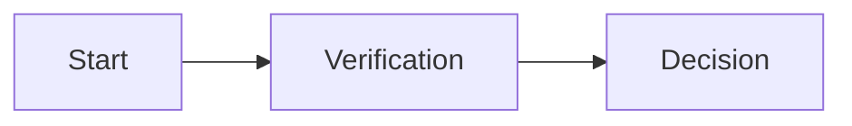

import { EnvUrls } from "/snippets/env-urls.jsx";

<EnvUrls lang="zh" />

- [Overview](/zh/guides/kyc-overview)
- [OCR and liveness](/zh/guides/kyc-ocr)
- [Errors](/zh/errors)

<AccordionGroup>
<Accordion title="Where do I start?">Start with the overview.</Accordion>
</AccordionGroup>
