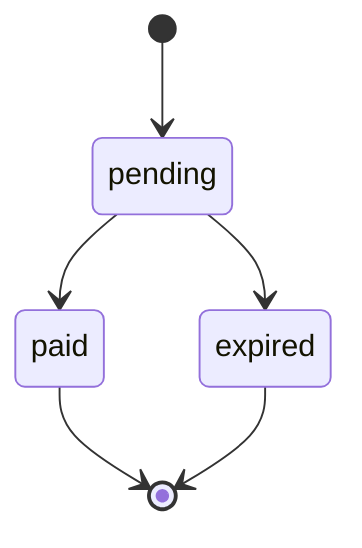

import { EnvUrls } from "/snippets/env-urls.jsx";

<EnvUrls lang="zh" />

QR payin 允许客户使用其银行 App 完成付款。当客户端可能在超时或网络
响应不明确后重试时，请使用幂等键。



## 创建 QR payin

向 `POST /v1/payins` 发送 `method: "qr"`。幂等键为可选字段，可以放在
JSON body 中，也可以放在 `Idempotency-Key` 请求头中。

```bash
curl -X POST https://api.qbank.cl/platform/v1/payins \
  -H "Authorization: Bearer <token>" \
  -H "Content-Type: application/json" \
  -d '{
    "country": "BO",
    "currency": "BOB",
    "method": "qr",
    "amount": "700.00",
    "description": "App top-up",
    "idempotency_key": "qr-bo-700-20261002-001",
    "expires_in": 3600
  }'
```

### QR 过期时间限制

平台 QR payin 的 `expires_in` 是以秒为单位的整数。服务器选择已配置的
QR 轨道，集成方不能选择轨道。legacy QR 合同的有效上限为 `86399` 秒
（23:59:59）。7 天 QR 轨道的有效上限为 `604800` 秒（7 天）；当值缺失
或不为正数时，默认值为 `86400` 秒（24 小时）。超过所选轨道上限的值会
被截断，不会被拒绝。对于 7 天轨道，建议至少使用 `120` 秒。
响应会在 `charge.requested_expires_in` 中保留请求的秒数。如果轨道返回
更短的有效期，还会返回包含 `requested_expires_in`、
`actual_expires_in` 和说明的 `ttl_notice`；请以 `charge.expires_at` 为准。

响应 `201`：

```json
{
  "payin_id": "9c2a1b2c-3d4e-5f60-7a8b-9c0d1e2f3a4b",
  "status": "pending",
  "reference": "77849505",
  "charge": {
    "charge_id": "c9d8e7f6-a5b4-c3d2-e1f0-a9b8c7d6e5f4",
    "our_reference": "77849505",
    "qr_image": "<base64 PNG>",
    "qr_image_url": "https://cdn.example.test/qr/77849505.png",
    "qr_payload": "<轨道提供时才有的 QR 内容>",
    "expires_at": "2026-10-29T19:00:00Z",
    "requested_expires_in": 3600,
    "status": "pending"
  }
}
```

展示 `qr_image` 或 `qr_image_url`；仅在存在时使用 `qr_payload`。巴西只返回
PNG 图像，不提供复制粘贴 payload。数字 `reference` 是可引用的支持编号。
客户付款后账户会自动入账；使用 `GET /v1/payins/{payinID}` 查询状态。

## 巴西：BRL 或 BOB PIX QR

巴西 `method: "qr"` 接受 `currency: "BRL"`（推荐）或 `currency: "BOB"`
（高级直接模式）。使用 BRL 时，平台按当前 mid 汇率报价 BOB，不在报价中
加入 spread，再将转换后的 BOB 金额发送给 core。入账和费用基于实际收到的
BOB。报价会被快照保存，幂等 replay 保留原始报价。

### 推荐：以 BRL 输入付款人金额

```bash
curl -X POST https://api.qbank.cl/platform/v1/payins -H "Authorization: Bearer <token>" -H "Content-Type: application/json" -d '{"country":"BR","currency":"BRL","method":"qr","amount":"120.00","description":"Order 7719","payer_document":"52998224725","payer_phone":"+5511999990000","payer_email":"payer@example.test","expires_in":1800,"idempotency_key":"qr-brl-20261022-001"}'
```

响应包含 QR 图像、付款人必须实际支付的 BRL 金额、收取的 BOB 金额和可审计的报价：

```json
{"reference":"77849505","charge":{"our_reference":"77849505","qr_image":"<base64 PNG>","qr_image_url":"https://cdn.example.test/qr/77849505.png","conversion":{"amount":"120.00","currency":"BRL","rate":"0.50"},"expires_at":"2026-10-22T12:57:14.937Z","requested_expires_in":1800,"bob_charged":"240.00","platform_quote":{"quoted_currency":"BRL","quoted_amount":"120.00","charged_currency":"BOB","charged_amount":"240.00","rate_brl_per_usd":"5.0000000000","rate_bob_per_usd":"10.0000000000","rates_updated_at":"2026-10-22T20:00:00Z"},"status":"pending"}}
```

`conversion.amount` 是付款人必须支付的确切金额，也是展示的唯一事实来源。
轨道自己的汇率可能让它明显不同于输入值：例如输入 `5.41` BRL 时，
QR 可能要求 `5.84` BRL。不要在客户端用请求金额替代它。

如果轨道返回更短的有效期，响应仍然成功：

```json
{"reference":"77849505","ttl_notice":{"requested_expires_in":1800,"actual_expires_in":300,"note":"the rail returned a shorter lifetime than requested; the payer must pay within the actual window"},"charge":{"expires_at":"2026-10-29T18:05:00Z","requested_expires_in":1800}}
```

巴西请请求 `expires_in: 300`，并在门户中显示固定的五分钟提示。

### 高级：直接输入 BOB 收取金额

对于 `country: "BR"`、`currency: "BOB"` 和 `method: "qr"`，charge 以 BOB
计价，付款人通过通道转换以 BRL 支付。付款人的 CPF 是必填项；
`payer_phone` 与 `payer_email` 为可选字段：

```bash
curl -X POST https://api.qbank.cl/platform/v1/payins \
  -H "Authorization: Bearer <token>" -H "Content-Type: application/json" \
  -d '{"country":"BR","currency":"BOB","method":"qr","amount":"1.00","description":"Order 7719","payer_document":"52998224725","payer_phone":"+5511999990000","payer_email":"payer@example.test","idempotency_key":"qr-br-bob-20261022-001"}'
```

响应为 `201`，状态为 `pending`，并包含 QR 图像字段、付款人看到的转换
和通道过期时间。巴西通道合同只提供 PNG 图像，不提供可复制粘贴的 EMV
payload：

```json
{
  "payin_id": "2f7b2a6e-6d1c-4c71-9d5e-4e0c2e7a1101",
  "status": "pending",
  "charge": {
    "charge_id": "8d4f1a90-0d7a-4fb1-8b51-8f3cc2b1e401",
    "our_reference": "77849505",
    "qr_image": "<base64 PNG>",
    "qr_image_url": "https://cdn.example.test/qr/77849505.png",
    "conversion": {
      "amount": "0.48",
      "currency": "BRL",
      "rate": "0.48"
    },
    "expires_at": "2026-10-22T12:57:14.937Z",
    "requested_expires_in": 300,
    "status": "pending"
  }
}
```

`BR`/`BOB` 和 `BR`/`BRL` corridor 的 checkout link quote 都会返回 `payer_required: true`。托管页面
会在 materialize charge 前要求付款人填写 CPF。
checkout link 同时报价两者：面向付款人的 `BRL`（materialize 时按与 direct payin 相同的 mid 汇率转换为 BOB，
并附带 `platform_quote` 快照）以及直接 `BOB`；同一 method 有两种货币时，materialize 调用需带 `?currency=BRL`（或 `BOB`）。

### 查询 QR payin

详情接口返回完整的已清理 charge，以便页面刷新后重新渲染二维码：

```json
{"payin_id":"2f7b2a6e-6d1c-4c71-9d5e-4e0c2e7a1101","kind":"qr","status":"pending","reference":"77849505","charge":{"charge_id":"8d4f1a90-0d7a-4fb1-8b51-8f3cc2b1e401","our_reference":"77849505","qr_image":"<base64 PNG>","qr_image_url":"https://cdn.example.test/qr/77849505.png","conversion":{"amount":"5.84","currency":"BRL","rate":"0.48"},"status":"pending","expires_at":"2026-10-29T18:05:00Z","requested_expires_in":300,"created_at":"2026-10-29T18:00:00Z","updated_at":"2026-10-29T18:00:01Z"},"ttl_notice":{"requested_expires_in":1800,"actual_expires_in":300,"note":"the rail returned a shorter lifetime than requested; the payer must pay within the actual window"}}
```

列表（`GET /v1/payins`）中的 QR 只包含 `charge.conversion` 和
`charge.expires_at`，不会返回图像。请使用明确的日期筛选：
`?from=2026-10-01&to=2026-10-31&kind=qr&page=1&page_size=50`。

<Note>
Checkout link 中带有图像的内部 QR 过期后，checkout 会在提供给付款人之前
自动重新生成新的 QR。绝不会把已过期图像作为可支付二维码展示。
</Note>

### 确认与对账

流程优先使用 webhook。经过认证的入站事件（通道 webhook 使用配置的
`x-api-key` header）可以关闭 `pending` charge；延迟
对账读取只有在达到最小年龄后才允许（默认 15 分钟）。平台状态验证为
`credited` 前，charge 保持 `pending`，不得入账。

订阅 `payin_credited` 和 `payin_charge_status_changed`，并使用
`GET /v1/payins/{payinID}` 作为事实来源。结果不明确时不要使用新的幂等键
重新创建付款。

## 巴西错误

| HTTP | Code | 处理方式 |
| --- | --- | --- |
| 400 | `invalid_request` | 为巴西 QR payin 提供 `payer_document`，并使用 `BRL` 或 `BOB`。 |
| 422 | `amount_too_small` | 增加 BRL 金额；转换并 half-up 舍入后必须至少为 `0.01 BOB`。 |
| 422 | `provider_rejected` | 付款轨道拒绝了 charge，包括 adapter 边界缺少 CPF；根据 `detail` 修正数据，不要盲目重试。 |
| 503 | `rates_unavailable` | 汇率恢复后使用相同幂等 key 重试；此时不会创建 charge。 |

## 幂等重试

QR payin 的 `idempotency_key` 为可选字段。可将它放在 JSON body 中，也
可以放在 `Idempotency-Key` 请求头中。如果两者同时存在，使用 body 中的
值。平台会在服务端按账户对 key 加 namespace；集成方发送的 key 不会被
修改。

请求身份包括国家、货币、方式和数值金额。例如，`"100"` 与 `"100.00"`
等价。`description` 只是展示文本，不属于 replay 身份。
QR 渠道不属于 replay 身份：相同 key 会重放同一笔 charge，与渠道无关。

第一次请求只创建一笔 charge。使用相同 key 和等价 payload 重试时，API
返回原始对象并带有 `idempotency_hit: true`，不会创建第二笔 charge：

```json
{
  "payin_id": "9c2a1b2c-3d4e-5f60-7a8b-9c0d1e2f3a4b",
  "status": "pending",
  "charge": {
    "charge_id": "c9d8e7f6-a5b4-c3d2-e1f0-a9b8c7d6e5f4",
    "status": "pending"
  },
  "idempotency_hit": true
}
```

请求头形式等价：

```bash
curl -X POST https://api.qbank.cl/platform/v1/payins \
  -H "Authorization: Bearer <token>" \
  -H "Idempotency-Key: qr-bo-700-20261002-001" \
  -H "Content-Type: application/json" \
  -d '{"country":"BO","currency":"BOB","method":"qr","amount":"700.00","description":"App top-up"}'
```

如果同一个 key 对应的国家、货币、方式或金额发生变化，API 返回
`409 idempotency_conflict`：

```json
{
  "error": "idempotency_conflict",
  "message": "this idempotency key was used with a different payload"
}
```

已过期或已支付的 charge 仍会按原对象 replay。响应保留原始对象；使用
`GET /v1/payins/{payinID}` 查询实时状态。

核心和平台都会在集成方 key 超过 256 个字符或包含回车/换行时返回
`400 invalid_idempotency_key`。如果平台在服务端添加的账户 namespace
使最终 key 超过 256 个字符，平台也会返回相同的错误码。该 namespace
对集成方不可见：请原样发送 key。

## 错误

| HTTP | Code | 处理方式 |
| --- | --- | --- |
| 400 | `invalid_idempotency_key` | 将 key 缩短到 256 个字符以内，并移除控制字符。 |
| 409 | `idempotency_conflict` | 重试原始 payload，或为新的 charge 生成新 key。 |

## 常见问题

<AccordionGroup>
<Accordion title="重试时可以修改 description 吗？">
可以。description 只是展示文本，不属于 replay 身份。
</Accordion>

<Accordion title="如果请求超时时客户已经付款怎么办？">
使用相同 key 重试，然后使用返回的 `payin_id` 调用
`GET /v1/payins/{payinID}`。同一笔操作不要生成新 key。
</Accordion>

<Accordion title="所有 QR payin 都需要 CPF 吗？">
只有巴西（`BR`/`BRL` 或 `BOB`/`qr`）需要。通道会验证 CPF 是否存在；
虚构或未知 CPF 可能返回 `CPF no encontrado`。其他 QR corridor 保持各自要求。
</Accordion>

<Accordion title="巴西 QR 的金额如何工作？">
推荐输入付款人应支付的 BRL；平台按 mid 汇率转换为 BOB 并保存报价。
需要直接指定 core charge 时才使用 BOB。
</Accordion>

<Accordion title="为什么付款金额可能相差几分钱？">
`conversion.amount` 是轨道返回给付款人的确切金额。轨道汇率可能使它
不同于请求值：一次真实事件中输入 `5.41` BRL，而 QR 显示 `5.84` BRL。
始终展示 `conversion.amount`，不要在客户端重新计算。
</Accordion>

<Accordion title="为什么巴西 QR 五分钟后过期？">
部分巴西 QR 轨道强制约五分钟的有效期，并忽略更长的请求值。API 保留
`charge.requested_expires_in`，返回实际的 `charge.expires_at`，并在差异
明显时增加 `ttl_notice`。请请求 `expires_in: 300`，过期后创建新的 QR。
</Accordion>

<Accordion title="QR 列表包含哪些内容？">
`GET /v1/payins` 只返回含 `conversion` 和 `expires_at` 的轻量 `charge`。
需要图像或完整 charge 时，请调用 `GET /v1/payins/{id}`。
</Accordion>

<Accordion title="汇率不可用时怎么办？">
API 在创建 charge 前返回 `503 rates_unavailable`。稍后使用相同幂等 key
重试。
</Accordion>

<Accordion title="什么时候可以把巴西 QR payin 当作已支付？">
只有在 API 返回已验证的 `credited` 状态或收到对应 webhook 后才可以。
生成或扫描 QR 本身不是结算证明。
</Accordion>

<Accordion title="生产环境 BO/BOB QR payin 的 expires_in 最大值是多少？">
在平台 API 中，当服务器选择 7 天 QR 轨道时，有效最大值为
`604800` 秒（7 天）。legacy QR 轨道的有效最大值为 `86399` 秒
（23:59:59）。超过所选上限的值会被截断，不会被拒绝；集成方不能选择
轨道。对于 7 天轨道，建议至少使用 `120` 秒。
</Accordion>
</AccordionGroup>
