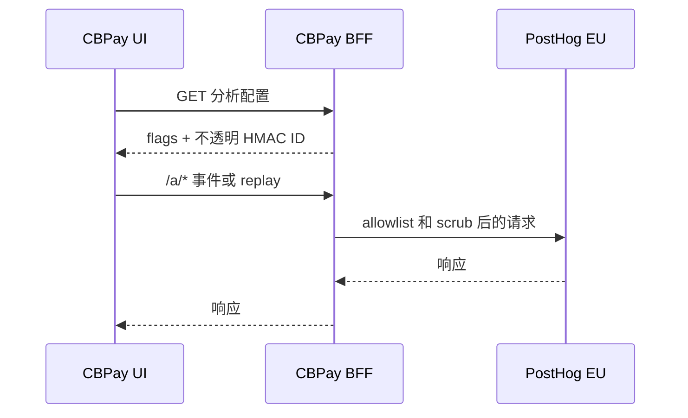

import { EnvUrls } from "/snippets/env-urls.jsx";

<EnvUrls lang="zh" />

产品分析帮助您了解激活、功能采用和集成健康状况，同时不收集客户身份或
原始财务数据。浏览器向平台请求受限配置；它不会读取密钥，也不会自行
推导账户身份。

## 测量内容

事件描述产品行为，而不是客户档案。tracking plan 覆盖注册和登录、引导、
KYC/KYB、payins、payouts、转账、swap、卡片、银行服务、公开验证页面、
支持和管理员操作。涉及资金的 server 事件是权威来源；前端只记录 UI 行为。

允许的属性是 `country`、`currency`、`method`、`service`、`status`、`source`、
`account_type`、语言环境以及金额或评分区间等受限值。排除邮箱、姓名、电话、
RUT/tax ID、账户或卡号、精确金额、原始请求体、供应商身份、token 和 AML/CFT
原因。数据离开平台前会经过过滤与 scrub。

## Opt-in 同意横幅

分析采用 opt-in。横幅解释用途并提供接受或拒绝。获得同意前 SDK 不会初始化，
配置也保持禁用。拒绝选择会被尊重，不会在下一次加载时强制打开。

已认证页面使用 `GET /v1/me/analytics-config`。匿名页面使用
`GET /v1/public/analytics-config`，不会获得身份。配置包含 `consent_required`、
`cb_env`、`proxy_path`、EU host hint；禁用时 token 为空。

## Replay 仅限门户

Session replay 只在已同意的认证客户门户启用。管理员页面和所有公开页面都关闭。
已发布客户端默认遮盖所有输入和文本、阻止敏感 selector 并覆盖 QR 内容；replay
不是支持录音，也不是身份来源。

## First-party proxy

浏览器将 PostHog 流量发送到 same-origin `/a/*`。代理只接受 `e`、`i`、`batch`、
`decide`、`array`、`static` 和 `capture`，仅转发必要内容与 `PostHog-*` header，
删除 cookie 和 forwarding header，并将 bearer token 固定到本项目。请求上限 64 MiB，
上游超时 10 秒，每个 IP 每小时 1,200 次。未知路径、无效 token 和禁用状态都会 fail closed。

## 配置端点

完整响应形状见 OpenAPI 参考：

- `GET /v1/me/analytics-config`（`getMyAnalyticsConfig`）— 已认证账户门户；仅启用时返回 HMAC 绑定的 `distinct_id` 和 `group_id`，并在启用时返回 `replay: true`。
- `GET /v1/public/analytics-config`（`getPublicAnalyticsConfig`）— 匿名 tracker、同意、验证和 embed 页面；`replay` 始终为 false。

错误请查看[错误目录](/zh/errors)：`service_unavailable`、`invalid_token`、
`rate_limited`、`not_found` 和 `upstream_unavailable`。

## 常见问题

<AccordionGroup>
<Accordion title="CBPay 会把个人数据发送到 analytics 吗？"> 不会。allowlist 排除直接身份和精确财务值。ID 是不透明 HMAC，金额使用区间。</Accordion>
<Accordion title="可以在管理员或公开页面使用 replay 吗？"> 不可以。Replay 仅限门户且经过遮盖。管理员和公开配置返回 `replay: false`。</Accordion>
<Accordion title="为什么浏览器调用 /a 而不是直接调用 PostHog？"> First-party proxy 保持 same-origin，删除 forwarding 元数据，并将请求固定到配置的 EU 项目。</Accordion>
<Accordion title="没有配置 PostHog 时会怎样？"> 配置端点返回禁用 flags，代理返回 `503 service_unavailable`；业务请求不受 analytics 影响。</Accordion>
<Accordion title="保留与删除规则在哪里？"> Tracking plan 定义事件保留一年、replay 保留 90 天，以及账户删除时删除 HMAC identity。</Accordion>
</AccordionGroup>
