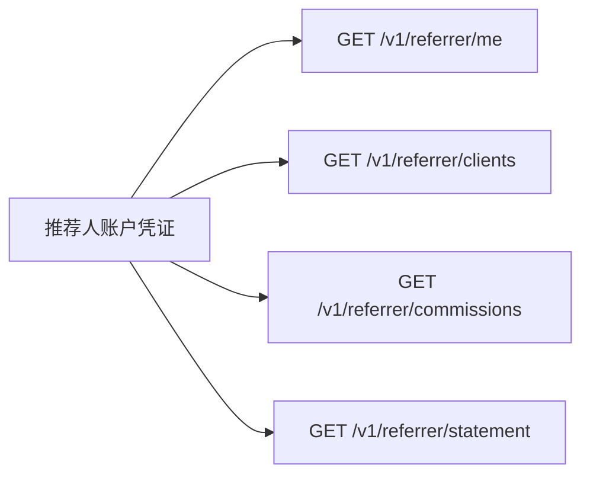

import { EnvUrls } from "/snippets/env-urls.jsx";

<EnvUrls lang="zh" />

推荐人门户是 active 推荐人 payout 账户凭证的只读页面。调用方不能提交
`referrer_id` 来访问其他推荐人；API 从已认证账户解析推荐人，因此只能
看到自己的客户、佣金和报表。



## 认证和限制

使用推荐人 payout 账户的 session 或 API 凭证。其他账户会收到
`404 not_found`。门户响应不包含内部服务商身份。

列表使用 `page` 和 `page_size`。佣金和报表必须提供 `from`、`to`。
`format` 支持 `json`（默认）、`pdf`、`xlsx`；`lang=en|es|zh` 用于下载
文件的人类可读标签。

## 1. 查看推荐人资料

```bash
curl "$CBPAY_URL/v1/referrer/me" \
  -H "Authorization: Bearer $REFERRER_TOKEN"
```

```json
{
  "id": "aaaaaaaa-aaaa-4aaa-8aaa-aaaaaaaaaaaa",
  "org_id": "99999999-9999-4999-8999-999999999999",
  "name": "Hernan Lopez",
  "code": "hernan",
  "email": "hernan@example.com",
  "payout_account_id": "11111111-1111-4111-8111-111111111111",
  "status": "active",
  "created_at": "2026-11-04T12:00:00Z",
  "updated_at": "2026-11-04T12:00:00Z"
}
```

此 endpoint 只读。组织管理员负责名称、状态、payout 账户和客户分配。

## 2. 查看客户分配

```bash
curl "$CBPAY_URL/v1/referrer/clients?status=active&page=1&page_size=50" \
  -H "Authorization: Bearer $REFERRER_TOKEN"
```

```json
{
  "page": 1,
  "page_size": 50,
  "assignments": [{
    "id": "bbbbbbbb-bbbb-4bbb-8bbb-bbbbbbbbbbbb",
    "org_id": "99999999-9999-4999-8999-999999999999",
    "referrer_id": "aaaaaaaa-aaaa-4aaa-8aaa-aaaaaaaaaaaa",
    "account_id": "33333333-3333-4333-8333-333333333333",
    "percent_bps": 2000,
    "percent": "20",
    "status": "active",
    "effective_from": "2026-11-04T12:01:00Z",
    "created_at": "2026-11-04T12:01:00Z"
  }]
}
```

使用 `status=active` 或 `status=revoked`。门户不会返回其他推荐人的分配。

## 3. 查看已计提佣金

```bash
curl "$CBPAY_URL/v1/referrer/commissions?from=2026-11-01&to=2026-12-01&status=pending&page=1&page_size=50" \
  -H "Authorization: Bearer $REFERRER_TOKEN"
```

```json
{
  "page": 1,
  "page_size": 50,
  "commissions": [{
    "id": "cccccccc-cccc-4ccc-8ccc-cccccccccccc",
    "org_id": "99999999-9999-4999-8999-999999999999",
    "referrer_id": "aaaaaaaa-aaaa-4aaa-8aaa-aaaaaaaaaaaa",
    "account_id": "33333333-3333-4333-8333-333333333333",
    "ref_type": "payout",
    "ref_id": "dddddddd-dddd-4ddd-8ddd-dddddddddddd",
    "asset": "USDT",
    "base_gross": "100.000000",
    "cost_amount": "25.000000",
    "base_net": "75.000000",
    "percent_bps": 2000,
    "percent": "20",
    "commission_amount": "15.000000",
    "cost_missing": false,
    "status": "pending",
    "period": "2026-11",
    "created_at": "2026-11-04T12:02:00Z"
  }]
}
```

佣金公式为 `floor(max(gross - cost, 0) × percent_bps / 10000)`。金额为
字符串而非浮点数。成本不可用时，行会标记 `cost_missing: true`，仍可审计。
可选过滤器为 `account_id`、`status`、`period`；`from` 和 `to` 限制范围。

## 4. 下载自己的报表

报表包括按资产 totals、客户摘要、交易明细、结算以及 `balanced` 对账标志，
并且只为当前已认证推荐人生成：

```bash
curl "$CBPAY_URL/v1/referrer/statement?from=2026-11-01&to=2026-12-01&format=json&lang=zh" \
  -H "Authorization: Bearer $REFERRER_TOKEN"
curl -OJ "$CBPAY_URL/v1/referrer/statement?from=2026-11-01&to=2026-12-01&format=pdf&lang=zh" \
  -H "Authorization: Bearer $REFERRER_TOKEN"
curl -OJ "$CBPAY_URL/v1/referrer/statement?from=2026-11-01&to=2026-12-01&format=xlsx&lang=zh" \
  -H "Authorization: Bearer $REFERRER_TOKEN"
```

JSON 响应包含 `org_id`、`org_name`、`referrer_id`、`referrer_name`、
`referrer_code`、`referrer_email`、`from`、`to`、`generated_at`、`totals`、`clients`、
`lines`、`closings`、`truncated`、`clients_truncated`、
`closings_truncated` 和 `balanced`。

PDF 和 XLSX 使用组织配置的 white-label logo、颜色、名称和 footer；未配置
时才使用 CBPay 默认品牌。

## 状态和错误

| 状态 | 含义 |
|---|---|
| `active` | 分配或推荐人可以计提佣金 |
| `inactive` | 不再新计提，历史佣金仍可见 |
| `pending` | 已计提，等待结算 |
| `reversed` | 之前的计提已冲正，保留在历史中 |
| `approved` | 已包含在审批通过的结算中 |
| `paid` | 已包含在已付款结算中 |
| `revoked` | 分配结束，历史保留 |

| HTTP | 错误代码 | 解决方法 |
|---:|---|---|
| 400 | `invalid_range` | 发送有效的 `from` 和 `to` 日期。 |
| 400 | `invalid_format` | 使用 `json`、`pdf` 或 `xlsx`。 |
| 404 | `not_found` | 使用 active 推荐人的 payout 账户认证。 |

参见[错误目录](/zh/errors)了解通用响应格式。

## 常见问题

<AccordionGroup>
  <Accordion title="可以选择推荐人 ID 吗？">不可以。推荐人由已认证的 payout 账户确定，不允许跨推荐人访问。</Accordion>
  <Accordion title="可以在这里修改比例或客户吗？">不可以。门户只读，请联系组织管理员。</Accordion>
  <Accordion title="为什么佣金是 pending？">佣金已经计提，但尚未关联到已审批或已付款的月度结算。</Accordion>
  <Accordion title="下载超时后怎么办？">使用相同日期范围和格式重复只读请求；报表请求不会触发付款。</Accordion>
  <Accordion title="支持哪些格式？">JSON 用于应用，PDF 用于正式报告，XLSX 用于分析。</Accordion>
</AccordionGroup>
