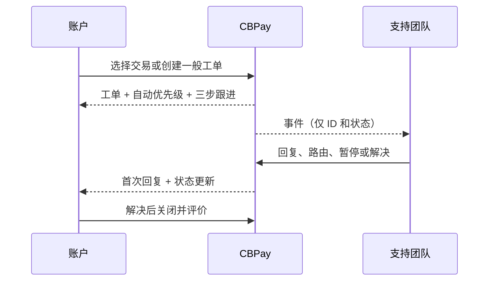

支持工单是与组织的可审计对话。可以从交易创建，也可以针对账户问题创建；之后可以关联、更换或解除交易。快照是只读证据，不会修改账本。



## 1. 选择流程

可以从交易详情创建，也可以在没有交易时使用 `kind: general`。后者必须使用 `category: other`；旧的 `general` 类别会在兼容期内转换为 `other`。

11 个类别为：交易类 `error`、`question`、`delay`、`amount_mismatch`、`unrecognized_operation`、`refund_request`；账户或其他 `account_verification`、`access_security`、`fraud`、`fees_limits`、`other`。另需发送 `money_stuck`：`yes`、`no` 或 `unknown`。

## 2. 创建工单

`kind` 必须是 `payout`、`payin`、`payin_refund`、`transfer`、`crypto_withdrawal`、`crypto_deposit`、`swap`、`card_purchase`、`banking_operation`、`wallet_send` 或 `wallet_deposit`。发送 `resource_id`；`general` 工单必须使用 `general` 类别并省略该字段。

```bash
curl -X POST https://api.qbank.cl/platform/v1/support/tickets \
  -H "Authorization: Bearer $ACCOUNT_TOKEN" -H "Content-Type: application/json" \
  -H "Idempotency-Key: support-payout-2026-0001" \
  -d '{"kind":"payout","resource_id":"payout-123","subject":"付款延迟","category":"delay","money_stuck":"yes","message":"请检查此付款。","idempotency_key":"support-payout-2026-0001"}'
```

首次请求返回 `201`，包含 `SUP-YYYY-NNNNNN` 编号、快照、SLA、`money_stuck` 和 `priority_source: auto`。客户不能选择优先级：欺诈/未识别 → urgent；资金卡住 → urgent；高金额交易错误 → high；访问安全 → high；其他 → normal。默认金额门槛为 USD 1,000。

幂等键按组织和账户限定，必须放在 body 或 header。重放返回 `idempotency_hit: true`；同一交易已有开放工单返回 `409 ticket_already_open`。网络超时后使用同一个密钥读取，不要生成新密钥。

## 3. 三步跟进

`open` 表示处理中；首次公开回复进入 `pending_customer`；`resolved` 后可以 CSAT；`closed` 是终态。账户回复会重新打开等待或已解决的工单。账户看不到内部备注和 Activity。

## 4. 搜索和关联交易

使用 `GET /v1/support/transactions?q=125&from=2026-10-01&to=2026-10-31&page=1&page_size=50`，结果含 11 种可关联交易和 `has_open_ticket`。为 true 时继续现有工单。

## 查看并继续对话

使用 `GET /v1/support/tickets?from=2026-10-01&to=2026-10-31&page=1&page_size=50` 列表。还可以按 `status`、`category`、`priority` 和 `kind` 过滤；`page_size` 最大为 200。详情包括 `snapshot`、公开消息和附件元数据。内部备注永远不会返回给账户。

```bash
curl -X POST https://api.qbank.cl/platform/v1/support/tickets/TICKET_ID/messages \
  -H "Authorization: Bearer $ACCOUNT_TOKEN" -H "Content-Type: application/json" \
  -d '{"body":"这里是更多背景信息。"}'
```

账户消息会把 `pending_customer`、`on_hold` 或 `resolved` 重新打开为 `open`。`closed` 是终态，请创建新工单。

## 附件

使用 multipart 字段 `file` 上传一个 `PDF`、`PNG` 或 `JPG`，最大 10 MiB。服务器检查真实签名并按工单 SHA-256 去重。下载是认证二进制响应，不要公开 `download_url`。

## 关闭和评价

`POST /v1/support/tickets/{id}/close` 具有收敛性：关闭已关闭工单会返回当前详情。解决后只能评价一次，`rating` 为 1 到 5，评论最多 1,000 个字符。重复评价返回 `409 already_rated`。

## 状态、SLA 和错误

| 状态 | 含义 | 操作 |
|---|---|---|
| `open` | 等待支持处理 | 必要时补充信息 |
| `pending_customer` | 支持已答复，等待账户 | 回复或关闭 |
| `on_hold` | 支持暂时暂停 | 等待或补充信息 |
| `resolved` | 支持已解决 | 评价或发送消息重新打开 |
| `closed` | 终态 | 创建新工单 |

默认首次回复 SLA 按 low、normal、high、urgent 分别为 4、2、1、0.5 小时；解决 SLA 为 48、24、8、4 小时。组织可以配置日历及等待客户时暂停 SLA，`sla_breached` 由服务器计算。

| HTTP | 代码 | 解决方案 |
|---:|---|---|
| 400 | `idempotency_key_required` | 在 body 或 `Idempotency-Key` header 发送密钥。 |
| 400 | `invalid_kind`、`invalid_category`、`invalid_money_stuck` 等 | 使用规定的枚举和值限制；优先级由服务器决定。 |
| 403 | `forbidden` | 使用拥有该工单的账户令牌。 |
| 404 | `not_found` | 确认交易或工单属于当前账户。 |
| 409 | `ticket_already_open`、`ticket_closed`、`already_rated`、`attachment_duplicate` | 继续现有工单、创建新工单或保留评价。 |
| 422 | `invalid_attachment` | 使用允许的类型和大小。 |
| 503 | `storage_unavailable` | 等待后只重新上传一次，不创建重复工单。 |

请参阅[错误目录](/zh/errors)和[webhook 事件](/zh/webhooks#支持工单事件)。

## 常见问题

<AccordionGroup>
<Accordion title="可以不关联交易创建工单吗？">可以。使用 `kind: general`，省略 `resource_id` 并设置 `category: other`；旧别名会被转换。</Accordion>
<Accordion title="可以选择 urgent 吗？">不可以。优先级由 first-match 规则自动计算，旧的 `priority` 字段会被忽略。</Accordion>
<Accordion title="如何避免重复工单？">先搜索交易并在重试时复用同一个幂等键；服务器也会阻止同一交易出现两个开放工单。</Accordion>
<Accordion title="账户能看到内部备注或 Activity 吗？">不能。这些内容只对管理员开放，webhook 也不包含备注正文。</Accordion>
<Accordion title="何时可以提交 CSAT？">工单处于 `resolved` 或 `closed` 后，每个工单只能提交一次。</Accordion>
</AccordionGroup>

????:https://cryptobank.qbank.cl/platform

