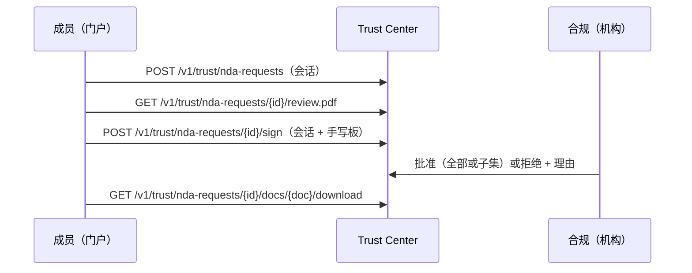

import { EnvUrls } from "/snippets/env-urls.jsx";

<EnvUrls lang="zh" />

公开 Trust Center 位于 [cbpayapp.com/trust](https://www.cbpayapp.com/trust)，展示公开合规记录并说明如何申请 N2 受限房间。受限文件室要求 CBPay 账户通过 KYC/KYB：每次申请、签署与下载都绑定已验证身份并全程审计。匿名令牌流程已对新信封关闭（已签署的旧授权全部撤销；待处理的令牌链接自然过期）。

文件室共有 31 份文件：7 份自有计划（美国 AML 计划、秘鲁 SPLAFT 手册、智利 AML 审计 + 培训计划、玻利维亚 UIF + SEPREC、哥伦比亚存续证明）、GRUPO CB LLC 收到的 14 份供应商报告与证书（Sophos C5、SOC 2、PCI AOC、医疗风险分析、ISO 27001、TX-RAMP Cloud/MDR、NIST/CIS/PCI 对照卡；Cloudflare C5、SOC 2、PCI AOC、ISO 27001），以及 10 份 PCI DSS/SAQ-A 与 ASV 扫描报告（Aperia，2026 年 9 月）。加拿大 FINTRAC/PSP 注册完全公开，可直接从网站下载。

按需申请：用 `document_ids` 传入所选目录 ID（见 `GET /v1/trust/nda-docs`）。省略表示全部；显式空列表会被拒绝。下载、状态面板与完成邮件均遵循该选择——范围外的文件返回 404，视为不存在。

签署时在门户中采集手绘（或手写）签名：印在已签署 NDA 的签署栏，并附于审核邮件。签署前可查看与下载品牌预签署 PDF。签署本身不会打开下载：已签署信封进入合规审核，只有本机构合规团队批准后门控文档才会释放（两种结果都会收到邮件通知）。



## 流程

<Steps>
  <Step title="申请访问">
    使用已验证账户的成员会话发起。公司、邮箱与国家来自已验证账户（回显值须完全一致）。pending 期间重复请求是幂等的。

```bash
curl -X POST https://api.qbank.cl/platform/v1/trust/nda-requests -H 'Authorization: Bearer <MEMBER_JWT>' -H 'Content-Type: application/json' -d '{"contact_name":"Jordan Lee","purpose":"评估合规控制","locale":"zh","document_ids":["us-aml-program","pci-saqa"]}'
```

响应 (`202`，重复请求时可能为带 `idempotency_hit: true` 的 `200`)：

```json
{"request_id":"4e7b1f3e-8b20-4ef8-9cc5-1bcb6d9b2a01","status":"pending_signature","expires_at":"2026-11-18T20:00:00Z","email_sent":true}
```
  </Step>
  <Step title="查看文档元数据">
    元数据公开，但文档内容受限。

```bash
curl https://api.qbank.cl/platform/v1/trust/nda-docs
```

```json
{"documents":[{"id":"us-aml-program","title_zh":"美国 AML 合规计划（Grupo CB LLC，2026年1月）","pages":39,"sha256":"7d1df3be9f4a8b4bf88dce93a3b939f8a737f123cb60b8074442ca035cd6e940"}]}
```
  </Step>
  <Step title="在门户中审核并签署">
    打开品牌预签署 PDF，然后提交签署人、地址、确认项与手写板签名。公司登记信息来自已验证账户。

```bash
curl https://api.qbank.cl/platform/v1/trust/nda-requests/<REQUEST_ID>/review.pdf -H 'Authorization: Bearer <MEMBER_JWT>' -o nda-review.pdf
curl -X POST https://api.qbank.cl/platform/v1/trust/nda-requests/<REQUEST_ID>/sign -H 'Authorization: Bearer <MEMBER_JWT>' -H 'Content-Type: application/json' -d '{"signer_name":"Jordan Lee","signer_title":"Chief Compliance Officer","company_address":"1 Main Street, Boston MA","accept":true,"signature_png":"data:image/png;base64,<签名PNG>","signature_mode":"drawn"}'
```

```json
{"request_id":"4e7b1f3e-8b20-4ef8-9cc5-1bcb6d9b2a01","status":"signed","review_status":"pending","download_token":"<32-hex-token>","download_url":"https://business.cbpayapp.com/trust?request=4e7b1f3e-8b20-4ef8-9cc5-1bcb6d9b2a01","expires_at":"2031-10-18T20:00:00Z"}
```
  </Step>
  <Step title="等待审核，再查询状态并下载">
    你的信封现为 `review_status: pending`：合规释放前下载返回 `409 review_pending`。轮询状态（或等待释放邮件），然后下载。
    使用成员会话认证。每个 PDF 返回 `X-Checksum-Sha256` 和 `Cache-Control: no-store`，每次交付都会记录审计。

```bash
curl https://api.qbank.cl/platform/v1/trust/nda-requests/<REQUEST_ID> -H 'Authorization: Bearer <MEMBER_JWT>'
curl -L -o trust-document.pdf https://api.qbank.cl/platform/v1/trust/nda-requests/<REQUEST_ID>/docs/us-aml-program/download -H 'Authorization: Bearer <MEMBER_JWT>'
```

```json
{"request_id":"4e7b1f3e-8b20-4ef8-9cc5-1bcb6d9b2a01","status":"signed","review_status":"approved","signed_at":"2026-10-19T20:00:00Z","expires_at":"2031-10-18T20:00:00Z","documents":["us-aml-program"]}
```

只有释放后 `documents` 才列出授予清单；`review_status` 为 `pending` 时为空。
  </Step>
</Steps>

## 状态和错误

| `status` | `review_status` | 含义 | 操作 |
|---|---|---|---|
| `pending_signature` | `none` | 信封 30 天有效。 | 审核并签署，或过期后重新申请。 |
| `signed` | `pending` | 已签署，待合规裁决。下载被拦（`409`）。 | 等待释放邮件，或轮询状态。 |
| `signed` | `approved` | 已释放。下载开放五年。 | 使用成员会话在门户下载。 |
| `signed` | `rejected` | 未授予，附理由。下载被拦（`410`）。 | 情况变化时可重新申请。 |
| `expired` | `none` | 签署或下载权限已过期。 | 提交新请求。 |
| `revoked` | `none` | 合规团队立即撤销了访问。 | 联系合规团队或重新申请。 |

请查看[错误目录](/zh/errors)。

## 常见问题

<AccordionGroup>
  <Accordion title="需要 CBPay 账户吗？">需要。账户须通过 KYC/KYB；申请、签署与下载均绑定已验证身份。</Accordion>
  <Accordion title="API 密钥可以申请或签署吗？">不可以（须使用已登录成员会话）；API 密钥仅可读取与下载本账户内容。</Accordion>
  <Accordion title="可以安全地重复申请吗？">可以。pending 状态下会返回原请求，不会创建重复信封。</Accordion>
  <Accordion title="email_sent 是什么意思？">`true` 表示邮件服务已接受投递；`false` 表示请求存在但投递失败。不要记录或暴露原始令牌。</Accordion>
  <Accordion title="下载有效多久？">签署后五年，除非合规团队提前撤销。审核只控制起点，不控制终点：批准不会延长窗口。</Accordion>
  <Accordion title="已签署但下载返回 409，为什么？">你的信封正在等待合规裁决（`review_status: pending`）。释放（或附理由拒绝）时会收到邮件通知。</Accordion>
  <Accordion title="申请被拒绝了，怎么办？">拒绝是终局。如情况变化请重新申请；邮件中的理由说明了裁决依据。</Accordion>
</AccordionGroup>
