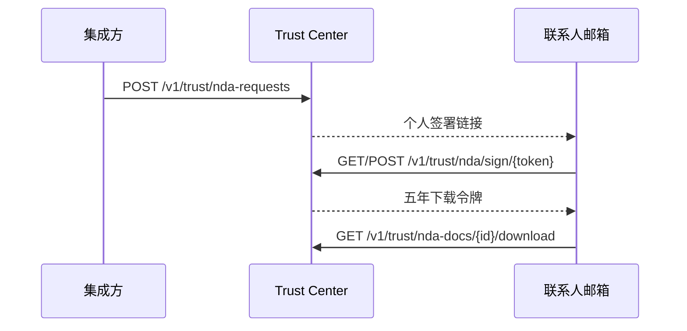

import { EnvUrls } from "/snippets/env-urls.jsx";

<EnvUrls lang="zh" />

公开 Trust Center 位于 [cbpayapp.com/trust](https://www.cbpayapp.com/trust)，展示公开合规记录并说明如何申请 N2 受限房间。受限文档与供应商无关；只有外部联系人签署 NDA 后才会提供文件内容。不需要 CBPay 账户。



## 流程

<Steps>
  <Step title="申请访问">
    发送公司、联系人和用途。同一公司和邮箱在 pending 期间重复请求是幂等的。

```bash
curl -X POST https://api.qbank.cl/platform/v1/trust/nda-requests -H 'Content-Type: application/json' -d '{"company_name":"Acme Payments Ltd","contact_name":"Jordan Lee","contact_email":"compliance@acme.example","country":"US","purpose":"评估合规控制","locale":"zh"}'
```

响应 (`202`，重复请求时可能为带 `idempotency_hit: true` 的 `200`)：

```json
{"request_id":"4e7b1f3e-8b20-4ef8-9cc5-1bcb6d9b2a01","status":"pending_signature","expires_at":"2026-11-18T20:00:00Z","email_sent":true}
```
  </Step>
  <Step title="查看文档元数据">
    元数据公开，但文档内容受限。

```bash
curl https://api.qbank.cl/platform/v1/trust/nda-docs
```

```json
{"documents":[{"id":"us-aml-program","title_zh":"美国 AML 合规计划（Grupo CB LLC，2026年1月）","pages":39,"sha256":"7d1df3be9f4a8b4bf88dce93a3b939f8a737f123cb60b8074442ca035cd6e940"}]}
```
  </Step>
  <Step title="从邮件审核并签署">
    打开个人链接，无需 CBPay 会话。提交签署人、公司登记信息、地址以及 `accept: true`；下载令牌只在响应中出现一次。

```bash
curl -X POST https://api.qbank.cl/platform/v1/trust/nda/sign/<SIGN_TOKEN> -H 'Content-Type: application/json' -d '{"signer_name":"Jordan Lee","signer_title":"Chief Compliance Officer","company_reg":"US-123456","company_address":"1 Main Street, Boston MA","accept":true}'
```

```json
{"request_id":"4e7b1f3e-8b20-4ef8-9cc5-1bcb6d9b2a01","status":"signed","download_token":"<32-hex-token>","download_url":"https://www.cbpayapp.com/zh/xinren/nda?request=...&token=...","expires_at":"2031-10-18T20:00:00Z"}
```
  </Step>
  <Step title="查询状态并下载">
    使用下载 Bearer 令牌。每个 PDF 返回 `X-Checksum-Sha256` 和 `Cache-Control: no-store`，每次交付都会记录审计。

```bash
curl https://api.qbank.cl/platform/v1/trust/nda-requests/<REQUEST_ID>/status -H 'Authorization: Bearer <DOWNLOAD_TOKEN>'
curl -L -o trust-document.pdf https://api.qbank.cl/platform/v1/trust/nda-docs/us-aml-program/download -H 'Authorization: Bearer <DOWNLOAD_TOKEN>'
```

```json
{"request_id":"4e7b1f3e-8b20-4ef8-9cc5-1bcb6d9b2a01","status":"signed","signed_at":"2026-10-19T20:00:00Z","expires_at":"2031-10-18T20:00:00Z","documents":["us-aml-program"]}
```
  </Step>
</Steps>

## 状态和错误

| 状态 | 含义 | 操作 |
|---|---|---|
| `pending_signature` | 签署链接 30 天有效。 | 审核并签署，或过期后重新申请。 |
| `signed` | 下载权限有效五年。 | 使用下载 Bearer 令牌。 |
| `expired` | 签署或下载权限已过期。 | 提交新请求。 |
| `revoked` | 合规团队立即撤销了访问。 | 联系合规团队或重新申请。 |

请查看[错误目录](/zh/errors)。

## 常见问题

<AccordionGroup>
  <Accordion title="需要 CBPay 账户吗？">不需要。联系人使用邮件中的个人令牌。</Accordion>
  <Accordion title="可以安全地重复申请吗？">可以。pending 状态下会返回原请求，不会创建重复信封。</Accordion>
  <Accordion title="email_sent 是什么意思？">`true` 表示邮件服务已接受投递；`false` 表示请求存在但投递失败。不要记录或暴露原始令牌。</Accordion>
  <Accordion title="下载有效多久？">签署后五年，除非合规团队提前撤销。</Accordion>
</AccordionGroup>
