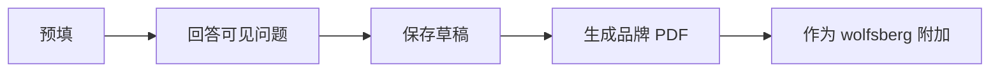

import { EnvUrls } from "/snippets/env-urls.jsx";

<EnvUrls lang="zh" />

## 填写问卷

企业入驻包含 Wolfsberg CBDDQ v1.4 问卷。它有 15 个部分、条件后续问题和最终声明。表单只显示由前面答案激活的问题；进度按可见问题计数。

匹配的企业资料值会预填，在各部分之间移动时会自动保存本地草稿。请检查每一项预填值：它只是建议，不是合规决定。

选择**生成 PDF** 以创建带品牌标识的 `wolfsberg-cbddq-v1.4-*.pdf`。完成的 PDF 会作为 `wolfsberg` 文档类别附加到原生 KYB 提交件。如果上传失败，请从已保存的草稿重试，无需重新作答。

<AccordionGroup>
  <Accordion title="可以提交未完成的问卷吗？">
    不可以。请完成所有可见必填问题和最终声明。
  </Accordion>
  <Accordion title="生成 PDF 后还可以编辑吗？">
    可以。请生成并上传最新版本；提交件保持不变。
  </Accordion>
  <Accordion title="它能替代其他 KYB 证据吗？">
    不能。它只是一种被要求的证据类别。
  </Accordion>
</AccordionGroup>

如果 PDF 上传失败，请见[错误目录](/zh/errors)。
